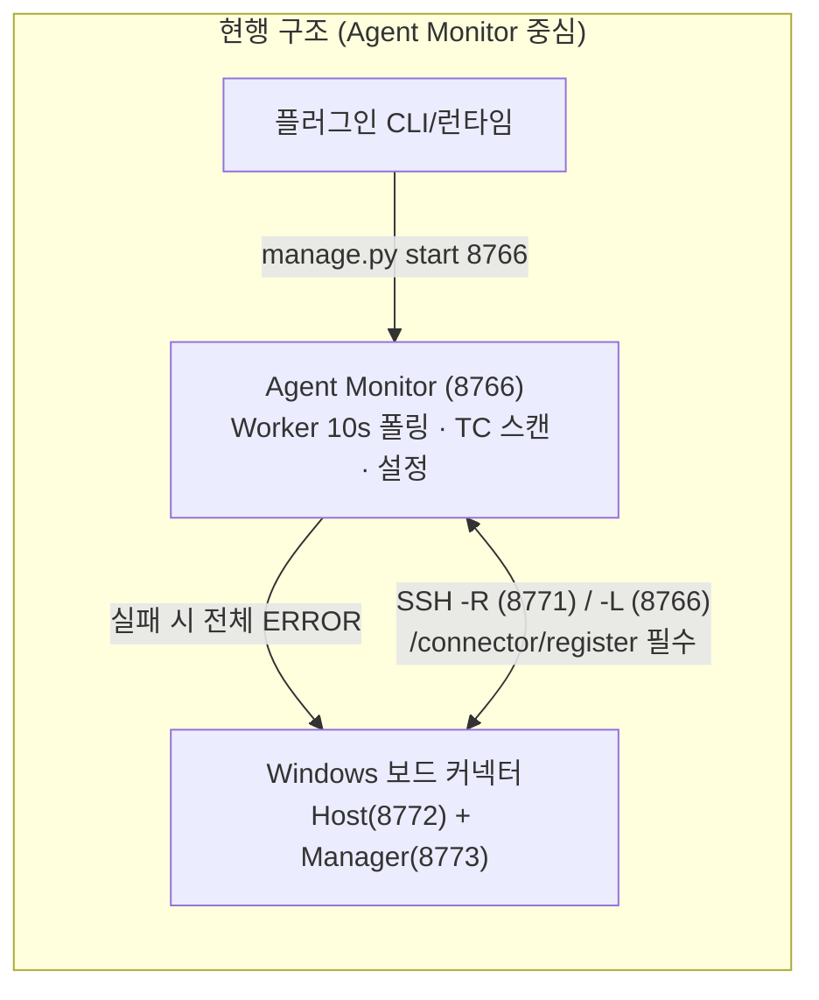
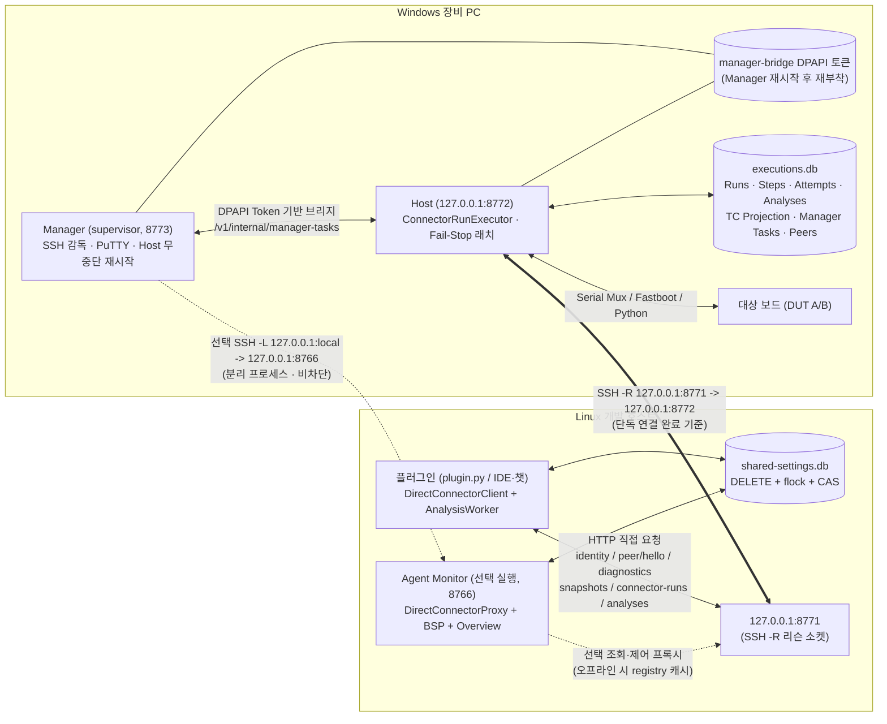
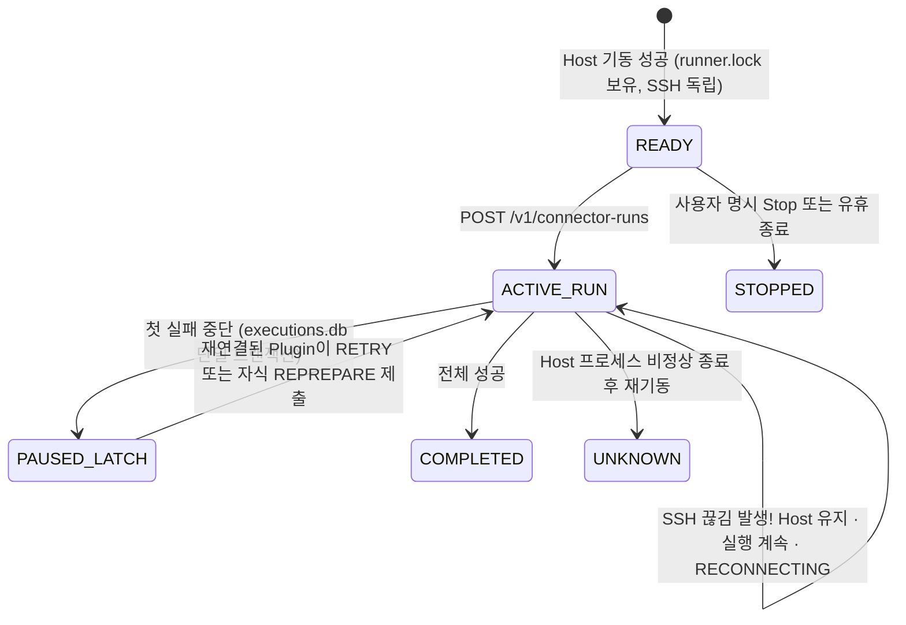
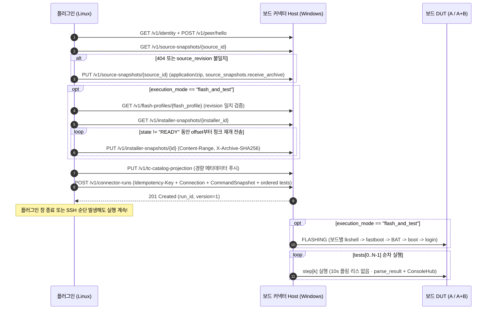
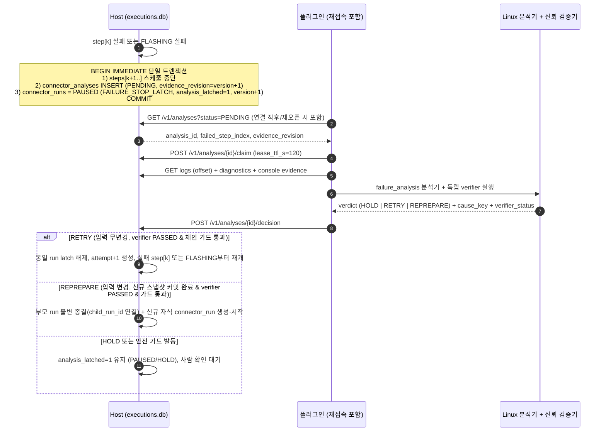

# 직결 보드 커넥터 · 자율 실행 · 양방향 연결 진단 상세 설계

> **문서 상태: `LOCAL_IMPLEMENTED_NOT_REVIEWED` (`NOT_REVIEWED`)**
> - 본 설계는 `RQ-77`~`RQ-81` · `D-83` · `T-291`~`T-305` · `PORT-013`으로 로컬 구현 및 모의/루프백 검증(`427 + 212 PASS`)을 완료했습니다([구현 검증 기록](../testing/runs/20261119-direct-connector-implementation.md)).
> - 기준 작업선: `main` (`14e640247a9e17567bc03a8171bbee437b1060ed` 기반 미커밋 워킹트리).
> - 남은 단계: **별도 독립 Hydrogen 리뷰 세션(`NOT_REVIEWED`)**, Node 22+ UI 빌드, 실장비/회사 인수(`T-305` / `DCA-15` `NOT_RUN`).
> - 기존 계약 참조: [보드 커넥터 계약](BOARD_CONNECTOR_CONTRACT.md), [보드 커넥터 미러](BOARD_CONNECTOR_MIRROR.md), [플러그인 연동 안내](../agents/PLUGIN_CONTROL_API.md).

---

## 확정 설계 결정 및 유지 정책

### 사용자 확정 아키텍처 결정 (2026-11-18/19)

| 항목 | 확정 내용 | 본 설계 반영 핵심 |
|---|---|---|
| **Q1. 직결 방식** | Windows 보드 커넥터가 SSH 역방향 터널(`-R`, 기본 Linux `127.0.0.1:8771`)만 열면 즉시 `CONNECTED`로 처리하고, 플러그인이 해당 포트로 보드 커넥터에 직접 요청한다. | Agent Monitor(`8766`) 미실행 상태에서도 연결 완료 판정; `-L` 대시보드 터널은 선택 기능으로 분리; `LogLevel=VERBOSE` 기반 실제 바인드 검증 도입; `bootstrap-v2`로 `runtime_id` 결합 제거 |
| **Q2. 실행 루프 주체** | 플러그인이 실행 묶음(플래싱/설치기 + 순서 지정 TC 목록)을 보드 커넥터에 전달하면, 보드 커넥터가 순차 실행·첫 실패 중단(`fail-stop-analysis-v1`)까지 자체 수행하고 결과를 영속 보관한다. | `Host.execute`의 `10초` HTTP 폴링 리스 제거; `executions.db` 기반 `ConnectorRunExecutor` 상태 머신(Single/Dual, `CommandTemplate`, `FlashProfile`, `parse_result`, `ConsoleHub`)·증분 로그·재연결 분석 핸드오프 |
| **Q3. Agent Monitor 역할** | 모니터링 위주이되 Agent Monitor 화면에서도 설정 변경, 일시중지/취소 등 안전한 제어를 허용한다. | 푸시 미러 대기 모델 폐기 → `127.0.0.1:8771` 직접 조회 프록시(`DirectConnectorProxy`) + `connector-registry.db` 오프라인 stale 캐시; 실패 분석 래치(`analysis_latched`) 중 임의 재개 차단 |
| **Q4. 양방향 연결 확인·진단** | 플러그인(Linux)과 보드 커넥터(Windows) **양쪽 모두**에서 연결 확인이 가능해야 하며, 연결이 안 될 때 **왜 안 되는지 이유를 양쪽에서 서로 확인** 가능해야 한다. | 양측 수동/자동 연결 점검 트리거 + Linux `/proc/net/tcp`/`tcp6`·`uid=0` `sshd` 구분·`.ssh` 읽기 전용 감사 + Windows 사전점검(키 ACL 포함)·`stderr` 분류 + `POST /v1/peer/hello`·`GET /v1/diagnostics/connection` 상호 진단 교환 |

### 변경 불가 운영 정책 및 기존 기능 보존

- [자동 퓨징 계약](AUTOMATIC_FLASH_TEST.md)(D-48/RQ-47)의 수동 시험 기본 원칙, 자동 프로파일(빌드·검증 후 `reboot lkshell` → 준비 확인 → `fast` → 이미지 배치 → 부팅 확인 → 필수 TC), 사람 최종 검토 필수 원칙을 유지한다. 기존 `/v1/flash-tests`(`backend/worker/hardware.py`) 경로는 그대로 보존하며 `Host` 내부에서 `connector_runs`와 동일 배타 잠금(`Host.lock`)을 공유한다.
- [에이전트 모델 정책](../governance/DECISIONS.md)(D-78), [모듈 콤보박스·Jira 화면 정리](PLUGIN_MODULE_CATALOG.md)(D-82), [웹 커넥터 좌우 패널](UI_SPEC.md#2026-11-18-보드-커넥터-좌우-패널)(D-81), [명시적 비상 강제 종료](../gui_test/FORCE_STOP.md)(D-77), [플러그인 전달 패키지](../porting/PORT-011.md)(D-80), BSP OS 업그레이드 작업 게이트·오케스트레이터 계약([운영 안내](../agents/ORCHESTRATION_V2_OPERATIONS.md), [모듈 보고 계약](AGENT_STATUS_CONTRACT.md))은 본 설계 변경으로 훼손하지 않는다.

---

## 1. 목표 아키텍처 및 토폴로지

### 1.1 현행 코드베이스의 7가지 구조적 병목

현재 코드베이스 실사에서 확인된 직결 장애 및 실행 취약 원인은 다음과 같다.

1. **Agent Monitor 강제 의존 프로브 (`backend/gui_test/connector/supervisor.py` `Manager._probe`)**: `dashboard_url`(`/api/v1/health`, `/api/v1/gui-test/live/connector/register`, `/test-status`, `/integration/settings`) 호출이 실패하면 Windows 커넥터 전체 상태가 `ERROR`/`REGISTRATION_FAILED`로 전락한다.
2. **취약한 SSH 기동 및 수명 결합 (`scripts/setup_runtime.py` `Wizard._windows_start`, `backend/gui_test/execution/launch.py`)**:
   - `ssh` 프로세스 기동 후 `0.1초`만 대기하고 `transport.poll() is None`이면 성공으로 간주(`phase = 'ssh_running'`)하며 `stderr`를 캡처·해석하지 않는다.
   - `finally:` 블록에서 `ssh`(`transport`) 종료 시 Windows `Host`(`process`)까지 함께 종료(`stop_owned(process, windows=True)`)하고 `active-endpoints.json`을 삭제하여, SSH 순단만으로 진행 중인 플래싱·TC 실행이 중단된다.
   - `launch.py`의 `read_active`가 `setup-launch.lock`과 `dashboard_port`/`remote_dashboard_port`가 포함된 단일 `_ACTIVE` 스키마를 강제해 `Host`와 `SSH`의 독립 수명을 표현하지 못한다.
3. **10초 리스 강제 종료 (`backend/gui_test/execution/host.py` `Host.execute`)**: 원격 워커 폴링이 10초 끊기면 실행 중 TC를 `lost`로 강제 실패 종료(`self.leases`)시키며, `/v1/flash-tests`는 로컬 `image_root` 공유폴더 기반 단발 파이프라인으로 일시중지/재개/실패 분석 래치를 지원하지 않는다.
4. **플러그인 CLI의 Agent Monitor 종속 (`apps/agent-monitor/plugin.py`, `backend/gui_test/standalone/plugin_client.py`)**: `status` 외 모든 명령이 `manage.py start`(8766)를 기동·경유하도록 강제되어 있고, `plugin.py connect export` 역시 Agent Monitor `/integration/connector-bootstrap`을 호출해야만 동작한다. 또한 `--port` 인자가 Agent Monitor 포트를 가리켜 `-R 8771`과 혼동/충돌 위험이 있다.
5. **Bootstrap v1의 불완전성 (`backend/gui_test/core/connector_bootstrap.py`, `backend/gui_test/connector/bootstrap.py`, `shared_control.py`)**: `v1`은 `remote_runner_port`(`8771`)를 포함하지 않고 Agent Monitor `identity`(`runtime_id`, `package_version`)를 필수로 요구해, `v2` 전환 시 `service_headers()`·`verify_service()`가 `ValidationError` 없이 동작하도록 함께 개편해야 한다.
6. **TC 목록의 Agent Monitor 종속 (`backend/gui_test/connector/test_status.py`)**: Linux `tc_root` 스캔이 Agent Monitor 내부에만 있어 Agent Monitor 미실행 시 Windows 커넥터 화면에 TC 목록이 표시되지 않는다.
7. **수동적 미러 모델 (`backend/gui_test/connector/mirror.py`, `mirror_client.py`, `connector/registry.py`, `connector/api.py`)**: Agent Monitor가 Windows의 `/mirror/state` 푸시와 `/mirror/claim` 폴링을 기다리는 구조라, 플러그인·Agent Monitor·보드 커넥터 간 직접 질의와 양방향 실패 원인 공유가 어렵다.

### 1.2 Before vs After 토폴로지





### 1.3 컴포넌트 책임 경계

| 컴포넌트 | 실행 위치 | 필수 여부 | 핵심 책임 | 비소유(위임) 책임 |
|---|---|---|---|---|
| **Windows `Host`** (`execution/host.py`) | Windows | 필수 | 로컬 HTTP 서버, 스냅샷/인스톨러 검증, 실행 묶음 수락(`POST /v1/connector-runs`), 순차 플래싱·Single/Dual TC 실행, `parse_result` 판정, 첫 실패 중단 래치, `executions.db`·증분 로그 영속화, TC 투영·진단 응답, `D-48`/기존 API 배타 유지 | SSH 프로세스 수명 직접 관리, `putty.exe` 직접 실행(미부착 시 `501`) |
| **Windows `Manager`** (`connector/supervisor.py` + `setup_runtime.py`) | Windows | GUI/감독 모드 필수 | `Host` 기동·모니터링, `SSH -R` 수명·`stderr` 파싱·재연결, 선택적 `-L` 관리, `putty.exe` 실행, DPAPI `manager-bridge` 토큰 기반 재부착, 설정 반영 및 `SSH -R` 무중단 `Host` 재시작, Windows 측 연결 자가점검 | 실행 루프 제어, TC 판정, Agent Monitor 등록 성공을 연결 조건으로 강제 |
| **플러그인 (`DirectConnectorClient`)** | Linux | 사용자 작업 시 | `127.0.0.1:<connector_port>`(기본 `8771`) 직접 연결·양방향 진단, `shared-settings.db` 읽기/쓰기, 스냅샷·인스톨러 동기화, TC 카탈로그 투영 푸시, `PENDING` 실패 분석 claim/분석/검증기 실행/verdict 제출, 재접속 재동기화, 오프라인 `bootstrap-v2` 생성 | `manage.py start` 자동 기동, TC 루프 10s 폴링 구동 |
| **`shared-settings.db`** (`core/shared_settings_store.py`) | Linux (`<runtime>/`) | 필수(인프로세스) | Linux 기준 경로(`installer_roots`, `source_roots`, `tc_root`, `installer_path`), `module_defaults`, `global_defaults`, `preferred_connector_port`, `expected_runner_id`, `timeouts`, `command_profiles`, `sources`, `storage_policy` CAS 저장 | Windows 로컬 COM/SSH 키/플래시 비밀(`send_env`) 저장 |
| **Agent Monitor (`manage.py`)** | Linux | **선택** | 웹 대시보드(`Overview`/`Diagram`/`보드 커넥터`/`Test 현황`/`History`/`Settings`), `127.0.0.1:<connector_port>` 직접 프록시 관제+안전 제어, `connector-registry.db` 오프라인 stale 캐시 갱신, 기존 `D-48`/`D-82`/BSP 업그레이드 | 플러그인 명령의 필수 관문, 연결 완료 전제 조건 |

---

## 2. SSH 터널 및 분리된 수명주기

### 2.1 연결 상태 분리 모델

Windows 커넥터와 Linux 클라이언트 모두 아래 세 축을 분리해 판정·표시한다. **연결 완료(`CONNECTED`)는 오직 로컬 `Host` 준비와 `SSH -R` 원격 바인드 성공으로만 결정한다.**

| 축 | 상태 값 | 의미 |
|---|---|---|
| `local_state` | `STARTING`, `READY`, `FAILED`, `STOPPED` | Windows `Host` 로컬 HTTP 서버, `runner.lock`, `executions.db` 준비 상태 |
| `ssh_state` | `NOT_CONFIGURED`, `CONNECTING`, `CONNECTED`, `DISCONNECTED`, `RECONNECTING`, `AUTH_OR_CONFIG_ERROR`, `STOPPED` | `SSH -R` 터널 사전점검·인증 및 원격 포트 바인드 검증 상태 |
| `overall_connection_state` | `CONNECTED`, `DEGRADED_SSH_RECONNECTING`, `DISCONNECTED`, `ERROR` | 대표 연결 상태 (`CONNECTED` = `local_state == READY && ssh_state == CONNECTED`) |
| `peers.plugin` (참고 관측) | `CONNECTED`, `WAITING`, `MISMATCH`, `STALE`, `NOT_CONNECTED` | 플러그인의 `POST /v1/peer/hello` 기준 관측 상태. `WAITING`이어도 `overall_connection_state`는 `CONNECTED` 유지 |
| `peers.agent_monitor` (참고 관측) | `CONNECTED`, `OPTIONAL_OFFLINE`, `MISMATCH`, `STALE` | Agent Monitor 관측 상태. 미실행(`OPTIONAL_OFFLINE`)은 정상이며 오류가 아님 |

**전송 연결(Transport Ready) vs 실행 준비(Execution Ready) 분리**:
- COM 포트 미선택/미감지, `tc_python` 미설정, `fastboot` 미탐지, `source` 미선택 등은 **연결 상태를 `ERROR`/`DISCONNECTED`로 떨어뜨리지 않고** `CONNECTED`를 유지한 채 `readiness` 필드(`readiness.com_port`, `readiness.tc_python`, `readiness.flash_tools`, `readiness.source`)로 분리 표시하며 실제 실행 시작 전(`POST /v1/connector-runs`)에만 차단한다.

### 2.2 `SSH -R` 기동·바인드 검증 규격 (기존 `0.1s` 슬립 결함 제거)

#### 1단계: Windows 사전 점검 (프로세스 기동 전, 비침습)
1. 필수 설정 확인: `server`, `account`, `ssh_port`(1~65535), `remote_runner_port`(기본 `8771`, **명시 포트 고정**). 누락/형식 오류 시 `SSH_CONFIG_INCOMPLETE`.
2. 실행 파일 확인: `external_environment()['PATH']`에서 `ssh` 탐색 실패 시 `SSH_BINARY_MISSING`.
3. 개인키 검사(지정 시): `ssh_key` 파일 미존재/링크/디렉터리 시 `SSH_KEY_NOT_FOUND`. Windows에서 `icacls` 또는 ACL 조회로 현재 사용자 외 과도한 읽기 권한(Users/Everyone 등)이 감지되어 OpenSSH가 거부할 가능성이 높으면 `SSH_KEY_PERMISSIONS` 사전 경고를 기록한다.
4. TCP 도달성 프로브: `socket.create_connection((server, ssh_port), timeout=2.5)` 시험. DNS 실패(`socket.gaierror`) → `SSH_DNS_FAILED`, 연결 거부(`ConnectionRefusedError`) → `SSH_CONNECTION_REFUSED`, 시간 초과(`TimeoutError`) → `SSH_TIMEOUT`.
5. `known_hosts` 사전 점검(읽기 전용): `%USERPROFILE%\.ssh\known_hosts`에서 `(server, ssh_port)` 엔트리 유무를 사전 확인해 `known_hosts_entry: "present" | "missing"` 메타데이터를 기록하되, 실제 호스트 키 검증은 OpenSSH에 맡긴다.

#### 2단계: `SSH -R` 명령 인자 및 `stderr` 파서
기본 터널 명령(`ssh_key` 미지정 시 `-i` 생략해 `ssh-agent`/기본 키 사용):
```text
ssh -NT \
  -o BatchMode=yes \
  -o ExitOnForwardFailure=yes \
  -o LogLevel=VERBOSE \
  -o ServerAliveInterval=15 \
  -o ServerAliveCountMax=3 \
  -o ConnectTimeout=10 \
  -o IdentitiesOnly=yes \
  [-i <ssh_key>] \
  -p <ssh_port> \
  -R 127.0.0.1:<remote_runner_port>:127.0.0.1:<actual_local_runner_port> \
  <account>@<server>
```

**핵심 설계 규약**:
- **원격 포트 폴백 금지**: `remote_runner_port`(기본 `8771`) 충돌 시 임의 포트로 우회하지 않고 즉시 `SSH_REMOTE_PORT_BUSY`로 실패 보고한다. Windows 로컬 `actual_local_runner_port`(기본 `8772`)만 충돌 시 `--allow-port-fallback`으로 다른 로컬 포트를 바인드하고 `-R` 대상에 실제 로컬 포트를 매핑한다.
- **선택 `-L` 터널 격리**: `remote_dashboard_port`가 설정된 경우에만 Agent Monitor 웹 UI용 `-L 127.0.0.1:<local_dashboard_port>:127.0.0.1:<remote_dashboard_port>`를 **주 `-R` 터널과 별도의 비차단 보조 `ssh` 프로세스**로 기동한다. 로컬 포트 충돌이나 포워드 실패 시 `-R` 세션에 영향을 주지 않고 `optional_forwards.dashboard = "LOCAL_DASHBOARD_FORWARD_SKIPPED"` 경고만 남긴다.
- **실제 바인드 완료 판정**: `SshSupervisor`는 `ssh`의 `stdout`/`stderr`를 별도 리더 스레드로 읽으며 최근 100줄을 마스킹 링 버퍼에 보관한다. 아래 조건이 모두 충족될 때만 `ssh_state = 'CONNECTED'`로 전이한다(최대 대기 `15s`):
  1. `stderr`에서 OpenSSH 포워드 성공 패턴(`remote forward success` 또는 `Allocated port <remote_runner_port>` — 구현 시 Windows OpenSSH 8.x/9.x 실측 fixture로 정규식 회귀 검증).
  2. 성공 관측 후 `250ms` 안정화 창 동안 `ssh` 프로세스가 생존(`poll() is None`).
  3. 단 1회라도 아래 즉시 실패 패턴이 관측되면 `15s`를 기다리지 않고 즉시 분류·종료한다:
     - `Host key verification failed` / `REMOTE HOST IDENTIFICATION HAS CHANGED` → `SSH_HOST_KEY_UNTRUSTED`
     - `UNPROTECTED PRIVATE KEY FILE` / `Bad permissions` → `SSH_KEY_PERMISSIONS`
     - `Permission denied` / `Too many authentication failures` → `SSH_AUTH_FAILED`
     - `remote port forwarding failed` / `listen port .* already in use` → `SSH_REMOTE_PORT_BUSY`
     - `administratively prohibited` / `Forwarding disabled` → `SSH_FORWARDING_DISABLED`
     - `Could not resolve hostname` → `SSH_DNS_FAILED`

### 2.3 Host와 SSH 수명 분리 (`Wizard._windows_start` 및 `launch.py` 리팩터링)



- **절대 금지 불변식**: `ssh` 프로세스 종료·재시작·타임아웃 시 `Manager` / `Wizard`는 **절대로 `Host`를 `kill`/`stop_owned` 하지 않는다.**
- **`launch.py` 및 `emergency.py` 분리 설계**:
  - 기존 `active-endpoints.json`에 `Host`와 `ssh`를 한 번에 묶어 `setup-launch.lock` 종료 시 무조건 둘 다 내리던 구조를 분리한다:
    - `Host` 소유권: `runner.lock` + `host-active.json` (또는 `active-endpoints.json` `version: 2`, `owner` = `Manager` 또는 CLI 프로세스, `runner` = `Host`, `runner_port`, `runner_id`, `local_state`, `manager_attached`).
    - `SSH` 소유권: `ssh-tunnel.lock` + `ssh-tunnel.json` (`transport` = `-R` `ssh.exe` OS 생성 세대, `dashboard_transport` = 선택 `-L` `ssh.exe` OS 생성 세대, `remote_runner_port`, `ssh_port`, `ssh_state`, `last_error_code`).
  - `emergency.py` (`board-connector.cmd --force-stop`, `D-77`)는 `connector-manager.json`, `host-active.json`, `ssh-tunnel.json`의 모든 기록된 OS 세대(`owner`, `runner`, `transport`, `dashboard_transport`)를 함께 읽어 기존 pin·자식 트리 종료·`force-stop.json` 계약을 그대로 유지한다.
- **재연결 백오프 정책**:
  - **일시 오류** (`SSH_DISCONNECTED`, `SSH_TIMEOUT`, `SSH_CONNECTION_REFUSED`, `SSH_REMOTE_PORT_BUSY`, `SSH_DNS_FAILED`): `Host`를 살린 채 `2s → 4s → 8s → 15s → 30s` 지수 백오프로 자동 재시도한다.
  - **설정/인증 치명 오류** (`SSH_HOST_KEY_UNTRUSTED`, `SSH_KEY_PERMISSIONS`, `SSH_AUTH_FAILED`, `SSH_FORWARDING_DISABLED`, `SSH_CONFIG_INCOMPLETE`): 계정 잠금·로그 폭주를 막기 위해 자동 무한 재시도를 중단하고 `AUTH_OR_CONFIG_ERROR` 상태에서 사용자 조치를 대기한다. 사용자가 `POST /v1/control/reconnect-ssh` 또는 설정 저장 시 재시도를 재개한다.
- **정상 종료 보호**: 사용자가 커넥터 GUI 종료 또는 연결 종료 요청 시 활성 `connector_run`(`FLASHING`, `RUNNING`, `PAUSE_REQUESTED`, `CANCEL_REQUESTED`), `jobs`(`RUNNING`/`UNKNOWN`), `batches`(`!= RELEASED`), 또는 `manual` PuTTY 제어권이 남아 있으면 정상 종료를 `409 CONNECTOR_BUSY`로 차단한다.

### 2.4 Bootstrap v2 (`gui-test-connector-bootstrap-v2`)

기존 `v1`(`gui-test-connector-bootstrap-v1`)을 대체하되 `v1` 파일 import 하위 호환을 유지한다.
```json
{
  "format": "gui-test-connector-bootstrap-v2",
  "endpoint": {
    "server": "linux-build-01.internal",
    "account": "bspdev",
    "ssh_port": 22,
    "remote_runner_port": 8771,
    "remote_dashboard_port": null
  },
  "expected_runner_id": null,
  "issued_at": "2026-11-19T00:00:00Z"
}
```
- **기존 `runner_id` 불변식 정합성**: `expected_runner_id`는 기존 코드베이스(`executions.db` `runner_meta.identity`, `connector/api.py`, `batches.py`, `integration_profiles.py`, `retention.py`)의 `^[a-f0-9]{32}$` 형식을 그대로 사용한다. 최초 부트스트랩 시점(Windows 최초 실행 전)에는 Linux가 `runner_id`를 아직 모르므로 `null`로 내보내고, 최초 성공 연결 시 `shared-settings.db`에 고정(`TOFU`)하며, 이미 고정된 Windows 재내보내기에서는 해당 32자리 hex `runner_id`를 채운다.
- **Agent Monitor 비의존 생성**: `apps/agent-monitor/plugin.py connect export`는 Agent Monitor(`8766`)를 기동하거나 `/connector-bootstrap`을 호출하지 않고, 로컬 `connector_bootstrap.py` 모델 검증을 거쳐 `bootstrap-v2` JSON과 `windows-board-connector.zip` (`plugin_delivery.windows_archive`)을 직접 생성한다.
- **보안 검증 유지**: `ReachableHost` 검증(`localhost`/`127.0.0.1`/loopback/link-local/unspecified 거부), 심볼릭 링크 거부, JSON 중복 키 거부, 8,192바이트 상한, 비밀정보(비밀번호·개인키 본문·토큰) 배제를 그대로 유지한다.
- **v1 호환 및 `shared_control.py` 안전 처리**: `connector/bootstrap.py`는 `v1` import 시 `remote_runner_port = 8771` 기본값으로 해석하고, `v2` import 시 `identity`(`runtime_id`, `package_version`) 부재를 정상 허용한다. `connector/shared_control.py` 및 `supervisor.py`는 `connector_bootstrap`이 `v2`(`identity` 없음)인 경우 `service_headers()` 호출 시 `ValidationError`를 내지 않고 `{'X-Bsp-Service': 'plugin'}`만 사용하며, 선택적 Agent Monitor 연결 시에도 `v1` `identity`가 있을 때만 `verify_service()`를 수행한다.

---

## 3. 양방향 연결 확인 및 실패 원인 상호 진단

### 3.1 물리적 한계와 양측 확인 원칙

SSH 터널 자체가 인증/방화벽/네트워크 단계에서 아직 열리지 않은 상태에서는 Windows `ssh.exe`의 `stderr`가 Linux로 전달될 수 없으며, 반대로 Linux `/proc` 정보도 `-R` 터널을 통해 Windows로 갈 수 없다. 따라서 본 설계는 **어느 쪽(Linux 플러그인/Monitor 또는 Windows 보드 커넥터)에서든 "연결 확인"을 실행하고 상대 측 원인까지 추론·교환**할 수 있도록 3계층 진단 + 양측 트리거로 구성한다.

1. **Linux 측 확인 (`plugin.py connect` / `plugin.py status --diagnose` / Agent Monitor UI "연결 확인")**:
   - `DirectConnectorClient.diagnose(port)` 실행: Linux 로컬 포트/프로세스/`sshd`/`.ssh` 읽기 전용 검사 + 터널이 열려 있으면 `GET /v1/identity` + `GET /v1/diagnostics/connection` + `POST /v1/peer/hello` 호출 → `MutualConnectionReport` 반환.
2. **Windows 측 확인 (보드 커넥터 웹/Qt UI "연결 확인" · `POST /v1/control/verify-connection`)**:
   - Windows 사전점검(키 ACL, `known_hosts`, TCP 2.5s) + `Host` `/v1/identity` + `SSH -R` 생존 및 바인드 상태 검증 + Linux로부터 `POST /v1/peer/hello`로 수신·저장된 `peer_observations`(`MISMATCH`, `client_issue`, `linux_diagnostics`) 즉시 표시.
   - 만약 선택 `-L` 터널(`remote_dashboard_port`)로 Linux Agent Monitor가 도달 가능하고 `-R`이 실패했다면, Windows가 선택적으로 `GET http://127.0.0.1:<local_dashboard_port>/api/v1/gui-test/live/connector/direct/linux-diagnostics`를 조회해 Linux 측 진단 요약(예: `8771` 점유 PID, `.ssh` 권한 경고)까지 Windows UI에 병기한다.
3. **터널 수립 후 상호 불일치 통지 (`POST /v1/peer/hello`)**:
   - 터널은 열렸으나 `runner_id` 불일치(`RUNNER_CHANGED`), 프로토콜 미지원(`CONNECTOR_PROTOCOL_UNSUPPORTED`), 스냅샷/래치 충돌이 감지된 경우, **Linux 클라이언트가 거부 사유를 `POST /v1/peer/hello`로 Windows `Host`에 통지**해 Windows UI에도 즉시 경고 배너로 표시되게 한다.

### 3.2 Linux 단독 계층의 권한·IPv6 경계 처리

- **IPv4 + IPv6 듀얼 검사**: Linux 측 `diagnose()`는 `/proc/net/tcp`(IPv4 `0100007F:<hex_port>`)뿐만 아니라 `/proc/net/tcp6`(IPv6 `::1` 및 IPv4-mapped `::ffff:127.0.0.1`)도 함께 파싱한다.
- **`uid=0`(`root`) `sshd` 리스너 처리**: OpenSSH privilege separation 구성에 따라 `-R` 리스닝 소켓 또는 다른 포트 `sshd` 소켓의 소유 UID가 `0`(`root`)일 수 있다. 비특권 Linux 사용자로 실행되는 `plugin.py`는 `/proc/<pid>/fd` 읽기 시 `PermissionError`가 발생하므로:
  - 동일 UID 프로세스는 `/proc/<pid>/fd`와 소켓 inode 매핑으로 정확한 `pid`, `comm`, `cmdline_hint`(예: `agent-monitor` vs `sshd`)를 식별한다.
  - `socket_uid == 0`이고 `/proc/<pid>/fd` 접근이 거부된 경우 에러로 중단하지 않고 `listener_owner_uid: 0`, `pid: null`, `comm: "privileged_or_root_listener"`로 정상 분류하며, HTTP 응답 프로브(`/v1/identity` vs Agent Monitor `/api/v1/health` vs 비HTTP EOF) 결과를 합쳐 `STALE_SSH_TUNNEL` / `PORT_OCCUPIED_BY_OTHER_SERVICE` / `SSH_REMOTE_PORT_BUSY`를 정확히 판정한다.
- **타 포트 동일 UID `sshd` 스캔**: 지정 포트(`8771`)가 미수신일 때 `/proc/net/tcp{,6}`에서 동일 UID의 `sshd`가 다른 loopback 포트(예: `8772`, `8781`)에 리슨 중이면 `suspected_port_mismatch_ports` 목록에 포함해 **"포트 불일치 가능성"**을 구체적으로 안내한다.
- **SSH 서버 환경 읽기 전용 점검**: `~/.ssh` 권한(`mode & 0o077 != 0`), `~/.ssh/authorized_keys` 존재·권한(`mode & 0o022 != 0`), `/etc/ssh/sshd_config`(읽기 가능한 경우)의 `AllowTcpForwarding no`, `DisableForwarding yes`, `PermitListen` 제한 여부를 검사한다.

### 3.3 양측 진단 코드 매트릭스

| 코드 | 1차 관측 측 | 유발 조건 | Windows UI 표시 내용 | Linux(플러그인/Monitor) 표시 내용 | 자동 처리 및 권장 조치 |
|---|---|---|---|---|---|
| `CONNECTED` | 양쪽 | `Host READY` + `SSH -R` 바인드 확인 + `/v1/identity` 호환 | 연결됨(녹색) + `peers.plugin`/`agent_monitor` 관측 상태 | 연결됨 + 보드 준비도(`readiness`) + 활성 실행 상태 | 정상. Monitor 미실행 시 `OPTIONAL_OFFLINE` 안내만 표시 |
| `SSH_HOST_KEY_UNTRUSTED` | Windows | `Host key verification failed` / `REMOTE HOST IDENTIFICATION HAS CHANGED` | 서버 호스트 키 미신뢰 또는 변경 + 지문 확인 안내 | (터널 미수립 시) Windows SSH 호스트 키 실패 가능성 체크리스트 | 자동 재시도 중단(`AUTH_OR_CONFIG_ERROR`); `StrictHostKeyChecking=no` 우회 금지 |
| `SSH_KEY_PERMISSIONS` | Windows | `UNPROTECTED PRIVATE KEY FILE` / 개인키 ACL 과다 허용 | 개인키 파일 권한이 너무 개방됨 (`icacls` 소유자 전용 제한 안내) | (터널 미수립 시) Windows 개인키 권한 점검 체크리스트 | 자동 재시도 중단; 현재 사용자 전용 권한 수정 후 재연결 |
| `SSH_AUTH_FAILED` | Windows | `Permission denied` / `Too many authentication failures` | 키 경로·계정·`authorized_keys` 인증 실패 | `~/.ssh` 권한·`authorized_keys` 읽기 전용 감사 결과 병기 | 자동 재시도 중단; 공개키/에이전트 확인 |
| `SSH_REMOTE_PORT_BUSY` | Windows | `remote port forwarding failed for listen port <P>` | Linux `127.0.0.1:<P>` 원격 포트 점유됨 | Linux에서 `<P>` 실제 점유 프로세스(`pid`/`comm` 또는 `uid=0`) 직접 표시 | 일시 `TIME_WAIT` 대응 백오프; 점유 서비스 포트 분리 안내(**자동 kill 금지**) |
| `SSH_FORWARDING_DISABLED` | Windows | `administratively prohibited` / 포워딩 차단 | 서버 `sshd` 포트 포워딩 비활성화 | 읽기 가능한 경우 `sshd_config`의 `AllowTcpForwarding`/`PermitListen` 값 표시 | 자동 재시도 중단; `sshd` 설정 조치 안내 |
| `SSH_DNS_FAILED` / `SSH_CONNECTION_REFUSED` / `SSH_TIMEOUT` | Windows | DNS 해석 실패, TCP 22 거부, 타임아웃 | 서버 주소·SSH 포트 도달 불가 세부 원인 | (미연결 시) Windows→Linux 네트워크/SSH 포트 도달 확인 안내 | 일시 백오프(`2s→30s`) 재연결 |
| `CONNECTOR_TUNNEL_NOT_LISTENING` | Linux | `127.0.0.1:<P>` `ECONNREFUSED` | (미실행/미연결 상태 자체 표시) | Linux `<P>` 리스너 없음 + 타 포트 `sshd` 감지 + `~/.ssh` 점검 + Windows 체크리스트 | Windows 커넥터 실행·포트 일치(`8771`)·SSH 로그 확인 |
| `STALE_SSH_TUNNEL` | Linux | `<P>` TCP 연결되나 HTTP EOF/timeout (`sshd` 소켓 잔존) | `Host` 미기동 시 `LOCAL_NOT_READY` 표시 | 리스너 정보(`sshd` 또는 `uid=0`) + HTTP 무응답 근거 | Windows `Host` 기동/재시작 또는 `reconnect-ssh` |
| `PORT_OCCUPIED_BY_OTHER_SERVICE` | Linux | `<P>`가 비커넥터 HTTP 응답(예: Agent Monitor가 8771 점유) | 설정 충돌 안내 | 점유 프로세스 `pid`/`comm` + HTTP 응답 서명(`agent-monitor` vs `unknown`) | 포트 분리(`--port` ≠ `--connector-port`); 타 프로세스 kill 금지 |
| `RUNNER_CHANGED` / `CONNECTOR_PROTOCOL_UNSUPPORTED` | 양쪽 | `/v1/identity`의 `runner_id` 불일치 또는 `direct-connector-v1` 미지원 | **`peer/hello` 수신으로 Windows UI에도 즉시 경고 배너 표시** | 기대 `runner_id`/`capabilities` vs 실제 값 표시 + 명시 `rebind`/업데이트 안내 | 명시적 `rebind` 또는 커넥터 업데이트 전 실행 차단 |
| `LOCAL_DASHBOARD_FORWARD_SKIPPED` | Windows | 선택 `-L` 포트 충돌/스킵 | 경고 배지(핵심 `-R` 연결 유지) | Agent Monitor 선택 터널 생략 참고 | 필요 시 `-L` 로컬 포트만 변경 |
| `READY_WITH_HW_WARNINGS` | 양쪽 | 전송 `CONNECTED`이나 COM/`tc_python`/`fastboot` 미준비 | 연결됨(녹색) + 하드웨어 경고(황색) | 동일 `readiness` 경고 표시 | 연결 오류로 오표시 금지; 실행 시점에만 preflight 차단 |

### 3.4 HTTP 프로토콜: 식별 · Peer 인사 · 상호 진단

모든 보드 커넥터 API는 `127.0.0.1` 루프백 전용으로 제공되며 JSON 응답에 `schema_version: "direct-connector-v1"`을 포함한다.

1. **`GET /v1/identity`** (기존 필드 하위 호환 유지 + 직결 필드 확장):
   ```json
   {
     "schema_version": "direct-connector-v1",
     "service": "bsp-board-connector",
     "runner_id": "a1b2c3d4e5f60718293a4b5c6d7e8f90",
     "connector_version": "2026.11.19",
     "capabilities": [
       "direct-connector-v1",
       "connector-runs-v1",
       "fail-stop-analysis-v1",
       "source_snapshot_v1",
       "installer_stream_v1",
       "tc-catalog-projection-v1",
       "manager-control-bridge-v1",
       "mutual-diagnostics-v1"
     ],
     "local_port": 8772,
     "remote_runner_port": 8771,
     "manager_attached": true,
     "tc_python_configured_v1": true,
     "source_less_snapshot_v1": true,
     "serial_proxy_v1": true,
     "started_at": "2026-11-19T01:00:00Z"
   }
   ```
   *(주의: 기존 `WindowsRemote` 호환을 위해 `connector_inventory_v1`, `flash_profile_setup_v1`, `storage_retention_v1`, `session_delete_v1`, `tc_timeout_v1`, `batch_reservation_v1`, `bsp_upgrade_integration_v1` boolean 키도 함께 유지한다.)*

2. **`POST /v1/peer/hello`** (양방향 상태 및 불일치 통지):
   - 플러그인과 Agent Monitor(실행 시)는 연결 확인, 실행 시작 전, 주기(`~10s`, 단 창을 닫아도 실행 중단 없음), 그리고 **`runner_id` 불일치/프로토콜 미호환 감지 직후에도** 호출한다.
   - 요청 본문: `{peer_type: "plugin"|"agent_monitor", peer_instance_id, peer_version, target_port, expected_runner_id, linux_host, client_status: "OK"|"MISMATCH"|"INCOMPATIBLE", client_issue: {code, message, expected, actual}|null, linux_diagnostics: {port_listener, ssh_prereq_warnings, active_shared_revision}}`.
   - `Host`는 `peer_observations` 테이블에 최근 최대 16개 `peer_instance_id`만 LRU/TTL로 상한 관리(무한 DB 증가 방지)하여 저장하고, `client_status != "OK"`이면 Windows 웹/Qt UI에 즉시 경고 배너를 노출한다.
   - 응답: `{runner_id, overall_connection_state, active_run_summary, pending_analyses_count, settings_sync_needed, tc_projection_stale}`.

3. **`GET /v1/diagnostics/connection`** (Windows 상세 진단 스냅샷):
   - 반환: `overall_connection_state`, `local_state`, `ssh_state`, `tunnel` (`server`, `ssh_port`, `remote_runner_port`, `actual_local_runner_port`, `remote_dashboard_port`, `optional_dashboard_forward`, `connected_since`, `reconnect_attempts`), `ssh_diagnostic` (`code`, `severity`, `summary`, `detail`, `recent_redacted_lines`, `preflight`), `readiness` (`transport_ready`, `execution_ready`, `com_port`, `tc_python`, `flash_tools`, `source`), `peers` (`plugin`, `agent_monitor`), `active_run`, `pending_analyses`.

---

## 4. 보드 커넥터 자율 실행 묶음 엔진 (`ConnectorRunExecutor`)

### 4.1 스냅샷 및 인스톨러 동기화 (기존 보안 검증기 재사용)

기존 `source_snapshots.py`와 `installer_snapshots.py`의 NTFS 예약어·대소문자 충돌·심볼릭 링크/junction·`retention.publish`·`cache_lock` 보호를 그대로 재사용하며 별도 중복 구현을 만들지 않는다.



- **소스 스냅샷**:
  - `GET /v1/source-snapshots/{identity}` 추가(기존 `PUT /v1/source-snapshots/{identity}`와 짝): 로컬 `source-snapshots/{identity}` 존재 및 `load_manifest` 무결성 검증 결과를 반환해 이미 커밋된 스냅샷 재업로드를 생략한다.
  - `PUT /v1/source-snapshots/{identity}`: 기존 `source_snapshots.receive_archive` (`MAX_ARCHIVE=160MiB`, `MAX_TOTAL=128MiB`, `retention.publish` 보호)를 그대로 사용한다.
- **인스톨러/이미지 스냅샷**:
  - 기존 `GET /v1/installer-snapshots/{identity}` + `PUT /v1/installer-snapshots/{identity}` (`application/zip`, `Content-Range: bytes start-end/total`, `X-Archive-SHA256`, `installer-transfers/{id}.partial` + `.json`, `installer_snapshots.receive_archive`) 계약을 유지한다.
  - 기존 `host.py`의 `end != total - 1` 제한만 완화하여 대용량 전송 시 16~64MiB 단위 순차 청크 `PUT`(`start == offset`, `start <= end < total`)를 모두 허용하고, 마지막 청크(`end == total - 1`) 수신 완료 시 전체 SHA-256 검증 및 `installer_snapshots.receive_archive` + `retention.publish`를 수행한다(단일 `offset..total-1` 스트리밍 클라이언트와 100% 하위 호환).

### 4.2 `POST /v1/connector-runs` 계약 (Single/Dual · CommandTemplate · FlashProfile 정합성)

기존 보안 경계(`adapters/runner.py` `validate_windows_command`, `resolve_argv`, `flashing.py` `FlashProfile` 비공개 자격 보호)를 100% 준수한다. **Linux에서 임의 `args`나 `env_overrides` 또는 `pre_commands`/`post_commands`를 전달하지 않는다.**

- **헤더**: `Idempotency-Key: <1..180자 키>`
- **요청 본문 핵심 필드**:
  - `run_id` (선택, 32자리 hex; 미지정 시 서버 발급)
  - `request_hash`: 정규화 JSON SHA-256 (`digest()`)
  - `execution_mode`: `"flash_and_test"` | `"tc_only"`
  - `connection`: 기존 `Connection` 모델 (`{"a": {"host", "board_id", "com", "node?"}, "b": {...}|null}`) — **Single과 Dual 모두 지원**
  - `source_snapshot_id`: 64자리 hex (Windows에 이미 커밋된 스냅샷 ID)
  - `source_revision`: string
  - `command_snapshot`: `{"name": str|null, "revision": str, "template": {"single": [...], "dual": [...]}}` (`Host`가 `validate_command_template` + `validate_windows_command` 재검증 후 `Host.python` + `resolve_argv`로만 실행 인자 조합)
  - `installer`: `tc_only`이면 `null`, `flash_and_test`이면 `{"installer_snapshot_id": "<64-hex>", "flash_profile": "<name>", "flash_profile_revision": "<64-hex>"}`. 실제 `fastboot.exe`, `login_steps`(`send_env` 비밀), `lkshell_prompt`, `boot_marker`, `login_prompt`, `observer`는 Windows `windows-runner.json`의 `flashing.profiles[flash_profile]`에서 읽으며 Linux로 유출하지 않는다.
  - `tests`: 순서 보장 배열 `[{"step_index": int, "tc_id": str, "path": str, "kind": "Single"|"Dual", "effective_timeout_s": int, "parser": dict, "after": list[str]}]` (`Host`가 `source-snapshots/{source_snapshot_id}` 카탈로그 및 선행 `after` 의존성과 대조 검증)
  - `timeout_settings_snapshot`: 감사 기록용 타임아웃 스냅샷. **적용 우선순위는 기존 `backend/gui_test/core/timeouts.py`와 동일하게 `개별 TC override` → `명시 공통 default_seconds` → `명시 TC metadata timeout` → `600초(DEFAULT_TC_TIMEOUT_SECONDS)` 순서를 사용한다.**
  - `failure_policy`: `{"mode": "fail-stop-analysis-v1", "max_retry_chain": 3, "stop_on_same_cause": true, "verifier_required": true}`
  - `origin`: `{"client": "plugin"|"agent_monitor", "session_id": str}`
  - `parent_run_id`, `retry_chain` (선택, `REPREPARE` 자식 Run 생성 시 전달/연결)
- **수락 및 배타 규칙**:
  - 동일 `Idempotency-Key` + 동일 `request_hash` → `200 OK` (기존 `run` 반환). 동일 키 + 상이 `request_hash` → `409 IDEMPOTENCY_CONFLICT`.
  - **공통 하드웨어 배타 (`Host.lock`)**: 활성/미정리/래치된 `connector_runs` (`state IN ('QUEUED','FLASHING','RUNNING','PAUSE_REQUESTED','CANCEL_REQUESTED','UNKNOWN')` 또는 `analysis_latched == 1`)가 있거나, 기존 `jobs`(`RUNNING`/`UNKNOWN`), `batches`(`!= RELEASED`), 또는 `manual` PuTTY 제어권이 점유 중이면 **`409 ACTIVE_RUN_EXISTS` / `RESERVATION_CONFLICT`**로 거부한다. 반대로 `connector_run` 활성 중에는 기존 `/v1/executions`, `/v1/batches`, `/v1/flash-tests`, `/v1/serial-control(manual=true)`, `bootstrap.import_profile()`, `shared_control.apply_pending()`도 모두 `409 CONNECTOR_BUSY`로 차단하고 `Host.inventory()` / `Host.safe_to_stop()`에 반영한다.
  - 스냅샷 미커밋/해시 불일치 → `422 SNAPSHOT_NOT_READY` / `IMAGE_CHANGED`.
  - 하드웨어 준비 부족(`COM` 미감지, `Host.python` 없음, `flash_profile` 비활성/불일치) → `422 HARDWARE_NOT_READY` (`readiness` 포함).

### 4.3 `ConnectorRunExecutor` 상태 머신 · 하드웨어 안전 종료 · 복구 (`UNKNOWN`)

- **실행 직렬화 및 리스 제거**: `Host` 내부의 직렬 워커 스레드(단일 커넥터 1개 실행 큐)가 처리하며, **기존 `Host.execute`의 `10초` HTTP 폴링 리스 타임아웃(`self.leases`)은 `ConnectorRunExecutor`에 적용하지 않는다.**
- **상태 전이**:
  - `QUEUED` → (`flash_and_test`일 때만 `FLASHING`: 기존 `FlashService`의 RX observer 시작 → 보드 A/B 순차 `ENTERING_LKSHELL` → `ENTERING_FASTBOOT` → `FLASHING` → `WAITING_LOGIN` → `fresh_login_ready`) → `RUNNING` (`tests[0..N-1]` 순차 실행) → `FINALIZING` (observer fence & 종료) → `COMPLETED` (`outcome`: `PASSED` | `FAILED` | `CANCELLED`).
  - **TC 판정 및 콘솔 감시 통합**: 각 TC는 `Multiplexers` 프록시 환경에서 실행하고 `core/results.py`의 `parse_result(stdout, stderr, exit_code, terminated=..., **parser)`로 엄격 판정(`PASS`/`FAIL`/`ERROR`)한다. 실행 중 `ConsoleHub`/`FlashService` observer에서 `CONSOLE_PANIC`/`CONSOLE_GAP`/`OBSERVER_UNAVAILABLE` (`CONSOLE_UNSAFE`)가 감지되면 즉시 `ERROR`로 중단하고 `fail-stop` 래치를 건다.
- **하드웨어 안전 일시중지 및 취소 (중요)**:
  - **`FLASHING` 중 (`flashing=True`)**: **절대로 `fastboot`/배치 프로세스를 `taskkill /T /F`로 강제 종료하지 않는다(보드 벽돌화 방지).** `pause` 또는 `cancel` 요청은 DB에 `pause_requested=1` / `cancel_requested=1`을 기록하고 다음 안전 단계 경계(`ENTERING_LKSHELL`, `ENTERING_FASTBOOT`, `FLASHING` 직전, `WAITING_LOGIN` 이후)에서 중단한다. `flash_timeout` 초과 시 기존 `FlashService.supervise()`로 전환해 `UNKNOWN`으로 격리한다.
  - **`RUNNING` (TC 실행 중)**:
    - `pause` (`POST /v1/connector-runs/{id}/pause`): `PAUSE_REQUESTED`로 기록하고 현재 진행 중인 `step[k]` 종료 후 `step[k+1]` 진입 전에 `PAUSED` (`pause_reason = 'OPERATOR_PAUSE'`)로 전이한다.
    - `cancel` (`POST /v1/connector-runs/{id}/cancel`): `CANCEL_REQUESTED`로 기록하고 `ProcessTree.stop()`을 수행한다. **`terminated == True`가 확인된 경우에만 `CANCELLED`로 종료하고, `terminated == False`이면 `UNKNOWN`으로 전이한다.**
- **비정상 재시작 복구 (`UNKNOWN`)**: `Host` 기동 시 `executions.db`에서 `state IN ('FLASHING', 'RUNNING', 'PAUSE_REQUESTED', 'CANCEL_REQUESTED', 'FINALIZING')` 레코드를 발견하면 즉시 `UNKNOWN`으로 전이하고 `recovery_reason = 'HOST_RESTARTED_DURING_EXECUTION'`을 기록한다. 명시적 `POST /v1/connector-runs/{id}/reconcile` (`action`: `"MARK_ABORTED"` | `"MARK_FAILED_FOR_ANALYSIS"`) 수행 전까지 신규 실행 수락을 `409`로 차단한다.
- **캐시 보호 및 영구 삭제**:
  - `execution/retention.py` (`collect()`)는 완료/취소되지 않았거나 실패/`analysis_latched`/`UNKNOWN` 상태인 모든 `connector_runs`가 참조하는 `source_snapshot_id`, `installer_snapshot_id`, 로그 디렉터리를 보호 대상(`protected`)에 포함한다.
  - `DELETE /v1/connector-runs/{id}`는 종료(`COMPLETED`/`CANCELLED`) 및 래치/예약 해제가 확인된 Run만 삭제하고 톰스톤(`RUN_DELETED` `410`)과 스냅샷/로그 정리 계약을 유지한다.

### 4.4 증분 바이트 오프셋 로그 및 상태 조회

- 각 시도·스트림(`uart`, `installer`, `stdout`, `stderr`, `events`)은 `runtime/connector-run-logs/<run_id>/<attempt_id>/<stream>.log`에 추가 기록하고 `connector_run_events` 테이블에 단조 증가 `seq`를 저장한다.
- `GET /v1/connector-runs/{run_id}` (및 `/v1/connector-runs/active`, `/v1/connector-runs?limit=20`): `state`, `outcome`, `version`, `current_step_index`, `analysis_latched`, 전체 `steps[]`, `attempts[]`, `active_analysis`, `installer_progress`, `retry_chain` 반환.
- `GET /v1/connector-runs/{run_id}/attempts/{attempt_id}/logs?stream=stdout&offset=<byte>&limit=65536`: UTF-8 경계 안전 슬라이싱과 `next_offset`, `total_bytes`, `eof`, 마스킹된 `text`를 반환해 재접속 시 중복·누락을 방지한다.

### 4.5 Windows `executions.db` 추가 스키마 (DDL)

기존 `jobs`, `batches`, `runner_meta`, `connector_console_errors` 테이블을 보존하고 아래 테이블을 추가한다(`PRAGMA journal_mode=WAL`, `PRAGMA foreign_keys=ON`, `runner_meta.connector_schema_version = '2'`).

```sql
CREATE TABLE IF NOT EXISTS connector_runs (
  run_id TEXT PRIMARY KEY,
  idempotency_key TEXT UNIQUE NOT NULL,
  request_hash TEXT NOT NULL,
  parent_run_id TEXT,
  child_run_id TEXT,
  execution_mode TEXT NOT NULL CHECK(execution_mode IN ('flash_and_test','tc_only')),
  state TEXT NOT NULL,
  outcome TEXT,
  pause_reason TEXT,
  recovery_reason TEXT,
  analysis_latched INTEGER NOT NULL DEFAULT 0,
  pause_requested INTEGER NOT NULL DEFAULT 0,
  cancel_requested INTEGER NOT NULL DEFAULT 0,
  current_step_index INTEGER NOT NULL DEFAULT 0,
  version INTEGER NOT NULL DEFAULT 1,
  source_snapshot_id TEXT NOT NULL,
  installer_snapshot_id TEXT,
  flash_profile TEXT,
  request_json TEXT NOT NULL,
  retry_chain_json TEXT NOT NULL,
  created_at REAL NOT NULL,
  updated_at REAL NOT NULL,
  ended_at REAL
);

CREATE TABLE IF NOT EXISTS connector_run_steps (
  run_id TEXT NOT NULL,
  step_index INTEGER NOT NULL,
  tc_id TEXT NOT NULL,
  path TEXT NOT NULL,
  kind TEXT NOT NULL,
  effective_timeout_s INTEGER NOT NULL,
  state TEXT NOT NULL,
  latest_attempt_id TEXT,
  result_reason TEXT,
  PRIMARY KEY (run_id, step_index)
);

CREATE TABLE IF NOT EXISTS connector_run_attempts (
  attempt_id TEXT PRIMARY KEY,
  run_id TEXT NOT NULL,
  step_index INTEGER, -- NULL when phase == 'FLASHING'
  phase TEXT NOT NULL CHECK(phase IN ('FLASHING','TC')),
  ordinal INTEGER NOT NULL,
  state TEXT NOT NULL,
  exit_code INTEGER,
  terminated INTEGER NOT NULL DEFAULT 0,
  reason TEXT,
  console_evidence_json TEXT,
  started_at REAL NOT NULL,
  ended_at REAL
);

CREATE TABLE IF NOT EXISTS connector_run_events (
  seq INTEGER PRIMARY KEY AUTOINCREMENT,
  run_id TEXT NOT NULL,
  event_type TEXT NOT NULL,
  payload_json TEXT NOT NULL,
  created_at REAL NOT NULL
);

CREATE TABLE IF NOT EXISTS connector_analyses (
  analysis_id TEXT PRIMARY KEY,
  run_id TEXT NOT NULL,
  attempt_id TEXT,
  phase TEXT NOT NULL CHECK(phase IN ('FLASHING','TC','UNKNOWN')),
  failed_step_index INTEGER,
  evidence_revision INTEGER NOT NULL,
  status TEXT NOT NULL CHECK(status IN ('PENDING','ANALYZING','HOLD','RETRY_READY','CHILD_CREATED','STOPPED','SUPERSEDED_BY_CANCEL')),
  lease_token TEXT,
  lease_owner TEXT,
  lease_expires_at REAL,
  decision_json TEXT,
  cause_key TEXT,
  verifier_status TEXT,
  created_at REAL NOT NULL,
  updated_at REAL NOT NULL
);

CREATE TABLE IF NOT EXISTS tc_catalog_projection (
  id INTEGER PRIMARY KEY CHECK(id = 1),
  data_json TEXT NOT NULL,
  updated_at REAL NOT NULL
);

CREATE TABLE IF NOT EXISTS manager_tasks (
  task_id TEXT PRIMARY KEY,
  action TEXT NOT NULL,
  payload_json TEXT NOT NULL,
  state TEXT NOT NULL CHECK(state IN ('QUEUED','RUNNING','COMPLETED','FAILED')),
  result_json TEXT,
  created_at REAL NOT NULL,
  updated_at REAL NOT NULL
);

CREATE TABLE IF NOT EXISTS peer_observations (
  peer_instance_id TEXT PRIMARY KEY,
  peer_type TEXT NOT NULL,
  client_status TEXT NOT NULL,
  data_json TEXT NOT NULL,
  last_seen_at REAL NOT NULL
);

CREATE TABLE IF NOT EXISTS settings_sync_state (
  id INTEGER PRIMARY KEY CHECK(id = 1),
  data_json TEXT NOT NULL,
  updated_at REAL NOT NULL
);
```

---

## 5. 첫 실패 즉시 중단 (`fail-stop-analysis-v1`) 및 실패 분석 핸드오프

기존 `backend/gui_test/core/failure_analysis.py`의 트랜잭션 래치, `HOLD`/`RETRY`/`REPREPARE`, 신뢰 검증기, 동일 원인 및 3회 재시도 가드 규약을 보드 커넥터 자율 실행 모델로 이식한다.



### 5.1 트랜잭션 래치 불변식

1. **즉시 후속 중단**: `FLASHING` 실패 또는 `tests[k]` 실패(`FAIL`, `ERROR`, `TIMEOUT`, `CONSOLE_UNSAFE`) 발생 즉시 `steps[k+1:]`의 실행 스케줄을 중단한다.
2. **단일 SQLite 원자적 커밋**: `BEGIN IMMEDIATE ... COMMIT` 내에서 (a) 실패 시도·단계 기록, (b) `connector_analyses` 행 삽입(`status = 'PENDING'`, `evidence_revision = run.version + 1`), (c) `connector_runs`를 `PAUSED` (`pause_reason = 'FAILURE_STOP_LATCH'`, `analysis_latched = 1`, `version = version + 1`)로 동시 전이한다.
3. **오프라인 내구성**: 플러그인과 SSH가 끊겨 있어도 `PENDING` 분석과 래치는 `executions.db`에 영구 보존된다.

### 5.2 분석 임대(Claim Lease), 신뢰 경계, `RETRY` vs `REPREPARE`

- **임대 복구**: 플러그인이 `POST /v1/analyses/{id}/claim` 호출 후 분석 중 창을 닫거나 크래시하면 `lease_expires_at`(기본 `120s`, `POST /v1/analyses/{id}/heartbeat` 연장 가능) 경과 시 `Host`가 자동으로 `ANALYZING → PENDING`으로 환원한다.
- **이중 안전 가드 (Linux 신뢰 검증기 + Windows `Host` 게이트)**:
  1. **Linux 측(`AnalysisWorker` + `analysis_runtime.py`)**: 기존 `failure-analysis.json`의 SHA-256 고정 `analyzer`와 별도 `verifier`를 실행하며, 분석기가 임의 셸 명령이나 `verifier_status`를 자체 조작하지 못하게 격리한다.
  2. **Windows `Host` 측 강제 검증 (`POST /v1/analyses/{id}/decision`)**:
     - `lease_token` 및 `expected_evidence_revision == run.version` 일치 검증.
     - `verifier_required == true`인데 `verifier_status != 'PASSED'`이면 `HOLD` (`verifier_gate_blocked`)로 강제 유지.
     - `retry_chain.causes`에 정규화된 `cause_key`가 이미 존재하면 `STOPPED`/`HOLD` (`REPEATED_ROOT_CAUSE`).
     - `retry_chain.automatic_retries >= max_retry_chain`(기본 `3`)이면 `STOPPED`/`HOLD` (`MAX_RETRY_CHAIN_REACHED`).
     - Windows 로컬 상태 확인: 모든 자식 프로세스 종료(`process_stopped`) 및 보드/COM 준비(`readiness.execution_ready`) 통과 시에만 재개 허용.
- **`RETRY` vs `REPREPARE` 의미 분리**:
  - **`RETRY` (입력 무변경)**: 동일 `connector_run`의 `analysis_latched = 0` 해제, `retry_chain` 갱신, 실패한 `step[k]`(또는 `FLASHING` 단계 실패 시 `FLASHING`)의 새 `attempt`를 생성해 재개한다.
  - **`REPREPARE` (입력 변경 — 신규 `source_snapshot_id` / `installer_snapshot_id` / `command_snapshot` / `timeouts`)**: 기존 `failure_analysis.py`의 감사 추적 불변식을 보존하기 위해 **이미 실행된 부모 Run의 입력 해시를 덮어쓰지 않는다.** 플러그인이 먼저 수정된 스냅샷을 `Host`에 업로드·커밋한 뒤 `/decision`에 참조 ID를 담아 제출하면, `Host`는 단일 트랜잭션으로 부모 Run에 `outcome = 'SUPERSEDED_BY_REPREPARE'`, `child_run_id`를 기록해 불변 종결하고, `parent_run_id`와 갱신된 `retry_chain`을 상속한 **자식 `connector_run`**을 생성·실행한다(`installer_snapshot_id`가 변경되었거나 `flash_and_test` 모드면 자식 Run에서 `FLASHING`부터 재수행).
- **Agent Monitor 제어 보호**: `analysis_latched == 1` 상태에서는 Agent Monitor나 REST 클라이언트가 `POST /v1/connector-runs/{id}/resume`을 호출해도 `409 ANALYSIS_LATCH_ACTIVE`로 거부한다. 단 `Cancel`(`POST /v1/connector-runs/{id}/cancel`)은 허용하며, 취소 시 미완료 분석은 `SUPERSEDED_BY_CANCEL`로 종결한다. 명시적 `POST /v1/analyses/{id}/acknowledge-hold`는 AI 자동 흐름이 아닌 사람 확인 UI 조작 전용으로 제공한다.

---

## 6. Windows `Host` ↔ `Manager` 로컬 제어 브리지 (재부착 가능 DPAPI 토큰)

Agent Monitor 없이 `PuTTY 실행`, `설정 반영`, `Host 재시작`을 수행하려면, `127.0.0.1:8771` 터널 종단인 `Host`와 `putty.exe`·프로세스 수명을 쥔 `Manager`(`supervisor.py`) 사이에 로컬 제어 브리지가 필요하다.

### 6.1 DPAPI `manager-bridge` 토큰으로 `Manager` 재시작 후 재부착 보장

기존 설계 초안의 단순 환경변수(`BSP_CONNECTOR_MANAGER_TOKEN`) 방식은 `Manager`가 재시작될 경우 실행 중인 `Host`와 토큰이 어긋나 브리지가 끊어지는 결함이 있다. 본 설계에서는 이미 코드베이스에 구현된 Windows DPAPI **`TokenStore(home / 'manager-bridge', windows=True)`**(`scripts/setup_runtime.py`)를 사용한다.
- 동일 Windows 사용자 계정의 `Manager`와 `Host`는 `home/manager-bridge/runner-token.dpapi`를 공유(최초 생성 시 48바이트 랜덤 생성, 평문 파일 없음)하며, `/v1/internal/manager-tasks*` 및 `/v1/internal/manager-heartbeat`는 `X-Manager-Token` 상수 시간(`hmac.compare_digest`) 검증을 통과한 경우에만 허용한다(불일치 시 `403`).
- `Manager`가 재시작되더라도 실행 중인 `Host`를 발견(`runner.lock` + `host-active.json`)하면 즉시 DPAPI 토큰을 로드해 `POST /v1/internal/manager-heartbeat`로 재부착(`manager_attached = true`)하고 `manager_tasks` 폴링(`0.5s`)을 재개한다.

### 6.2 `manager_tasks` 기반 비파괴 제어 흐름

| 외부 호출 (Plugin / Agent Monitor → `Host`) | 동작 방식 | `Manager` 부재(Headless 단독 `Host`) 시 응답 |
|---|---|---|
| `PUT /v1/control/settings` | `Host`가 스키마·`revision` CAS·활성 작업 여부 검증 후 `windows-runner.json` 및 `executions.db` 반영; `Manager` 부착 시 `APPLY_SETTINGS` 작업 큐 적재해 SSH/PuTTY 설정 동기화 | 설정 파일·DB 반영 완료 (`manager_reload: "skipped_headless"`) |
| `POST /v1/control/putty` | `manager_attached == true` 및 `Host.safe_to_stop()`(활성 `connector_runs`/`jobs`/`batches`/타 `manual` 없음) 확인 후 `OPEN_PUTTY` 적재 (`GET /v1/control/tasks/{id}` 조회, PuTTY 종료 시 기존 `manual_lease` 자동 반환) | `501 MANAGER_NOT_ATTACHED` 명시 반환 |
| `POST /v1/control/restart` | 활성 `connector_runs`(`FLASHING`/`RUNNING`/`PAUSE_REQUESTED`/`CANCEL_REQUESTED`) 또는 `jobs`/`batches` 존재 시 `409 ACTIVE_RUN_BLOCKS_RESTART` 차단; 유휴 시 `RESTART_HOST` 적재 후 `202 Accepted` | `501 MANAGER_NOT_ATTACHED` 명시 반환 |
| `POST /v1/control/reconnect-ssh` | `RECONNECT_SSH` 작업 적재 (`AUTH_OR_CONFIG_ERROR` 상태에서도 사용자 명시 재시도 허용) | `501 MANAGER_NOT_ATTACHED` 명시 반환 |
| `POST /v1/control/verify-connection` | Windows 사전점검 + `SSH -R` 생존·바인드 + (선택 `-L` 가능 시 Linux 진단 조회) + 수신 `peer_observations` 결합 반환 | `Host` 단독 항목 + `ssh_diagnostic: "MANAGER_NOT_ATTACHED"` 반환 |

- **무중단 `SSH -R` 재시작**: `Manager`가 `RESTART_HOST`를 처리할 때 **`ssh-tunnel.json`의 `ssh.exe` 터널 프로세스는 죽이지 않고** 기존 `Host`만 정상 종료한 뒤 새 `Host`를 동일 `actual_local_runner_port`에 즉시 띄운다.

---

## 7. 공통 설정 (`shared-settings.db`), `recovery.py` 호환, TC 카탈로그 투영

### 7.1 이중 저장소 소유 경계 및 경로 결정 규약

- **공통 경로 결정 (`shared-settings.db`)**: `plugin.py`와 `manage.py`/`serve_monitor.py`/`worker/main.py`는 모두 `--runtime` → `<home>/runtime-location.json` → `<home>/runtime` 순서로 **동일한 `<runtime>` 경로**를 해석하고 `<runtime>/shared-settings.db`를 열어야 한다.
- **동시성 및 DDL (`shared-settings.db`)**:
  - `PRAGMA journal_mode=DELETE` + `<runtime>/shared-settings.lock` `fcntl.flock(LOCK_EX)` 직렬화(Agent Monitor 미실행 시에도 단발 CLI 호출 간 안전).
  - 테이블: `meta(key, value)` (`schema_version='1'`, `migrated_from`), `shared_settings(id=1, revision, data_json)`, `timeouts(id=1, revision, data_json)`, `command_profiles(name, revision, data_json)`, `sources(id=1, revision, data_json)`, `storage_policy(id=1, revision, data_json)`, `connector_preferences(id=1, data_json)` (`preferred_connector_port` 기본 `8771`, `expected_runner_id` nullable).
  - 최초 1회 자동 마이그레이션: `shared-settings.db` 미존재 시 기존 `<runtime>/gui-test-dashboard-windows/runs.db`의 `shared-settings`, `execution-timeouts`, `command`, `source-state`, `storage-policy` 문서와 `<runtime>/gui-test-settings.json`에서 1회 이관한다(`migrated_from` 기록).
- **`apps/agent-monitor/recovery.py` 호환성 (필수)**:
  - `manage.py reset`, `doctor`, `adopt`, `backup`은 `<runtime>` 내 모든 `*.db`를 검사하므로, `recovery.py`의 `RESET_TABLES`에 `'shared-settings.db': set()`(초기화 시 설정 보존, `connector-registry.db`의 `registration` 보존과 동일 원칙)을 등록하고 `inspect()` / `offline_locks()`가 `shared-settings.db`를 정상 스키마로 인식하게 해야 한다. 이를 누락하면 `bash run.sh reset`이 `RESET_BLOCKED`로 실패한다.

| 구분 | Linux `<runtime>/shared-settings.db` | Windows `<home>/runtime/executions.db` + `windows-runner.json` |
|---|---|---|
| **동시성 전략** | SQLite `DELETE` + `fcntl.flock` + `revision` CAS | SQLite `WAL` + `BEGIN IMMEDIATE` + `Host.lock` + `revision` CAS |
| **소유 필드** | `installer_roots`, `source_roots`, `installer_path`, `tc_root`, `module_defaults`, `global_defaults`, `preferred_connector_port`, `expected_runner_id`, `timeouts`, `command_profiles`, `sources`, `storage_policy` | `runner_id`, `local_runner_port`, `remote_runner_port`, `server`, `account`, `ssh_port`, `ssh_key`, `com` 매핑, `serial_settings`, `putty_path`, `flashing.profiles` (`send_env` 비밀 포함), 실행/분석/스냅샷/투영/브리지 테이블, 동기화된 `timeouts`/`storage_policy` 사본 |
| **접근 주체** | 플러그인(인프로세스) 및 Agent Monitor(동일 DB 공유) | `Host` 소유, `Manager`가 로컬 브리지/설정 파일 경유 |

### 7.2 설정 CAS 및 오프라인 양방향 동기화 (`timeouts` · `storage_policy`)

- 모든 변경 요청(`PUT /v1/control/settings`, 플러그인 `settings save`, Agent Monitor 설정 저장)은 `expected_revision` CAS를 검증하고 불일치 시 `409 SETTINGS_REVISION_CONFLICT`(현재 문서와 `current_revision` 포함)를 반환한다.
- **실제 Windows 오프라인 편집 가능 범위 동기화**: Windows 웹 UI(`packages/gui-test-ui/src/connector_web/view.mjs`)가 오프라인에서도 수정 가능한 공통 필드는 `timeouts` 및 `storage_policy`다.
  - Linux가 Windows에 `timeouts`/`storage_policy`를 푸시할 때 `base_linux_revision`을 함께 저장한다.
  - Linux 미연결 중 Windows에서 이를 편집하면 `settings_sync_state`에 `{dirty_on_windows: true, runner_id, base_linux_revision, patch, updated_at}`를 기록한다.
  - 재연결 시 Linux(`expected_runner_id` 일치 확인 후)가 현재 `shared-settings.db` 리비전과 `base_linux_revision`을 비교해:
    - 같음(Linux 무변경): `shared-settings.db`에 자동 반영 후 Windows에 `POST /v1/settings/ack-sync` 전송.
    - 다름(양측 동시 편집): 자동 덮어쓰기를 금지하고 양쪽 UI에 `SETTINGS_SYNC_CONFLICT`를 띄워 사용자가 기준본(Linux 또는 Windows)을 명시 선택하도록 한다.

### 7.3 TC 카탈로그 투영 (`PUT /v1/tc-catalog-projection`) — Agent Monitor 없는 Windows TC 표시

- 기존 `RQ-73`/`D-81` 좌우 분할 커넥터 웹 UI를 유지하되 Agent Monitor 없이도 Windows UI가 TC 목록과 상태를 볼 수 있도록 Linux(`Plugin` 연결/목록 갱신 시 또는 `Agent Monitor` 스캔 시)가 경량 메타데이터만 `PUT /v1/tc-catalog-projection`으로 푸시한다.
- 페이로드: `{tc_root, catalog_revision, generated_at, truncated, total_count, items: [{tc_id, path, name, module, kind, effective_timeout_s, source_timeout_s, disabled_reason, after}]}` (스크립트 원문 바이트 제외; 최대 2,000건 / 512 KiB).
- Windows `Host`는 `tc_catalog_projection`에 저장하고 `GET /v1/test-status`에서 활성/최근 `connector_runs`의 step별 실시간 상태와 병합해 반환한다. `tc_root` 불일치 또는 오래된 갱신(15분 초과 + Linux 미연결) 시 `projection_stale: true`와 갱신 시각을 표시한다.

---

## 8. Agent Monitor 관제 + 안전 제어 역할 (Q3)

### 8.1 수동 푸시 미러 → 직접 조회 프록시 (`DirectConnectorProxy`) 전환

- **폐기 대상 동작**: `ConnectorMirror`가 Windows의 `POST /mirror/state`와 `POST /mirror/claim` 폴링을 수동적으로 기다리는 방식, 및 `agent-monitor` 부재 시 커넥터를 오류로 간주하는 `/connector/register` 게이트.
- **목표 동작 (`DirectConnectorProxy`)**:
  1. Agent Monitor(`8766`)의 `보드 커넥터` / `공통 설정` API는 `shared-settings.db`의 `preferred_connector_port`(기본 `127.0.0.1:8771`)로 직접 HTTP 요청(`connect 1.5s`, `read 3s`)을 보내 라이브 상태를 가져온다.
  2. 연결이 열려 있으면 `POST /v1/peer/hello`(`peer_type: "agent_monitor"`)로 관측 상태를 통지하고 `DirectConnectorProxy`가 최신 스냅샷(inventory, console, active_run, diagnostics, test_status)을 `connector-registry.db`에 저장한다.
  3. **오프라인 캐시 최신성 유지**: `serve_monitor.py`가 실행 중일 때는 `DirectConnectorProxy`가 10초 주기 경량 프로브(또는 API 조회 성공 시마다)로 `connector-registry.db` 캐시를 갱신하되, 연결 실패/오프라인 시에는 저장된 직전 스냅샷을 `fresh: false, live_status: "OFFLINE_CACHED"`로 반환하고 Linux 측 진단(`MutualConnectionReport`)을 UI 상단에 즉시 표시한다.
- **보안 미들웨어 동기화 (`backend/api/main.py` & `backend/gui_test/standalone/integration.py`)**:
  - 모든 신규 `DirectConnectorProxy` 엔드포인트(`/api/v1/gui-test/live/connector/direct/*`)에는 기존과 동일하게 loopback peer 제한, `Origin`/`Sec-Fetch-Site` 검사, `X-Bsp-Client: dashboard` 검증, standalone `gui_test_viewer`의 `settings` vs `control` 스코프 및 `X-Gui-Csrf` 검증을 적용한다.

### 8.2 Agent Monitor 허용 화면·제어 매트릭스

| 기능 범주 | 동작 | 백엔드 처리 경로 | 안전 제약 |
|---|---|---|---|
| **관제(읽기)** | 양방향 연결 진단, 보드/COM/readiness, 활성 번들 진행률, 단계별 TC 상태, byte-offset 증분 로그, 실패 분석 대기 상태 조회 | `GET 127.0.0.1:<port>/v1/*` 직접 프록시 (+ Linux 로컬 진단 병합) | 오프라인 시 `OFFLINE_CACHED` + 진단 원인 표시 |
| **설정 변경** | 공통 경로/`timeouts`/`command_profiles`/`storage_policy` 및 커넥터 COM/`ssh`/포트 설정 변경 | Linux `shared-settings.db` CAS 갱신 + `PUT 127.0.0.1:<port>/v1/control/settings` | `revision` CAS 검증; 충돌 시 `409` 반환 |
| **실행 제어** | 실행 일시중지(`pause`), 실행 취소(`cancel`), `UNKNOWN` 정리(`reconcile`) | `POST 127.0.0.1:<port>/v1/connector-runs/{id}/...` | `cancel`은 활성 분석도 `SUPERSEDED_BY_CANCEL`로 종결 |
| **실행 재개** | `OPERATOR_PAUSE` 상태에서 `resume` | `POST 127.0.0.1:<port>/v1/connector-runs/{id}/resume` | **`analysis_latched == 1` 시 `409 ANALYSIS_LATCH_ACTIVE`로 엄격 차단** (분석 우회 방지) |
| **원격 유틸** | PuTTY 실행, `Host` 재시작, SSH 재연결, 연결 자가점검 | `POST 127.0.0.1:<port>/v1/control/putty` · `restart` · `reconnect-ssh` · `verify-connection` | 활성 실행 중 재시작 차단; `Manager` 없으면 `501` 전달 |
| **기존 화면** | `Overview`, `Diagram`, `BSP OS Upgrade`, `D-48` 자동/수동 시험, `D-82` 모듈 후보/시작 검사 | 기존 `backend/api` · `backend/worker/hardware.py` · `backend/gui_test/core` 유지 | 변경 없음 (단 `Host` 실행 잠금 공유) |

---

## 9. 플러그인 CLI / 런타임 디커플링

### 9.1 `apps/agent-monitor/plugin.py` 및 `standalone/*` 재편

1. **Agent Monitor 기동 제거 및 `.venv` 준비 분리**:
   - `connect`, `diagnose`, `status`, `settings`, `test list`, `test preview`, `test run`, `test watch`, `test pause`, `test resume`, `test cancel`, `test reconcile`, `test analyze`, `connector *` 명령은 **`manage.py start`를 절대 호출하지 않는다.**
   - 기존 `plugin.py`는 `release/.venv/bin/python`(`httpx`, `pydantic` 포함)을 확보하려고 `manage.py start`를 불렀다. 이를 대체하기 위해 `manage.py prepare-env` 액션(기존 `prepare()`만 실행해 가상환경과 잠금 패키지를 준비/재사용하고 `_serve`·`8766`·`worker`는 절대 띄우지 않음)을 도입한다. 이미 활성 `.venv`가 유효하면 서브프로세스 설치 없이 즉시 재사용한다.
   - `manage.py start`/`stop`/`status`는 사용자가 명시적으로 `monitor ...` 또는 `bsp-control-v1`(BSP 업그레이드 대시보드 작업 연동)을 호출할 때만 실행한다.
2. **CLI 포트 옵션 충돌 방지**:
   - `--connector-port <1..65535>` (보드 커넥터 `-R` 포트; 생략 시 `shared-settings.db`의 `preferred_connector_port`, 기본 `8771`).
   - `--port` / `--monitor-port <1..65535>` (`monitor` / `bsp-control-v1` 전용, 기본 `8766`). 두 인자가 같은 포트(예: `--port 8771`)로 지정되면 CLI 파서에서 즉시 오류로 거부해 Agent Monitor가 `SSH -R` 포트를 가로채는 사고를 원천 차단한다.
3. **새 클라이언트 계층 (`DirectConnectorClient` & `PluginSession`)**:
   - `<runtime>/shared-settings.db`를 인프로세스로 직접 읽고 쓴다(CAS 재시도 포함).
   - `http://127.0.0.1:<connector_port>`와 직접 통신한다.
   - `connect export`: `shared-settings.db` 또는 `--connector-port` 정보를 사용해 **Agent Monitor 없이 로컬에서 `bootstrap-v2` 및 `windows-board-connector.zip`을 직접 생성**한다.
   - `test list`: Linux `tc_root` 스캔 + `shared-settings.db` 타임아웃 해석을 로컬에서 즉시 수행하고, 터널이 열려 있으면 `PUT /v1/tc-catalog-projection`을 함께 갱신한다.
   - `test run [--no-follow]`:
     - 사전 양방향 진단 확인(`NOT_CONNECTED` 시 `MutualConnectionReport` 전체 출력 후 실패) → 스냅샷/인스톨러 동기화 → TC 카탈로그 투영 푸시 → `POST /v1/connector-runs` 제출.
     - 기본 포그라운드 추적 시에도 `SIGINT`/`SIGTERM`/챗 창 종료는 **`cancel`을 전송하지 않고** 추적 루프만 분리 종료하며 `"보드 커넥터에서 계속 실행 중 (run_id=...); 'test watch'로 다시 붙을 수 있습니다"`를 출력한다. 취소는 오직 명시적 `test cancel`로만 수행한다.
   - `test watch` / `test analyze`: 재오픈·재접속 시 `GET /v1/connector-runs/active`와 `GET /v1/analyses?status=PENDING`을 즉시 조회해 중단된 로그 스트림과 미처리 실패 분석(내장 `AnalysisWorker` + `analysis_runtime.py` verifier 포함)을 자동 이어받는다.

---

## 10. 보안 및 운영 안전 가드레일

| 위협 / 리스크 | 의무 방어 설계 |
|---|---|
| **로컬호스트 브라우저 CSRF / SSRF** | 보드 커넥터(`Host`, 8772/8771)와 Agent Monitor 제어 API는 `127.0.0.1`에만 바인딩한다. 모든 비조회(`POST`/`PUT`/`PATCH`/`DELETE`) 요청에서 `Sec-Fetch-Site: cross-site`를 즉시 거부(`403`)하고, `Origin` 헤더 존재 시 동일 로컬 출처 외 전부 거부(`403`)한다. `Access-Control-Allow-Origin: *` 사용 금지. |
| **내부 제어 브리지 스푸핑** | `/v1/internal/manager-tasks*` 및 `/v1/internal/manager-heartbeat`는 Windows DPAPI `TokenStore(home / 'manager-bridge', True)`의 48바이트 비밀을 `X-Manager-Token` 상수 시간 비교(`hmac.compare_digest`)로 통과한 요청만 허용한다. |
| **스냅샷/인스톨러 경로 탈출** | 기존 `source_snapshots.py` 및 `installer_snapshots.py`의 `safe_name`, `validate_paths`, `regular`, `Content-Range`, `X-Archive-SHA256`, ZIP 비암호화/심볼릭링크 거부 규칙을 그대로 강제한다. |
| **비밀정보 유출** | 개인키 본문, 암호, `login_steps` `send_env` 값, DPAPI 토큰, `Authorization`/`Cookie` 헤더는 `ssh_diagnostic.recent_redacted_lines`, `executions.db`, `shared-settings.db`, UI, 실행 로그 어디에도 저장·출력하지 않는다. |
| **하드웨어 손상·자동 킬·보안 우회 금지** | `FLASHING` 중 `taskkill /T /F` 금지(안전 단계 경계 중단 또는 `supervise()`). `SSH_HOST_KEY_UNTRUSTED` 시 `StrictHostKeyChecking=no` 우회 금지. Linux 포트 충돌 시 타 프로세스 자동 `kill` 금지. SSH 터널은 `-NT`를 유지한다. |

---

## 11. 마이그레이션, 호환성 및 단계별 구현 계획 (Hydrogen용)

### 11.1 파일별 변경 매핑표 (실사 기반)

| 영역 | 대상 파일 (실제 경로) | 주요 변경 내용 |
|---|---|---|
| **Windows 커넥터 감독 · 수명 분리** | `scripts/setup_runtime.py`, `scripts/board_connector.py`, `scripts/setup_ports.py`, `backend/gui_test/connector/supervisor.py`, `backend/gui_test/connector/bootstrap.py`, `backend/gui_test/connector/shared_control.py`, `backend/gui_test/connector/emergency.py`, `backend/gui_test/execution/launch.py` | `Manager._probe`의 Agent Monitor 필수 의존 제거, `SSH -R` `LogLevel=VERBOSE` 바인드 확인 + `stderr` 분류기(키 ACL/DNS 포함), `Host` vs `SSH` 수명 완전 분리(`launch.py` + `emergency.py` `--force-stop` 정합), DPAPI `manager-bridge` 토큰 + `manager_tasks` 폴러, 선택 `-L` 분리, `bootstrap-v2` 및 `shared_control.py` 호환 처리 |
| **Windows HTTP · 자율 실행 · 저장소** | `backend/gui_test/execution/host.py`, `flashing.py`, `batches.py`, `retention.py`, `session_deletion.py`, `connector/console.py`, `connector/settings.py` (+ 신규 `execution/connector_runs.py`) | `executions.db` 신규 테이블(DDL §4.5), `/v1/source-snapshots/{id}` `GET`, `/v1/installer-snapshots/{id}` 청크 범위 지원, `POST /v1/connector-runs` 멱등/배타/Single·Dual/`CommandTemplate`/`FlashProfile`, 10s 리스 없는 `ConnectorRunExecutor`, `FLASHING` 안전 취소, `fail-stop-analysis-v1` 원자적 래치, `RETRY`(동일 Run) vs `REPREPARE`(자식 Run), `UNKNOWN` 복구·`reconcile`·`DELETE`, byte-offset 로그, `retention.py` 보호, `/v1/identity`·`/v1/peer/hello`·`/v1/diagnostics/connection`·`/v1/control/*`·`/v1/tc-catalog-projection`·`/v1/test-status` |
| **Windows 웹 · Qt · 미리보기 UI** | `packages/gui-test-ui/src/connector_web/view.mjs`, `packages/gui-test-ui/src/connector_web/style.css`, `backend/gui_test/connector/web.py`, `web_actions.py`, `web_assets/host.mjs`, `gui.py`, `preview.py`, `shared_settings_ui.py` | 연결 3축 상태·양방향 진단 배너·"연결 확인" 버튼(`verify-connection`), `tc_catalog_projection` 기반 TC 목록/실시간 상태, 자율 실행 진행·분석 래치 상태 표시, `preview.py` 모의 시나리오 및 `gui.py` Qt 호환 표시 |
| **Linux 공통 설정 · 진단 · 부트스트랩** | `backend/gui_test/core/shared_settings_store.py`(신규), `shared_settings.py`, `timeouts.py`, `connector_bootstrap.py`, `diagnostics.py`, `connector/test_status.py`, `apps/agent-monitor/recovery.py` | `shared-settings.db`(`DELETE`+`flock`+CAS) 분리, 1회 마이그레이션, **`recovery.py` `RESET_TABLES`/`inspect`/`backup` 지원**, Linux `/proc/net/tcp`/`tcp6`·`uid=0` 구분·타 포트 `sshd`·`.ssh` 읽기 전용 감사, `bootstrap-v2` 로컬 export, TC 투영 빌더 |
| **플러그인 독립 클라이언트 · 전달** | `apps/agent-monitor/plugin.py`, `apps/agent-monitor/manage.py`, `apps/agent-monitor/plugin_delivery.py`, `backend/gui_test/standalone/plugin_client.py`, `plugin_runtime.py`, `plugin_commands.py`, `integration.py` | `manage.py prepare-env` 추가 및 `start` 강제 호출 제거, `--connector-port` vs `--port` 충돌 차단, `DirectConnectorClient` & `PluginSession`, `connect export` 로컬 `v2` 패키지 생성, 재접속 추적(`test watch`), `connector_analyses` claim/분석/검증기/verdict 제출, `MutualConnectionReport` 출력 |
| **Agent Monitor 직접 프록시 · UI · 보안** | `backend/gui_test/core/integration.py`, `manager.py`, `backend/gui_test/connector/mirror.py`, `registry.py`, `connector/api.py`, `backend/api/main.py`, `packages/gui-test-ui/src/ConnectorMirror.tsx`, `apps/web/src/main.tsx` | `DirectConnectorProxy`(`127.0.0.1:<port>`) 전환, `connector-registry.db` 주기/조회 캐시, 안전 제어(설정/`pause`/`cancel`/`reconcile`/래치 보호 `resume`/PuTTY/재시작/연결 확인), `main.py` & `integration.py` CSRF/스코프 미들웨어, `ConnectorMirror.tsx` UI 반영 |

### 11.2 구현 단위 순서 (6단계, 단위별 테스트 동반)

1. **Unit 1 — `shared-settings.db` + `recovery.py` + `bootstrap-v2` + Linux 진단 프로브**: `<runtime>/shared-settings.db`(`DELETE`+`flock`+CAS), 1회 마이그레이션, `recovery.py`(`reset`/`doctor`/`adopt`) 지원, `bootstrap-v2`, `/proc/net/tcp{,6}`·`uid=0` `sshd`·`.ssh` 감사를 구현한다.
2. **Unit 2 — Windows `SSH -R` 수명 분리 + `LogLevel=VERBOSE` 파서 + `launch.py`/`emergency.py` + DPAPI 제어 브리지**: `0.1s` 오판 제거, `stderr` 분류, `Host` 무중단 생존, `--force-stop` 정합성, DPAPI `manager-bridge` 기반 `putty`/`settings`/`restart`/`reconnect-ssh`/`verify-connection` 브리지 구현.
3. **Unit 3 — `executions.db` 자율 실행 묶음 엔진 + 스냅샷 + `fail-stop-analysis-v1` 래치**: 인스톨러 청크 업로드, `POST /v1/connector-runs`(Single/Dual, `CommandTemplate`, `FlashProfile`, `D-48` 배타), `parse_result` + `ConsoleHub`, `FLASHING` 안전 취소, 원자적 실패 분석 래치, `RETRY`/`REPREPARE`(자식 Run), `UNKNOWN` 복구, byte-offset 로그, `retention.py` 보호 구현.
4. **Unit 4 — 플러그인 디커플링 + `DirectConnectorClient` + 분석 핸드오프 + TC 투영 푸시**: `manage.py prepare-env`, 포트 옵션 분리, `plugin.py`가 Agent Monitor 없이 로컬 `export`·직접 실행·재접속 추적·실패 분석 claim/`verifier` 실행/verdict 제출을 수행하도록 구현.
5. **Unit 5 — Agent Monitor `DirectConnectorProxy` + 양방향 진단/제어 Web·Qt·Preview UI**: `DirectConnectorProxy`·캐시·미들웨어 보안, `ConnectorMirror.tsx`·`packages/gui-test-ui/src/connector_web/view.mjs`·`gui.py`·`preview.py` 반영.
6. **Unit 6 — 보안 강화·통합 E2E·회귀(`D-48`, `D-82`, `D-77`, BSP)·문서/요구사항/시험 카탈로그 정식 등록**: `DCA-01`~`DCA-15`를 정식 `RQ-*`/`D-*`/`T-*` 및 `PORT-*`로 등록하고, 별도 독립 Hydrogen 리뷰 세션을 거쳐 검증 완료한다.

---

## 12. 검증 및 수용 시험 계획 (`DCA-01` ~ `DCA-15`)

> 아래 `DCA-01`~`DCA-15` 항목은 [요구사항](../requirements/REQUIREMENTS.md)(`RQ-77`~`RQ-81`), [결정](../governance/DECISIONS.md)(`D-83`), [시험 목록](../testing/TEST_CATALOG.md)(`T-291`~`T-305`), `TEST_RESULTS.csv`, [PORT-013](../porting/PORT-013.md)에 정식 등록되었으며, 로컬/모의 시험 `T-291`~`T-304`(`DCA-01`~`DCA-14`)는 `PASS`, 실장비/회사 인수 `T-305`(`DCA-15`)는 `NOT_RUN`이다([구현 검증 기록](../testing/runs/20261119-direct-connector-implementation.md)).

| ID | 대상 범위 | 시나리오 및 필수 단정(Assertion) | 권장 검증 수준 |
|---|---|---|---|
| **DCA-01** | Agent Monitor 없는 직결 완료 | Agent Monitor(`8766`) 완전 미기동 상태에서 Windows `Host`+`SSH -R 8771` 기동 → `overall_connection_state == "CONNECTED"`, `peers.agent_monitor == "OPTIONAL_OFFLINE"`, 플러그인 `/v1/identity`·`/v1/diagnostics/connection`·`connect export`(`bootstrap-v2`) 성공 | Unit + Mock SSH Integration |
| **DCA-02** | SSH `0.1s` 오판 제거 및 `stderr` 분류 | OpenSSH 8.x/9.x fixture `stderr`로 `Host key verification failed`, `UNPROTECTED PRIVATE KEY FILE`, `Permission denied`, `Could not resolve hostname`, `remote port forwarding failed`, `administratively prohibited` 및 성공 후 지연 종료 검증 → 실제 바인드 성공+생존 시에만 `CONNECTED`, 치명 오류는 `AUTH_OR_CONFIG_ERROR` 정지 | Unit + Subprocess Harness |
| **DCA-03** | 양방향 연결 실패 상호 진단 | (a) `8771` 미수신 + 동일 UID 타 포트 `sshd` 감지, (b) `uid=0` `sshd` 리스너(`PermissionError` 안전 처리), (c) `STALE_SSH_TUNNEL`, (d) 타 서비스(`Agent Monitor`) 포트 점유, (e) `runner_id`(`^[a-f0-9]{32}$`) 불일치 시 `POST /v1/peer/hello(MISMATCH)`로 **Windows UI에도 경고 노출**, (f) Windows `verify-connection`으로 양측 상태 확인 | Unit + Loopback Socket Integration |
| **DCA-04** | 선택 `-L` 비차단 격리 | `-L` 로컬 대시보드 포트 충돌 상황에서도 주 `-R 8771` 터널이 유지되며 `CONNECTED` + `LOCAL_DASHBOARD_FORWARD_SKIPPED` 경고만 기록 | Unit + Integration |
| **DCA-05** | 원격 포트 폴백 금지 및 CLI 포트 충돌 방지 | `remote_runner_port=8771` 바인드 실패 시 임의 포트 전환 금지(`SSH_REMOTE_PORT_BUSY`); `plugin.py --port 8771 --connector-port 8771` 즉시 거부 | Unit |
| **DCA-06** | 자율 실행(Single/Dual) + 창 종료/SSH 순단 내성 | 플래시+TC 3개 묶음(Single 및 Dual 포함) 제출 후 플러그인 종료 및 SSH 15초 이상 단절 → 10초 폴링 리스 없이 `Host`가 `CommandTemplate`+`FlashProfile`+`parse_result`+`ConsoleHub`로 끝까지 실행; 재접속 후 `offset` 기준 로그 중복/누락 0건 | Loopback E2E (Mock Flash+TC) |
| **DCA-07** | TC-only 묶음 및 타임아웃 우선순위 | `installer: null` 실행 묶음이 플래싱 없이 즉시 `RUNNING` 진입; 타임아웃 우선순위 **`개별 override` → `명시 공통 default_seconds` → `명시 TC metadata` → `600초`** 정확 적용 | Unit + E2E |
| **DCA-08** | 첫 실패 즉시 중단(`fail-stop-analysis-v1`) · 안전 취소 · 원자적 래치 | 플래시/TC 실패 및 `CONSOLE_PANIC` 시 `steps[k+1:]` 미실행 + 단일 트랜잭션 `PAUSED(FAILURE_STOP_LATCH)` + `connector_analyses(PENDING)`; `Host` 재시작 후 래치 유지; `FLASHING` 중 `cancel` 시 `taskkill` 금지·안전 경계 정지; `RUNNING` 중 `cancel` 시 `terminated=False`면 `UNKNOWN`; Agent Monitor `resume` `409 ANALYSIS_LATCH_ACTIVE` 거부 | Integration + Crash/Restart Test |
| **DCA-09** | 분석 핸드오프 (`RETRY` vs `REPREPARE`) 및 안전 가드 | claim 만료(`ANALYZING→PENDING`) 복구; `verifier_required=true` & `verifier_status=FAILED` 시 강제 `HOLD`; 동일 `cause_key` 및 `max_retry_chain=3` 차단; `RETRY`는 동일 Run `step[k]` 재개, `REPREPARE`는 부모 불변 종결 후 갱신 스냅샷으로 자식 Run 생성 | Integration |
| **DCA-10** | 비정상 종료 복구(`UNKNOWN`) · `reconcile` · 캐시 보호 · 삭제 | `FLASHING`/`RUNNING` 중 `Host` 강제 종료 후 재기동 → `UNKNOWN` 전이, 신규 실행 `409` 차단, `retention.collect()`가 활성/래치 Run 스냅샷 보호, `reconcile` 및 `DELETE /v1/connector-runs/{id}` 정상 동작 | Crash Recovery Integration |
| **DCA-11** | `Host↔Manager` 브리지 · `Manager` 재시작 재부착 · `--force-stop` | Agent Monitor 없이 `putty`, `control/settings`, `control/restart` 동작; `restart` 중 `SSH -R` 생존; **`Manager` 강제 재시작 후 DPAPI `manager-bridge` 토큰으로 실행 중 `Host`에 재부착 성공**; 활성 실행 중 `restart` `409`; `Manager` 미부착 시 `501`; 잘못된 `X-Manager-Token` `403`; `D-77 --force-stop` 정상 종료 | Unit + Process Integration |
| **DCA-12** | `shared-settings.db` · `recovery.py` · 오프라인 동기화 · TC 투영 | 다중 프로세스 동시 쓰기 `flock`+`409` CAS; **`manage.py reset/doctor/adopt`가 `shared-settings.db` 포함 상태에서 정상 동작 및 설정 보존**; Windows 오프라인 `timeouts`/`storage_policy` 편집 병합 vs 충돌 감지; `PUT /v1/tc-catalog-projection` 후 Monitor 없이 Windows 웹 UI에서 TC 목록 표시 | Concurrency + Recovery + Browser Test |
| **DCA-13** | 보안 가드레일 | 비로컬 `Origin` / `Sec-Fetch-Site: cross-site` mutation `403`; `DirectConnectorProxy` standalone `settings`/`control` 스코프 및 CSRF 강제; 스냅샷 경로 탈출 차단; `login_steps`/`send_env`·SSH 키 마스킹; `CommandTemplate` 외 임의 `args`/`env_overrides` 거부 | Security Unit Tests |
| **DCA-14** | `Agent Monitor` 프록시 캐시 · `Preview` · 기존 회귀 | Windows 단절 시 `DirectConnectorProxy`가 `connector-registry.db` 기반 `OFFLINE_CACHED` 반환; `preview.py --preview` 정상 동작; `D-48` `/v1/flash-tests`(배타 포함), `D-82` 모듈 콤보박스/시작 검사, BSP 업그레이드 파이프라인, `D-81` 좌우 패널 기존 회귀 전부 통과 | Existing Regression + Browser E2E |
| **DCA-15** | 실환경 인수(구현 완료 후 별도) | 실제 Windows OpenSSH 8.x/9.x, 실제 COM 멀티플렉서·PuTTY·`fastboot` 보드, 실제 Linux `sshd` 환경에서 직결·단절 복구·양방향 진단·자율 플래싱+TC E2E 확인 | Manual/Live Site Acceptance |
