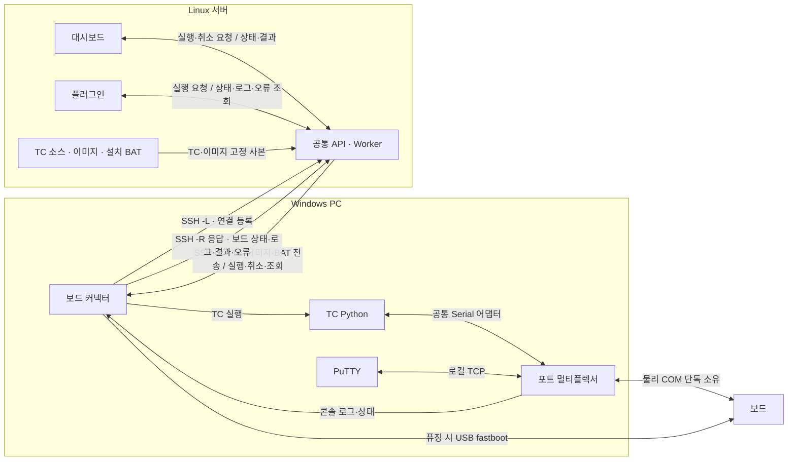

# 보드 커넥터 가이드

## Windows 더블클릭·서버 포트

전체 소스 폴더 최상위의 **`board-connector.bat`**를 더블클릭한다. BAT는 `%SystemRoot%`의 `cmd.exe /d`로 같은 폴더의 `board-connector.cmd`를 호출하는 얇은 실행 파일이며 설치·GUI 코드는 중복하지 않는다. 기존 CMD 직접 호출도 유지한다. `SystemRoot` 철자와 인자 전달 `%*`를 사용하고 공백 경로 인용·지연 확장 OFF·자식 종료 코드를 보존한다.

서버 포트를 명시하려면 PowerShell에서 다음처럼 실행한다. 이는 **Linux Agent Monitor 포트**이며 Windows 로컬 커넥터 포트가 아니다.

```powershell
.\board-connector.bat --server-port 8765
```

명시한 값은 기존 공통 포트 저장/Manager IPC 경로로 저장한다. 다음 더블클릭부터 저장값을 재사용하며 첫 기본값은 **8766**이다. GUI 환경설정에서도 같은 서버 포트를 확인·변경한다. 다른 포트로 바꾸려는데 연결·TC·예약·UNKNOWN이 남아 있으면 기존 안전 게이트를 따른다. 강제 종료에는 설정 변경 옵션을 함께 넘기지 않는다.

```powershell
.\board-connector.bat --force-stop
.\board-connector.bat --diagnose
```

기존 `--home`, 연결 JSON·서버 포트 등 일반 인자는 그대로 CMD에 전달된다. BAT 하나만 옮기지 말고 CMD와 전체 소스를 같은 폴더 구조로 유지한다. 고급 CLI 번들의 `launch.cmd`와는 별도다. 실제 Windows LF/CRLF·공백/기호 경로·인자·실패 코드 계약 시험은 Windows에서 수행하며 이번 Mac 환경에서는 NOT_RUN이다.


## 실행 직후 플러그인 연동 확인

서버와 SSH 계정이 저장돼 있으면 BAT/CMD로 보드 커넥터를 열 때 Windows Host와 SSH 연결을 자동으로 시작한다. 처음 사용하는 프로필은 환경설정에서 저장하면 연결을 시도한다. 연결 파일로 서버와 계정을 가져온 경우에는 보드 등록 전에도 연결 상태를 볼 수 있다. 수동 종료 후 다시 연결하려면 **시작**을 누른다. 탭을 새로고침해도 종료 상태는 유지된다.

첫 탭의 **플러그인 연동 확인** 옆에 현재 연결에서 마지막으로 보고를 받은 시각과 Linux 호스트·포트가 나온다. **플러그인이 보낸 설정**을 펼치면 그때 받은 TC 경로, 설치 BAT, 플래싱 프로파일, 기본 제한시간과 설정 revision을 확인할 수 있다. 연결 보고만 보내고 설정을 생략한 경우도 구분한다. 회사 플러그인이 보고를 보내기 전에는 **플러그인 연결 보고 대기**로 표시된다. 참조 플러그인의 `bsp gui_test connect`는 연결 보고를 보내며, `connect --watch --read-only`는 보고를 보내지 않는다.

## 연결 후 Linux TC 소스 확인

보드 커넥터가 연결되면 **환경설정 → Linux TC 소스 경로**에 해당 Linux 서버에 저장한 경로가 자동으로 표시된다. 8771만 연결한 경우 같은 서버 플러그인의 최신 연결 보고 또는 Agent Monitor 설정 API를 사용한다. 둘 다 사용할 수 없고 API 포트가 닫혀 있으면 직결 프로필의 SSH 계정이 기존 공통 설정 DB를 읽는다. 이 경로는 읽기 전용으로 표시될 수 있다.

**Linux 공통 설정 수신 대기 중**이면 보드 연결을 유지한 채 설정 조회를 재시도한다. 갱신된 Manager는 SSH 명령 제한, HTTP 오류, DB 누락, 커넥터 불일치 등 확인한 원인을 표시한다. 해당 Linux 로그인 계정의 기본 설치 위치는 `~/.local/share/bsp-agent-monitor`이고, `runtime-location.json`으로 지정한 런타임 또는 기본 `runtime/shared-settings.db`에서 읽는다. 별도 설치 home을 사용하면 같은 런타임으로 회사 플러그인의 `bsp gui_test settings show`를 실행해 `shared_settings.integration.tc_root`를 확인하고 `bsp gui_test connect`로 보고를 갱신한다. 서버 경로가 미설정이면 Linux 공통 설정에 TC 경로를 저장한다. 경로가 먼저 표시되고 TC 목록 수신 대기가 나오면 Linux 플러그인의 다음 목록 전달을 기다린다.

**서버 공통 설정 불러오기**를 누르면 연결한 Linux 서버의 설정을 다시 조회한다. 현재 연결을 유지하면서 사용 가능한 출처를 다시 확인한다. 구형 서비스 식별자 고정(v1) 프로필에서는 지정된 Agent Monitor가 필요하다. Linux의 8771은 보드 커넥터 포트다. Agent Monitor 설정 API는 해당 서버에 지정한 포트에서 응답한다.

조회 결과에는 실제 사용한 출처가 나온다. Agent Monitor는 설정 GET 주소, 최신 플러그인 보고는 Linux 호스트와 보드 포트, SSH로 DB를 직접 읽었으면 Linux 호스트와 `shared-settings.db` 전체 경로가 표시된다. API와 플러그인 보고만 받은 경우에는 해당 프로세스의 DB 위치를 화면에서 추정하지 않는다.

같은 Linux 계정·런타임에서 `bsp gui_test settings show`를 실행한다. 갱신된 직결 플러그인은 `settings_db_path`에 연 DB 파일, `tc_root_state`에 `SET` 또는 `UNSET`을 출력한다. 실제 폴더는 `shared_settings.integration.tc_root`다. 처음 지정한 런타임에서 플러그인 명령을 실행하면 기본 DB를 초기화할 수 있으므로 평소 플러그인의 경로와 대조한다. 커넥터의 SSH 직접 조회는 기존 DB를 읽기 전용으로 연다. 정상 JSON에서 이 값이 빈 문자열이면 서버 경로가 미설정이다. 동일한 경로를 다시 읽으면 커넥터가 ‘TC 소스 경로 변경 없음’을 표시한다. 명령의 출력이 비었거나 JSON을 못 읽으면 조회 오류이며 설정 여부는 알 수 없다.

공통 설정을 저장하더라도 **테스트 스크립트** 목록은 이전 경로를 표시할 수 있다. 목록 갱신을 확인할 때는 플러그인의 `bsp gui_test test list` 실행 후 목록에 표시된 경로를 대조한다. Monitor 없이 직결한 상태에서 로컬로 변경할 수 있는 공통 항목은 제한시간과 보관 정책이다. [회사 인수 절차](../porting/PORT-009.md#브라우저-파일-선택과-tc-경로-확인)

## 어디서 받아 실행하는가

보드 커넥터는 **Windows PC에서 실행**한다. Linux 플러그인을 설치하는 것만으로 Windows에 자동 다운로드·설치되지는 않는다. 회사 플러그인의 설치 hook은 회사에서 연결하며, 현재 원본에는 보드 커넥터 전용 다운로드 버튼이나 자동 업데이트가 없다.

1. 플러그인 배포 담당자가 지정한 **동일한 고정 커밋의 전체 소스** 또는 검증된 전체 Agent Monitor 전달 폴더를 받는다. 원본은 [GitHub 저장소](https://github.com/graycoral/bsp_os_upgrade_dashboard)다. GitHub의 해당 커밋에서 소스 ZIP을 받거나, 아래처럼 Git으로 받는다. 브랜치 최신본과 플러그인 배포 버전을 임의로 섞지 않는다.
2. 전체 폴더를 Windows의 쓰기 가능한 위치에 푼다. 예: `C:\work\bsp_os_upgrade_dashboard`.
3. 폴더 최상위의 **`board-connector.bat`**를 더블클릭한다. BAT가 같은 폴더의 CMD를 호출한다. `scripts` 폴더에서 별도 실행 파일을 찾을 필요는 없다.
4. 플러그인이 만든 연결 JSON을 가져오고, 보드·COM을 확인한 뒤 연결한다.

```powershell
git clone https://github.com/graycoral/bsp_os_upgrade_dashboard.git
cd bsp_os_upgrade_dashboard
git checkout <플러그인과-일치하는-고정-커밋>
.\board-connector.cmd
```

`<...>`는 실제 전달받은 커밋으로 바꾼다. Git이 없는 PC는 검증된 전달 폴더를 복사하거나 같은 커밋의 GitHub 소스 ZIP을 풀어 사용한다. `board-connector.cmd` 하나만 복사하면 실행할 수 없다. 최소한 같은 폴더의 `scripts/`, `backend/`, `apps/`, `packages/` 등 전체 소스 구성을 함께 둔다. 전달 폴더를 만드는 방법은 [현재 폴더 전달 안내](../porting/PORT-011.md#폴더-전달과-검증)를 따른다. 이 문서가 배포 서버나 새 ZIP의 게시 완료를 뜻하지는 않는다.

현재 GUI와 다른 **고급 CLI 번들**의 제작·실행은 [CLI 번들 안내](BOARD_CONNECTOR_BUNDLE.md)를 따른다. 그 번들의 `launch.cmd`는 CLI Host·SSH를 실행하며, 현재 브라우저형 GUI의 대체 배포물이 아니다. 과거 EXE는 신규 배포하지 않는다.

## 이름과 호환성

현재 사용자용 이름은 **보드 커넥터**, Windows 더블클릭 진입점은 **`board-connector.bat`**, 설치·실행을 담당하는 기존 명령은 **`board-connector.cmd`**다. 예전 이름 Windows Runner는 별도 설치할 제품이 아니다. 기존 설정 파일 `windows-runner.json`, 예제 `windows-runner.example.json`, API의 `runner`·`runner_id`·`windows-http`·`registered`, 설치 CLI `gui-test-runner`는 기존 설정·통신 호환성을 위해 유지한다. 이 이름을 바꾸려고 DB·설정·실행 기록을 이전하거나 지우지 않는다.

`scripts/board_connector.py`는 루트 CMD가 호출하는 설치·GUI 준비 코드다. `scripts/setup.*`는 Linux 설정과 고급 CLI 설정·진단, `scripts/build-connector-bundle.*`는 고급 CLI 번들 제작, `scripts/board_connector_legacy_entry.py`는 과거 frozen EXE의 dispatch 호환 시험용이다. GUI와 CLI Host를 같은 home·포트에서 동시에 기동하지 않는다. 자세한 정리 목록은 [scripts 안내](../../scripts/README.md#windows-실행-스크립트-정리--2026-11-13)를 따른다.

## 플러그인에서 연결 확인·설정 기준

원본 `PluginClient.connect()`는 서비스·커넥터 준비를 확인하고 `connector_inventory()`/`connector_mirror()`는 보드·COM·fresh 상태와 설정 적용 상태를 조회한다. 서비스 연결, 최신 Windows 등록·콘솔 수신, 실제 보드 부팅·TC 준비를 구분한다. 화면에 과거 보드가 남았다는 이유로 연결 성공으로 보지 않는다. 회사 플러그인 UI에 이 조회와 표시를 연결하는 것은 회사 적용 범위이며, 이 저장소만 확인해 회사 화면의 연결 완료를 보장할 수는 없다.

| 설정 | 기준·기본 위치 |
|---|---|
| TC·이미지 허용 폴더/BAT·프로파일·제한시간 | Linux Agent Monitor의 공통 설정. 플러그인·Agent Monitor·커넥터는 같은 API로 읽고 revision을 확인해 저장한다. 실행 중 Run은 수락 당시 snapshot 유지 |
| Windows 장비 설정 | 실제 적용은 해당 커넥터가 소유한다. 중앙 요청의 PENDING과 Windows 적용 receipt를 구분하며 연결·예약 상태가 허용할 때 반영 |
| SSH 계정·키 경로·보드/COM·TC Python | 기본 `%USERPROFILE%\.bsp-dashboard\windows\windows-runner.json`; `--home` 지정 시 그 폴더. SSH 개인 키는 기존 Windows 위치에 유지 |
| Linux runtime | 소스 `run.sh`는 기본 `<저장소>/.runtime`. 설치 관리자 기본은 `~/.local/share/bsp-agent-monitor/runtime`이며 기존 runtime 연결 시 `runtime-location.json`의 저장 경로를 재사용 |
| 최초 값 | 서버·SSH 계정·COM·TC/이미지 경로를 실제 값으로 설정한다. 새 Windows 프로파일은 보드 목록이 비어 있고 serial 방식은 proxy. API 기본 8766·커넥터 8771이며 저장값과 명시값이 우선 |

공통 설정은 GUI Test 저장소의 revision 문서로 관리하며 Windows JSON 전체를 복제하지 않는다. TC/이미지 Linux 경로를 Windows 로컬 경로로 반복 입력하지 않는다. [플러그인 준비 순서](../agents/PLUGIN_CONTROL_API.md#새-설치의-준비-순서)를 따른다.

## 강제 종료

Windows는 `.\board-connector.cmd --force-stop`, Linux Agent Monitor는 `bash run.sh force-stop`을 사용한다. 각 호스트에서 해당 설치본만 대상으로 하며 실제 실행/예약 기록은 보존한다. 일반 연결 종료와 구분한 [명령·결과·복구 안내](FORCE_STOP.md)를 먼저 확인한다.

## Agent Monitor에서 보기·변경하기

1. Windows에서 기존 `board-connector.cmd`를 실행하고 연결한다.
2. Agent Monitor의 **보드 커넥터** 탭을 연다.
3. 보드를 선택해 **보드 콘솔 / TC 로그 / 공통 오류**를 확인한다.
4. 보드·COM 설정을 편집하고 **장비 설정 요청 저장 → Windows에 설정 적용 요청**을 누른다.
5. Windows 적용 확인 또는 실패 사유를 확인한다. 진행 중 TC·예약·PuTTY가 있으면 먼저 해당 작업을 종료한다.

Windows에서 변경한 설정도 다음 상태 게시에 반영된다. **PuTTY 열기**는 Windows에 창을 연다. 오프라인에서는 과거 상태만 표시한다. SSH 최초 설정·Windows 파일 선택은 Windows 화면에서 진행한다. 새 토큰·자동 시작 등록·EXE 설치는 요구하지 않는다. [미러 계약과 결과 불명 복구](../design/BOARD_CONNECTOR_MIRROR.md), [회사 전달](../porting/PORT-009.md).

## 플러그인이 만든 연결 파일 사용

```bat
board-connector.cmd --import-profile "Z:\project\connector-connection.json"
```

```bat
board-connector.cmd --choose-profile
```

1. 플러그인이 만든 연결 JSON을 선택한다.
2. 서버·SSH 계정·포트가 입력된 화면에서 COM과 보드를 확인한다.
3. 첫 탭에서 자동 연결과 플러그인의 마지막 수신 시각을 확인한다. 보드 매핑을 변경할 때는 연결을 종료하고 저장한다.

기존 SSH 키·보드 설정은 유지한다. `--import-only`는 저장만 한다. 실행 중인 Manager, 진행·예약·UNKNOWN 작업 또는 다른 Linux 서비스 identity가 있으면 가져오기를 거부한다. 기존 연결을 안전하게 종료한 뒤 다시 가져온다. 개인 키나 비밀번호를 연결 JSON에 넣지 않는다.

설정 파일 생성은 [플러그인 연결 절차](../agents/PLUGIN_CONTROL_API.md)를 따른다. RQ-69 코드·시험 고정 커밋은 `bfb7a21075d2bc7f44f414e087179720cdd3dd5c`이며 아래 과거 고정 버전에는 포함되지 않는다.

2026-11-14 RQ-67/68: [플러그인 중심 공통 설정·실패 분석·설치 안내](../agents/PLUGIN_CONTROL_API.md). 최신 적용/검증 상태는 해당 안내를 따른다.


## 스냅샷 저장 공간

1. 환경설정 → **저장 공간 자동 정리** → **정리 기준 불러오기**를 누른다.
2. 보관 기간·용량을 바꾸고 **정리 기준 저장**을 누른다.
3. **정리 대상 확인**으로 Linux와 Windows의 정리량을 확인한다. 바로 정리하려면 **지금 정리**를 누른다.
4. Windows 적용이 **SYNC_PENDING**이면 연결을 복구한다. 저장한 정책은 다시 전달된다.

Qt 호환 화면에서는 **스냅샷 저장 공간**의 **저장**·**정리 예상 보기**를 사용한다.

기본값은 자동 정리, 7일, 서버·Windows 각각 20 GiB다. 현재 소스·실행 중·일시 중지·종료 불명 작업·준비된 이미지·실패 근거는 보존한다. 실행 기록과 로그는 지우지 않는다. Windows의 재개 가능한 업로드도 보존하므로 용량 목표를 넘을 수 있다. **일부 경로 제외**가 표시되면 해당 경로는 계산·삭제하지 않은 상태다.

설정 파일을 사용하는 플러그인은 `PluginClient.export_storage_policy(path)`로 내보내고, 수정한 파일을 `import_storage_policy(path)`로 적용한다. 파일 형식과 시험 범위는 [실행 기록](../testing/runs/20261114-remaining-implementation.md)을 따른다.

## 설치 전 준비

- Windows PC: 저장소 소스와 최초 설치 권한. Python 3.13 64비트·OpenSSH·platform-tools는 실행 스크립트가 확인하고 누락된 도구를 준비한다. 설치된 Python 3.11/3.12도 호환된다.
- Linux 서버: 대시보드 API·Worker 실행, SSH 키 또는 agent 인증 설정.
- 보드: 실제 COM 연결. 멀티플렉서 방식은 별도 RX COM·가상 COM 드라이버가 필요 없다.
- TC Python: 실제 TC에 필요한 패키지가 설치된 `python.exe` 준비.
- 최초 연동: 아래 **플러그인·대시보드 연동**의 서버 설정 완료.

명령은 PowerShell 기준이다. 예시 소스 위치는 `C:\work\bsp_os_upgrade_dashboard`다. 최초 설치에는 패키지 저장소 접속 또는 회사에서 준비한 pip 오프라인 설정이 필요하다. 기존 CLI 배포 ZIP에는 GUI용 Qt가 포함되어 있지 않다.

## 설치 방법

현재 기본 화면은 **Windows 로컬 브라우저**다. `board-connector.cmd`를 실행하면 커넥터 환경을 확인하고 기존 Manager를 시작/재사용한 뒤 웹 화면을 연다. 기본 실행에는 Qt를 설치하거나 import하지 않는다. Python·TC 의존성·OpenSSH·장비 드라이버는 여전히 필요하다. Linux의 공유 폴더를 Z:로 열어 실행해도 실행 주체는 Windows다. 실제 회사 Z:/UNC 실행은 아래 인수 항목에서 확인한다.

```powershell
cd C:\work\bsp_os_upgrade_dashboard
.\board-connector.cmd
```

탐색기에서는 저장소 루트의 **board-connector.bat**를 더블클릭한다. 기존 board-connector.cmd 직접 실행도 유지한다. 처음에는 실행 환경과 패키지를 준비한 뒤 웹 화면을 연다. 다음 실행부터 설치가 정상인지 확인하고 같은 Windows Manager를 재사용한다. 소스만 바뀌면 패키지를 다시 설치하지 않는다. 브라우저를 닫아도 연결/시험은 유지된다. 다시 CMD를 실행하면 새 화면 세션을 얻는다. 주소에 포함된 일회성 화면 열기 값은 브라우저에서 즉시 제거하며 사용자에게 토큰 입력을 요구하지 않는다.

Qt 호환 화면이 필요한 경우에만 ` .\board-connector.cmd --ui qt`를 사용한다. 이 경우 기존 Qt 고정 의존성을 검사/설치하며 브라우저용 환경과 이전 Qt 환경을 삭제하지 않는다. GUI 기술을 바꿔도 TC·COM·플래싱 실행 코어와 단일 실행 소유권은 유지한다.

### 웹 화면에서 확인할 것

Mac/Linux에서 같은 웹 화면을 살펴보려면 `.venv/bin/python -m backend.gui_test.connector --preview`를 실행한다. 기본 브라우저가 열리며 보드/연결/TC는 임시 모의 데이터다. 미리보기는 loopback 8774를 사용하고 점유 시 OS가 다른 포트를 배정한다. 실제 Windows 설정·COM·SSH는 사용하지 않는다. 미리보기 서버는 실행한 터미널에서 Ctrl+C로 종료한다.

- **보드 현황:** 연결 단계, 등록/감지/시험 중 보드 수, 보드 선택과 제어권, 실행·예약·UNKNOWN 때문에 조작할 수 없는 이유.
- **COM 멀티플렉서:** 같은 기존 물리 COM 단독 소유·TC lease·PuTTY 조회/수동 제어 경로다. 여러 화면을 열어도 물리 COM을 추가로 열지 않는다.
- **연결 전원:** 전원 아이콘 버튼 하나로 연결을 시작/종료한다. 이는 Windows 실행부·SSH·서버 연결 조작이며 TC 실행 버튼이 아니다. 진행 중에는 잠그고, 오래된 상태나 진행·예약·종료 불명 작업이 있으면 종료하지 않는다. 서버에서도 기존 안전 조건을 검사한다.
- **상단 조작:** Windows/SSH/서버/왕복 상태등과 같은 줄 오른쪽에 환경설정·시작/종료를 배치한다. 일반적인 창 종료 안내는 화면에서 생략하고 stale/소스 미준비 등 필요한 상태만 표시한다.
- **화면 이동:** 기본 화면은 보드 현황이다. 시작/종료 버튼 왼쪽의 톱니바퀴 아이콘(환경설정)으로 기존 설정 화면을 열고, 설정 화면의 보드 현황 버튼으로 돌아온다. 왕복해도 미저장 입력을 유지한다. 별도 상단 탭 줄은 없다.
- **화면 배치:** 상단은 `WINDOWS · BOARD CONNECTOR` 제목 하나만 표시한다. 상세 영역은 항상 보이는 로그 → 접힌 소스와 실행 경로 → 접힌 연결 상세·콘솔 안내 순서다.
- **진행 메시지·서버:** 메시지는 Windows/SSH/서버/왕복 옆에 표시하고 길면 아래 줄로 넘긴다. 단순 요청 전달 문구는 남기지 않는다. 연결된 Linux 서버 주소는 보드 리스트 제목 아래 작게 표시한다.
- **간략 표시:** 등록·감지·시험 중 대수는 가로 보드 선택 줄 오른쪽에 작게 표시한다. PuTTY 열기는 선택한 보드 이름 옆 터미널 아이콘이며 마우스 설명과 접근 가능한 이름을 제공한다. 연결 단계 아래에 보드명·상태등을 가로로 표시하며 보드가 많으면 해당 줄만 가로 스크롤한다. 보드 이름을 클릭하면 좌측 TC와 우측 로그가 함께 전환된다. 선택 보드는 배경/밑줄로 구분하고 COM은 마우스 설명으로 확인한다. Windows/SSH/서버/왕복도 상태등으로 표시하며 이름이나 상태등에 마우스를 올리거나 키보드로 선택하면 연결 대상과 현재 상태를 작은 상자로 확인할 수 있다. Esc로 닫는다. 초록은 정상, 빨강은 오류, 노랑은 진행/확인 필요, 회색은 미연결/대기다. 시험 중인 보드의 상태등만 천천히 점멸하고 시험이 끝나면 멈춘다. OS 동작 줄이기 설정에서는 점멸하지 않는다.
- **접기/열기:** COM 멀티플렉서와 콘솔 안내는 `연결 상세 · 콘솔 안내` 안에 두고 기본 접는다. 소스와 실행 경로도 접기/열기를 제공한다. 로그 보기는 항상 우측 패널에 표시한다. 좌측 TC와의 경계를 드래그하거나 좌우 방향키로 너비를 조절한다. 기본30:70이며 비율은 다음에도 유지된다. TC 목록과 로그는 각자 스크롤하고 남은 화면 높이를 사용한다. 700px 이하에서는 TC 위/로그 아래로 배치한다.
- **콘솔 구분:** 보드 콘솔은 수신된 UART 부팅·시스템 출력을 조회한다. PuTTY를 열면 같은 UART의 입력 제어권을 자동으로 받고, 창을 닫으면 반환한다. TC 로그는 TC 프로그램의 stdout/stderr다.
- **로그:** 별도 로그 보기 제목 없이 상단과 같은 스타일의 보드 콘솔/TC 로그/연결/공통 오류 탭과 옆의 로그 폴더 열기를 제공한다. 검색·오류 필터·복사·로그 폴더. 화면은 최대 1,000줄/64 KiB를 표시하며 같은 로그를 매번 다시 쓰지 않는다.
- **환경설정:** Windows 서버/TC Python/보드 매핑과 서버 공통 설정을 구분한다. Linux 경로는 서버 폴더 탐색으로 고르며 TC별 제한시간 재정의와 미지 기존 설정을 보존한다. 오래된 폼 저장은 충돌로 거부하고 초안은 유지한다.
- **파일 선택:** Windows 표준 대화상자로 전체 경로만 가져온다. 취소하면 기존 입력을 유지한다. **찾아보기**를 눌러도 창이 열리지 않으면 전체 경로를 직접 입력할 수 있다. 선택 중에는 대기 안내가 표시된다. 미리보기에서는 파일을 고를 수 없어 전체 경로 직접 입력을 안내한다. [Windows 인수 절차](../porting/PORT-009.md#브라우저-파일-선택과-tc-경로-확인)

Linux 대시보드/플러그인은 이미 연결된 보드 커넥터에 작업을 요청한다. Linux 화면의 버튼이 꺼진 보드 커넥터 프로세스를 직접 기동하는 기능은 구현하지 않았다. Z:의 실행 소스를 Windows 로컬로 버전별 복사하는 배포 캐시도 이번 변경에 포함하지 않는다.

### CMD 경로 오류 · 번호별 진단과 조치

먼저 PowerShell의 같은 소스 폴더에서 읽기 전용 진단을 실행한다. 설치·Manager·GUI·SSH·COM을 시작하지 않는다.

```powershell
.\board-connector.cmd --diagnose
# CMD 시작 설정 영향을 제외하고 비교
cmd.exe /d /c .\board-connector.cmd --diagnose
```

| 표시 | 의미와 조치 |
|---|---|
| BC-00 이전의 경로 오류 | CMD 실행 전 AutoRun 등 시작 환경의 가능성을 확인한다. `/d` 실행과 비교하며 원인을 확정하지 않는다. 스크립트 내부 재진입이 이미 발생한 최초 오류를 없애지는 못한다. |
| BC-02 | 로컬 진단 로그를 만들 수 없다. 콘솔 내용을 보존하고 Windows 로컬 로그 폴더 쓰기 권한을 확인한다. 실행은 계속 시도한다. |
| BC-11 | CMD가 놓인 소스 폴더 접근 실패. 같은 사용자·같은 Windows 세션에서 Z:/UNC를 열고 확인한다. 필요하면 전체 소스를 로컬 폴더로 복사한다. 자동 드라이브 매핑/관리자 승격은 하지 않는다. |
| BC-12 | 소스 파일 누락. 표시된 Missing 경로를 확인하고 CMD만 복사하지 말고 전체 소스를 갱신한다. |
| BC-20 | Python 후보 검사. 일부 후보 실패는 정상 fallback일 수 있다. 후보별 경로·버전·오류는 로컬 launcher 로그에서 확인한다. |
| BC-30 / BC-31 | 지원하는 64비트 Python을 못 찾았거나 명시 경로 검사 실패. 직접 성공한 Python 경로를 아래 방법으로 지정한다. Python 미설치로 단정하지 않는다. |
| BC-40 / BC-41 | Python 선택 후 설치/GUI 준비 단계. 앞선 Python 오류와 connector.log를 확인한다. pip 오류는 회사 네트워크/오프라인 wheelhouse를, GUI 오류는 자산·브라우저/Manager 버전을 확인한다. |
| BC-50~54 | 읽기 전용 파일/환경 진단. BC-53은 아직 재사용 환경이 없다는 뜻이며 자동 설치를 수행하지 않는다. |
| BC-55 | 웹 화면 자산 누락. 전체 소스 또는 같은 버전 배포본을 갱신한다. pip 재설치를 반복하지 않는다. |
| BC-56 | 별도 공개 필수 도구 준비 접점 실패. 전체 소스의 bootstrap 스크립트와 표시된 prerequisites 로그를 확인한다. 회사의 설치 정책·허용 배포 경로를 따르며 웹 화면 오류와 구분한다. |

PowerShell에서 성공한 Python의 실제 경로를 확인하고 이 CMD에만 지정할 수 있다. 따옴표는 PowerShell 문법이며 변수 값 안에 추가 따옴표를 넣지 않는다.

```powershell
python -c "import sys; print(sys.executable)"
$env:BOARD_CONNECTOR_PYTHON = 'C:\실제 Python 폴더\python.exe'
.\board-connector.cmd --diagnose
.\board-connector.cmd
# 자동 탐색으로 되돌릴 때
Remove-Item Env:BOARD_CONNECTOR_PYTHON
```

CMD 진단 로그는 `%LOCALAPPDATA%\BspBoardConnector\logs\launcher-*.log`에 실행별로 남긴다. LOCALAPPDATA가 없으면 TEMP를 사용한다. Python 준비/GUI 상세 로그는 기존 home의 `logs\connector.log`다. 전체 환경변수나 사용자 인자를 로그에 덤프하지 않는다. CMD는 레지스트리·드라이브 매핑·기존 설정/환경을 자동 삭제하지 않는다.

기존 구버전 Manager가 살아 있으면 화면 지원 여부를 확인하고 업데이트 안내를 표시한다. 작업 중인 Manager를 강제 재시작하거나 두 번째 Manager를 만들지 않는다. 기존 Qt 화면에서 작업/연결을 안전하게 끝낸 후 이전 Manager도 종료해야 새 코드를 읽는다. 구버전에 Manager 종료 접점이 없으면 회사의 프로세스 종료 절차 또는 **작업이 모두 끝난 뒤** Windows 로그아웃/로그인으로 사용자 프로세스를 정리한다. 새 CMD를 실행하기만 해서는 이미 실행 중인 구버전 프로세스 코드가 교체되지 않는다.

기본 브라우저 열기 실패는 Windows 기본 브라우저 설정을 확인하고 다시 CMD를 실행한다. 화면 세션 만료/브라우저 실패는 기존 TC를 종료하지 않는다. 현재 변경의 로컬 시험과 남은 실제 Windows 인수는 [실행 기록](../testing/runs/20261114-connector-web.md), 설계·구현 후 리뷰 상태는 [Astra 리뷰 기록](../testing/runs/20261114-connector-web-review.md)을 따른다.

## 연결 구조



- SSH 연결은 Windows에서 시작한다. 터널은 커넥터가 생성한다.
- Linux는 TC 소스·제한시간·시험 기록을 관리한다. Windows에 TC 폴더를 다시 입력하지 않는다.
- 현재는 TC 고정 사본을 전송한다. Z: 드라이브 원본 직접 실행은 지원하지 않는다.
- 멀티플렉서가 물리 COM을 열고 TC·PuTTY·로그에 출력을 분배한다. 명령 전송은 한 작업만 허용한다. 연결할 때 기존 프로파일도 자동 전환한다. 이전 RX 설정은 백업에 보존하며 사용하지 않는다.

| 포트 | 용도 |
|---|---|
| Linux SSH 포트 | 기본 22. 회사 설정에 맞춰 입력 |
| Linux 대시보드 포트 | 회사 예시 8765. 실행 중인 서버 포트 입력 |
| Windows 브라우저 포트 | 터널이 사용 중인 로컬 포트. **대시보드 열기**로 접속 |
| 커넥터·역방향 터널 포트 | 기본 8771. 기존 저장 설정이 있으면 해당 값 사용 |

`127.0.0.1`은 접속하는 PC 자신이다. Linux의 `8765`와 Windows 브라우저 포트는 같을 필요가 없다.

## 동작 방법

### 서버 포트 지정

```powershell
.\board-connector.cmd --server-port 8765
```

- Linux Agent Monitor가 사용하는 포트다. SSH 포트·Windows 브라우저 포트와는 별개다.
- 지정한 값은 저장되고 환경설정의 **Agent Monitor 서버 포트**에도 표시된다. 생략하면 저장값, 저장값이 없으면 `8766`을 사용한다.
- 서버 포트를 변경했다면 커넥터 연결을 종료한 뒤 새 값으로 실행하고 다시 연결한다. 실행·예약·UNKNOWN이 남아 있으면 변경을 보류한다.
- `--remote-dashboard-port`도 같은 옵션이다. 연결 JSON과 함께 지정하면 명령줄 값이 우선한다.

### 최초 설정

플러그인에서 Linux SSH 연결 설정을 포함해 생성한 폴더를 받았다면 `start-board-connector.bat`로 실행한다. 생성할 때 저장한 서버 주소와 SSH 계정이 적용된다. [플러그인에서 연결 폴더 생성](../porting/PORT-015.md).

1. `board-connector.cmd`를 실행한다.
2. **환경설정**에서 Linux SSH 서버·계정·대시보드 서버 포트를 입력한다.
3. **TC Python → 찾아보기…**에서 TC용 `python.exe`를 선택한다.
4. **연결할 보드 수**를 지정한다.
5. 보드별 탭에서 이름·실제 보드 COM·통신 속도를 설정한다. 목록이 없으면 **COM 새로고침**을 누른다.
6. 필요하면 **고급 연결 설정**에서 SSH 포트·키 파일을 지정한다.
7. **설정 저장** 후 연결한다. 멀티플렉서는 자동으로 시작한다. RX COM·가상 COM 드라이버·TC import 변경은 필요 없다.

### TC 공통 모듈 연결

기존 공통 모듈의 `import serial`, `from serial import Serial`, `serial.Serial(COM번호, ...)`를 그대로 사용한다. 커넥터가 TC 실행 전에 프록시를 연결한다. 등록된 실제 COM 번호를 전달하면 된다. TC 소스와 저장된 실행 인자는 변경하지 않는다.

TC용 Python에는 기존 pySerial이 설치되어 있어야 한다. 설치된 패키지와 `.pth`·`sitecustomize`·`PYTHONPATH`는 프록시를 연결한 뒤 불러온다. 연결 정보가 없거나 초기화에 실패하면 TC를 시작하지 않는다. 물리 COM 직접 연결로 우회하지 않는다.

지원 범위는 read/readline/write, timeout, 입력 버퍼 초기화, 통신 설정과 명시적 DTR/RTS 변경이다. OS COM 핸들·fileno/ioctl, inter_byte_timeout, RS485 설정은 지원하지 않는다. TC가 별도 Python 프로세스나 네이티브 프로그램을 실행해 COM을 여는 경우에는 별도 연동이 필요하다. TC가 읽는 `sys.flags.isolated/no_site`는 안전한 초기 실행 옵션에 따라 설정된다.

기존 프로파일은 작업·예약·종료 불명 기록이 없을 때 백업 후 자동 전환한다. 이전 RX 설정과 비활성 보드 정보는 보존한다. 화면의 **다음 연결 시 자동 적용**은 실제 Host가 멀티플렉서를 시작하면 사라진다.

### PuTTY

1. 연결 화면에서 보드를 선택하고 선택 보드 이름 옆 **PuTTY 터미널 아이콘**을 누른다. 입력 제어권을 자동으로 받은 뒤 PuTTY가 열린다.
2. PuTTY 창을 닫으면 입력 제어권을 자동 반환한다. TC/퓨징은 반환 후 시작할 수 있다.

로그만 볼 때는 보드 콘솔을 사용한다. PuTTY를 열어도 보드 콘솔 수신은 계속된다. TC·예약·UNKNOWN·오래된 상태에서는 열 수 없으며 실행 실패나 연결 전 창 종료도 제어권을 반환한다. 반환 통신 오류는 자동 재시도하며 연결 단계 옆에 반환 중을 표시한다. 이전 창 종료 처리가 새 입력 제어권을 반환하지 않도록 구분한다. 별도 수동 제어 버튼은 없다.

PuTTY 주소·포트는 자동 전달한다. PuTTY를 찾지 못하면 고급 연결 설정에서 `putty.exe`를 선택한다. 같은 버전의 Windows Manager·Host·화면을 함께 적용하고 기존 실행을 안전 종료한 뒤 다시 시작한다.

### 연결·시험·종료

1. **연결 → 연결**을 누른다.
2. 로컬·SSH·대시보드·역방향 응답이 정상인지 확인한다.
3. 보드 수·COM·상태를 확인한다.
4. **대시보드 열기**를 누른다.
5. 대시보드에서 TC 소스를 선택하고 시험을 시작한다. 플러그인에서도 같은 서버로 요청한다.
6. 보드 행을 선택하고 **로그 보기**에서 필요한 탭을 선택한다.
7. 작업이 끝나면 **연결 종료**를 누른다. Windows Host 상태가 최신이고 종료를 막는 작업이 없으면 SSH 연결 시도 중이나 재연결 중에도 같은 버튼을 사용할 수 있다.

창만 닫으면 연결과 시험은 계속된다. 연결된 동안 보드 설정을 바꾸려면 작업을 끝내고 **연결 종료**부터 수행한다.

| 상태 | 의미 |
|---|---|
| 초록 · 연결 | COM 감지 및 연결 상태 확인. 부팅·시험 통과를 뜻하지 않음 |
| 노랑 · 시험 중 / 예약·대기 | 실행 또는 장비 예약 중 |
| 노랑 · 확인 필요 | 현재 상태를 확인할 수 없음 |
| 빨강 · 오류 | 연결 또는 장비 오류 확인 필요 |
| 회색 · 미연결 | COM 또는 연결 확인 불가 |

| 로그 탭 | 내용 |
|---|---|
| 보드 콘솔 | 멀티플렉서에서 분배한 실제 보드 출력 |
| TC 로그 | TC 프로그램의 표준 출력·표준 오류. 실행 버튼이 아님 |
| 연결 | 커넥터·SSH·서버 연결 상태 |
| 플러그인 오류 | 공통 서버에 전달할 보드 오류. 실제 플러그인 수신 여부는 플러그인에서 확인 |

**오류만**, 검색, **복사**, **로그 열기**를 사용할 수 있다.

## 경로 확인

**연결 → 경로 보기**에서 확인한다. 경로는 읽기 전용이다.

| 표시 | 기준 |
|---|---|
| Linux 선택 TC 소스 | 서버에서 현재 선택한 소스 |
| Linux 설치 BAT | 플러그인이 해당 실행에 전달한 BAT 절대경로 |
| Linux 실행 TC 소스 | 해당 실행에 저장된 TC 경로 |
| Windows 이미지 작업 폴더 | 커넥터가 이미지 준비 후 기록한 폴더 |
| Windows TC 작업 폴더 | 표시된 TC 실행 ID의 작업 폴더 |

요청 전에는 **요청 전**, 아직 경로를 받지 못하면 **준비 전 또는 경로 미수신**으로 표시한다. 완료된 작업은 **이전 실행**, 연결이 끊기면 **과거 수신 정보**로 표시한다. 폴더의 현재 존재 여부는 확인하지 않는다.

## 플러그인에서 이미지 플래싱 요청

Agent Monitor의 **보드 커넥터 → 이미지 퓨징 설정**에서 Linux 설치 BAT 절대 경로와 플래싱 프로파일 이름을 확인한다. 처음이면 **서버 접근 범위**에 이미지 허용 폴더도 입력한다. Windows 웹의 **환경설정 → 이미지 퓨징 · 서버 공통 설정**은 Linux 공통 서버에 연결해 같은 값을 저장한다. 플러그인이 값을 주지 않아도 대시보드에서 수동 설정할 수 있다. 저장한 조합은 `test preview --flash`로 확인하고, 퓨징을 요청할 때만 `test run --flash`를 사용한다.

1. Linux에서 빌드가 끝난 이미지와 설치 BAT를 같은 폴더에 준비한다.
2. 플러그인에 BAT까지 포함한 절대경로를 지정한다. 예: `/srv/images/build-123/install.bat`.
3. 플러그인에서 실행할 TC를 선택하고 요청한다.
4. Linux 서버가 허용 경로·파일 해시를 검사하고 이미지·BAT·TC를 Windows로 전송한다.
5. 커넥터가 저장된 플래싱 프로파일로 fastboot 진입 → BAT 실행 → 부팅 확인 → TC 실행을 진행한다.
6. 플러그인에서 결과·오류를 확인한다. 커넥터에서는 **경로 보기**와 **보드 콘솔**을 확인한다.

BAT는 같은 폴더와 하위 폴더의 파일을 상대경로로 참조해야 한다. BAT 안의 Linux 절대경로나 특정 PC 경로는 자동 변환하지 않는다. 플래싱 프로파일이 먼저 설정되어 있어야 하며 커넥터 GUI에 별도 실행 버튼은 없다.

## 예외 조치

| 증상 | 조치 |
|---|---|
| 창이 열리지 않음 | 아래 진단 실행 명령으로 시작해 오류 확인. Python 3.13 64비트(3.11/3.12 호환)와 패키지 저장소 접속 확인 |
| COM이 목록에 없음 | 케이블·드라이버 확인 후 **COM 새로고침** |
| COM 중복 오류 | 보드별 실제 COM을 다르게 선택 |
| 보드 콘솔이 비어 있음 | 실제 COM을 점유한 다른 프로그램을 종료하고 통신 속도 확인 |
| 프록시 COM 매핑 없음 | 공통 모듈을 연결한 뒤 대시보드·플러그인에서 TC 시작 |
| SERIAL_PROXY_FAILED | 보드 분리·수신 누락·통신 설정 오류 확인. 실패 기록 확인 후 안전 종료·재연결 |
| `Connection refused` / `channel ... open failed` | Linux API 실행 여부와 **대시보드 서버 포트** 확인 |
| 각 소켓 주소는 하나만 사용 가능 | 기존 커넥터·SSH 터널의 사용 포트 확인. 중복 실행 정리 후 재연결 |
| SSH 인증 실패 | PowerShell에서 같은 서버·계정·포트·키로 SSH 인증과 서버 키 확인 완료. GUI는 비밀번호 입력을 지원하지 않음 |
| 역방향 등록 HTTP 401/403 | 서버·커넥터 버전과 loopback 주소 확인. 브라우저에서 등록 API를 직접 호출하지 않음 |
| `remote port forwarding failed for listen port 8771` | 아래 순서로 Linux 리스너와 보드 커넥터 응답 확인 |
| `TC_PYTHON_NOT_CONFIGURED` | **TC Python**에서 실행 가능한 `python.exe` 선택 |
| 시험 중 timeout | 대시보드 **Test 현황**에서 TC 시간을 눌러 전체·개별 제한시간 조정. 통신 오류이면 연결 로그부터 확인 |
| `확인 필요` / 과거 로그 표시 | SSH·COM·실제 시험 상태 확인. 기록 삭제로 해제하지 않음 |
| 연결 종료 거부 | 실행·예약·일시정지·종료 불명·삭제 중 작업 확인 후 정리 |

진단 실행:

```powershell
.\board-connector.cmd --install-only
```

설치 실패 시 콘솔 창에 오류가 남는다. 연결·실행 오류는 커넥터의 **로그 보기** 또는 `%USERPROFILE%\.bsp-dashboard\windows\logs\connector.log`에서 확인한다. 기존 `--home`을 사용했다면 같은 인자를 전달한다.

### Linux 역방향 포트 8771 연결 실패

Windows 보드 커넥터가 SSH 역방향 터널을 직접 연다. 아래 명령은 커넥터에 설정한 Linux 서버에서 실행한다. 포트를 변경했다면 두 명령에 설정한 포트를 사용한다.

1. `sudo ss -ltnp 'sport = :8771'`로 리스너와 PID를 확인한다. 리스너가 없으면 커넥터에서 재연결한다. 계속 리스너가 생기지 않으면 해당 SSH 계정의 원격 포워딩 허용 여부를 확인한다.
2. 리스너가 있으면 `curl --noproxy '*' -i --max-time 5 http://127.0.0.1:8771/v1/identity`로 응답을 확인한다. HTTP 200이고 JSON의 `service`가 `bsp-board-connector`, `runner_id`가 대상 커넥터와 일치하면 터널이 이미 동작한다. `curl: (52) Empty reply from server`이면 Windows 커넥터 Host가 실행 중인지 확인한다. 리스너가 본인의 이전 터널 또는 진단용 터널이고 사용 중인 작업이 없음을 확인한 경우 원래 터미널에서 종료한다. 원래 터미널에 접근할 수 없으면 1번 명령으로 해당 세션의 PID를 다시 확인하고 `sudo kill <sshd_pid>`의 자리표시자를 그 PID로 바꿔 실행한다. 포트가 해제되면 커넥터에서 재연결하고 같은 URL을 다시 조회한다.
3. Manager는 Linux에서 위 identity를 조회해 Windows Host와 대조한다. SSH 성공 로그가 없어도 연결을 표시한다. 단발 SSH 확인 요청의 기본 제한은 60초다. `SSH_BIND_UNVERIFIED`이면 주 터널을 유지하며 identity 조회만 재시도한다. 연결 진단에 표시되는 HTTP 상태, runner 불일치 또는 원격 명령 종료 코드를 확인한다. 원격 명령이 제한된 계정은 같은 Linux 서버의 플러그인에서 연결 진단을 실행한다. Manager는 현재 시도 이후 해당 서버·포트에서 받은 정상 진단 보고도 인정한다.

별도로 진단용 `ssh -R`을 실행했다면 확인이 끝나는 즉시 **그 명령을 실행한 터미널에서 Ctrl+C**로 종료한다. Linux에서 진단 리스너가 사라진 뒤 보드 커넥터를 재시도한다.

## 플러그인·대시보드 연동

### 설치 담당자: 최초 한 번

1. Linux 대시보드에 [PORT-009](../porting/PORT-009.md)의 서버·Worker 변경을 적용한다. 기존 서버를 재사용한다.
2. 해당 runtime의 `gui-test.json`에서 `runner`를 `registered`로 설정한다. 기존 실행 기록과 다른 설정은 보존한다.
3. Linux API·Worker, 보드 커넥터, 플러그인 클라이언트에 토큰 제거 변경을 함께 적용한다. 이전 버전과 혼용하면 토큰 오류가 날 수 있다.
4. Linux API·Worker가 같은 runtime을 사용하도록 설정하고 재시작한다.
5. 커넥터에서 **연결**을 누른다. 대시보드 실제 시험 화면에 보드가 표시되는지 확인한다.
6. 대시보드에서 TC 소스를 선택한다. 이후 보드·COM·TC 경로를 플러그인에 중복 입력하지 않는다.

연결 토큰의 생성·복사·입력은 필요 없다. 기존 `GUI_TEST_RUNNER_TOKEN`, `GUI_TEST_CONNECTOR_REGISTRATION_TOKEN`, `GUI_TEST_INTEGRATION_TOKEN`과 저장된 연결 토큰 파일은 사용하지 않는다. 기존 파일을 자동 삭제하지는 않는다. SSH 키 인증은 유지한다.

### 플러그인 연결

1. Linux의 같은 대시보드 API를 연결 대상으로 지정한다. 같은 서버에서 실행하는 경우 예시는 `http://127.0.0.1:8765`다.
2. 참조 클라이언트를 `PluginClient(url, expected_identity=identity)`로 생성한다. 연결 토큰은 전달하지 않는다.
3. `gui-test.json`의 `integration` 실행 설정을 준비한다. 자동 퓨징 설정은 [플러그인 설치 안내](BSP_UPGRADE_COMPANY_GUIDE.md#회사-플러그인-연결)를 따른다.
4. loopback `/api/v1/health` 응답으로 서비스·Worker·커넥터 identity를 확인하고 고정한다.
5. 참조 `PluginClient`의 아래 메서드를 회사 플러그인에 연결한다.

| 확인할 내용 | 메서드 |
|---|---|
| 연결된 보드 | `connector_inventory()` |
| 보드 콘솔 | `board_console()` |
| 새 오류 | `connector_errors(after=마지막_seq)` |
| 시험 진행·결과 | `run(run_id)` |

오류 조회의 마지막 `seq`를 저장하고 다음 조회에 사용한다. 재접속 시 기존 Run ID를 유지한다.

회사 플러그인 화면·설정 메뉴는 이 저장소에 없다. 위 메서드 연결과 실제 오류 수신은 회사에서 확인해야 한다. 이미 전체 대시보드가 실행 중이면 같은 runtime에 별도 standalone Worker를 추가하지 않는다.

## 설정·업데이트

| 항목 | 위치·처리 |
|---|---|
| Windows 설정 | `%USERPROFILE%\.bsp-dashboard\windows\windows-runner.json` |
| Windows 로그 | 같은 폴더의 `logs` 또는 **로그 열기** |
| TC 소스·제한시간·세션 | Linux 대시보드에서 관리 |
| 대시보드 화면만 재빌드 | 커넥터 재설치 불필요 |
| 커넥터 코드·의존성 변경 | 시험 종료 → 연결 종료 → 기존 설정 백업 → 변경 파일 적용 → board-connector.cmd 실행 |

기존 사용자 지정 `--home`이 있으면 `board-connector.cmd --home "D:\기존 설정"`처럼 같은 경로를 계속 사용한다. 새 실행 환경은 해당 home의 `connector-environments` 아래에 둔다. 기존 저장소 `.venv`가 필요한 패키지를 모두 갖추고 있으면 그대로 사용한다. 의존성 변경·환경 손상 시 새 환경을 준비하고 이전 환경과 설정은 보존한다. 설치 확인은 TC나 이미지 파일을 복사하지 않는다. 현재 스냅샷 자동 정리는 지원하지 않는다.

## Mac 미리보기

```bash
python3.13 -m venv .venv
.venv/bin/python -m pip install -r apps/gui-test/requirements.lock -r apps/board-connector/requirements.lock
.venv/bin/python -B -m backend.gui_test.connector --preview
```

저장소 루트에서 실행한다. 화면과 모의 로그만 확인할 수 있으며 실제 서버·보드에는 연결하지 않는다.

Windows 실장비·회사 서버 검증은 미실행이다. 로컬 검증 결과는 [시험 기록](../testing/runs/20261112-board-connector-gui.md), 개발 상세는 [연결·콘솔 계약](../design/BOARD_CONNECTOR_CONTRACT.md)을 따른다.

## 테스트 스크립트 목록·상태 확인

선택한 보드의 좌측 **테스트 스크립트** 목록에서 공통 TC 경로의 스크립트와 대기 중·진행 중·PASS·FAIL을 확인한다. 공통 TC 경로가 없으면 Agent Monitor에서 적용한 TC 소스를 표시한다. 실행 대상으로 선택하지 않은 스크립트는 미선택, 해당 보드에 실행이 없으면 미실행이다. 보드를 전환하면 해당 보드의 상태를 표시한다.

TC 검색과 상태 필터로 표시할 항목을 좁힐 수 있다. FAIL 필터에는 실행 오류와 시간 초과도 포함한다. 전체 상태/빈 검색으로 전체 목록에 복귀한다.

이 목록은 조회 전용이다. TC 선택·시작·중지·재실행은 기존 플러그인·Agent Monitor에서 수행한다. 연결/상태 수신이 끊기면 마지막 목록을 과거 수신 정보로 표시하며 UNKNOWN이나 취소를 PASS로 처리하지 않는다. 폴더 내용은 약10초마다 재확인하고, 선택 경로 변경은 다음 상태 조회에 반영한다. Windows 웹·Qt·Agent Monitor 커넥터 탭에 적용된다. [계약](../design/BOARD_CONNECTOR_CONTRACT.md#tc-목록과-상태-조회--rq-73d-79), [로컬 검증·미실행 범위](../testing/runs/20261117-connector-test-status.md).
