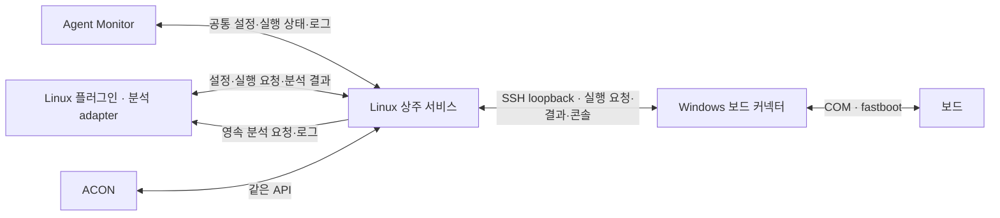

# Agent Monitor 연동·설치 안내

설명: **bsp-os-upgrade**. RQ-67/D-71 · RQ-68/D-72. 현재 소스 기준의 공개 진입점이다. [최신 검증 기록](../testing/runs/20261114-remaining-implementation.md)에서 로컬 시험과 회사 미검증 범위를 구분한다.

## 구성



실제 배정은 기존 Worker 하나가 맡는다. 플러그인과 각 화면은 API 클라이언트다. 화면을 닫아도 서비스와 TC는 종료되지 않는다. 회사 플러그인·ACON 소스는 이 저장소에 없으므로 설치 hook, UI 연결, 분석 호출과 조치 검증 adapter는 회사에서 연결한다.

## 설치·공개 필수 도구 준비

배포자는 UI를 미리 빌드한 소스를 전달한다. 사용자의 Linux 설치에는 Node가 필요 없다.

```bash
bash scripts/build-ui.sh
python3 apps/agent-monitor/delivery.py --output /path/to/agent-monitor-source
cd /path/to/agent-monitor-source
bash run.sh --port 8765
python3 apps/agent-monitor/manage.py status
```

`run.sh`는 지원 Python 3.11~3.13을 찾고, 없으면 `scripts/bootstrap-prerequisites.sh`로 배포판의 Python·venv·OpenSSH client를 준비한다. 관리자의 `install`/`start`도 누락된 공개 필수 도구를 검사·준비한다. 정상 설치는 재사용하며 Linux는 apt/dnf/pacman, Windows는 winget과 Windows OpenSSH capability를 사용한다. 관리자 권한이나 회사 저장소 정책으로 설치가 거부되면 해당 단계와 로컬 로그를 반환한다. 임의 저장소·PPA·드라이버 업체를 추정하지 않는다.

Windows 진입점은 `board-connector.cmd`다. 지원 Python이 없으면 PowerShell bootstrap으로 준비한 뒤 계속하며, Python 선택 후 OpenSSH client·Google platform-tools와 고정 Python 패키지를 확인한다. 기본 브라우저 화면에는 Qt를 설치하지 않는다. `--diagnose`는 Python이 없어도 설치를 시작하지 않는다. 공개 도구 설치는 SSH 접속·서비스 시작·TC·장비 명령을 실행하지 않는다.

공개 명령의 근거는 [Microsoft winget install](https://learn.microsoft.com/en-us/windows/package-manager/winget/install), [Windows OpenSSH 설치](https://learn.microsoft.com/en-us/windows-server/administration/openssh/openssh_install_firstuse), [Microsoft 저장소의 Google.PlatformTools 식별자](https://github.com/microsoft/winget-pkgs/blob/master/manifests/g/Google/PlatformTools/35.0.2/Google.PlatformTools.yaml), [Ubuntu python3-venv](https://packages.ubuntu.com/noble/python3-venv)다. 실제 제공 버전은 대상 OS 저장소의 현재 후보를 확인하며 지원 범위를 벗어나면 성공으로 처리하지 않는다.

관리자는 `--home` 아래 `releases/`에 검증한 소스·가상환경을 두고 runtime을 분리한다. 기본 home은 `~/.local/share/bsp-agent-monitor`, 포트는 8766이다. 기존 runtime은 첫 설치/시작에 `--runtime /absolute/existing-runtime`으로 연결한다. `runtime-location.json`에 고정하며 생략하면 재사용하고 다른 경로 요청은 거부한다. `run.sh`와 Linux 설정 마법사는 기존 `.runtime`을 연결한다. 포트 점유·기존 설정·실패 이력을 조용히 바꾸지 않는다.

```bash
python3 apps/agent-monitor/manage.py start --runtime /absolute/existing-runtime --port 8765
python3 apps/agent-monitor/manage.py tools                 # 공개 도구 준비 계획
python3 apps/agent-monitor/manage.py tools --apply         # 실제 공개 도구 준비
```

## 기존 runtime 검사·최초 이관·복원

이전 관리 release가 없는 runtime에 미완료 작업이 있으면 자동 활성화는 `INITIAL_RUNTIME_ADOPTION_BLOCKED`로 중단한다. 다음 오프라인 검사는 실제 Worker 잠금과 저장된 계약·상태를 확인하며 API·모델·장비를 실행하거나 Run을 수정하지 않는다.

```bash
python3 apps/agent-monitor/manage.py inspect-runtime
python3 apps/agent-monitor/manage.py adopt --release RELEASE_SHA256 --inspection-revision INSPECTION_SHA256
python3 apps/agent-monitor/manage.py rollback             # 직전 설치 버전
python3 apps/agent-monitor/manage.py rollback --release VERIFIED_INSTALLED_SHA256
python3 apps/agent-monitor/manage.py cleanup --keep 2      # 정리 계획
python3 apps/agent-monitor/manage.py cleanup --keep 2 --apply
```

`adopt`는 최초 이관에만 사용한다. 설치 manifest·환경과 현재 지원 계약이 검증되고 검사 revision이 같아야 하며, SQLite WAL을 포함한 DB와 설정의 로컬 backup을 만든 후 설치 포인터만 연결한다. UNKNOWN·실행 중·종료 불명 프로세스·예약·미지원 계약 또는 기존 Worker 소유권이 있으면 거부한다. 상태를 완료로 바꾸거나 실패 기록을 지우지 않으며 이관 자체는 서비스를 시작하지 않는다. 거부된 작업은 그 작업을 수행한 원본 또는 별도로 검증한 호환 실행 코드로 종료 근거를 복구해야 한다.

`rollback`은 설치된 대상의 manifest·가상환경을 다시 검사하며 실행 서비스나 미완료·UNKNOWN·예약이 있으면 활성화를 거부한다. `cleanup`은 현재·직전·이관 및 runtime 기록이 참조하는 release를 보존한다. 미검증 폴더는 삭제하지 않으며 작업이 남아 있으면 정리를 거부한다. backup·로그·상태 DB는 release 정리 대상이 아니다.

## 회사가 제공하는 드라이버·TC 패키지

공개 Python·OpenSSH·platform-tools의 자동 준비와 회사 드라이버/TC 의존성은 구분한다. 회사 패키지 이름이나 공급자를 추정하지 않으며 운영자가 제공한 파일과 신뢰 근거만 사용한다.

Linux 공급 파일은 `agent-monitor-supplied-artifacts-v1` JSON의 `artifacts`에 `path`, `sha256`, `kind`(`driver-deb`, `driver-rpm`, `tc-requirements`)를 기록하고 detached signature와 신뢰 keyring을 제공한다. TC requirements는 모든 버전·SHA256 hash를 고정하고 명시한 offline wheelhouse만 사용한다.

```bash
python3 apps/agent-monitor/manage.py tools --artifact-manifest /approved/supplied.json --artifact-signature /approved/supplied.sig --trusted-keyring /approved/trusted.gpg --wheelhouse /approved/wheels
# 검증·계획 확인 후 같은 명령에 --apply를 추가한다.
```

Windows의 `scripts/bootstrap-prerequisites.ps1`은 `-InstallerPath`, `-ExpectedSha256`, `-PublisherThumbprint`로 서명된 MSI를 받는다. TC 패키지는 `-RequirementsPath`, `-RequirementsSha256`, `-Wheelhouse`, `-TcPython`을 명시한다. `-Plan`은 검증·계획만 수행한다. 설치 명령 성공은 보드 드라이버·회사 TC 실행 인수를 뜻하지 않는다. 실제 OS 패키지 설치·Windows PowerShell/CMD·장비/회사 패키지 인수는 별도 NOT_RUN이다.

## 클라이언트 연결

1. 플러그인 설치 hook에서 관리자의 `start`를 실행한다.
2. 관리자 상태의 관리 인스턴스·release·runtime 일치를 확인한다.
3. `/api/v1/health`의 `runtime_id`, `package_version`을 설치 기록에 저장한다.
4. 이후 `PluginClient` 생성 시 그 값을 `expected_identity`로 전달한다. 응답이 다른 서비스면 새 인스턴스를 추가로 실행하지 않는다.
5. 보드·TC 설정 전에도 health·공통 설정·커넥터 등록을 사용할 수 있다. 보드 준비와 서비스 준비는 별도 상태다.

소스 import는 `backend.gui_test.standalone.plugin_client.PluginClient`다. 기존 GUI Test wheel의 import는 `gui_test`다. 전체 Agent Monitor 전달 폴더는 회사 `backend` 위에 덮어쓰지 말고 독립 설치 경로에 둔다.

```python
from backend.gui_test.standalone.plugin_client import PluginClient

client = PluginClient("http://127.0.0.1:8765", expected_identity=installation_identity)
client.health()
settings = client.settings()
settings["timeouts"]["default_seconds"] = 600
client.save_settings(settings)
```

`installation_identity`는 앞 단계에서 검증·저장한 두 식별자다. 서비스 공유 토큰은 없다. 비브라우저 loopback·SSH/OS 권한 경계를 사용한다. `prepared_token`, batch lease, 브라우저 일회용 session은 연결용 공유 토큰과 다른 용도다.

## 공개 인터페이스

아래 경로의 공통 prefix는 `/api/v1/gui-test/live/integration`이다. 요청 모델·정확한 필드는 [공통 설정 모델](../../backend/gui_test/core/shared_settings.py), [설정 API](../../backend/gui_test/api/shared_control.py), [분석 API](../../backend/gui_test/api/failure_analysis.py)가 원문이다.

| 용도 | API | 공개 클라이언트 |
|---|---|---|
| 공통 설정 조회·CAS 저장 | `GET/PUT /settings` | `settings`, `save_settings` |
| JSON 내보내기·검사·적용 | `GET/POST /settings/file`, `POST /settings/file/validate` | `export_settings`, `import_settings` |
| Linux 허용 폴더 탐색 | `GET /paths` | `paths` |
| Windows 장비 설정 요청 | `PUT /connector-settings` | `save_connector_settings` |
| Windows 적용 근거 | `POST /connector-settings/receipt` | 커넥터가 보고 |
| 설치·TC 실행 | `POST /runs`, `GET /runs/{id}` | `start`, `run` |
| 일시중지·재개·취소 | `POST /runs/{id}/actions/{action}` | `request` |
| 분석 조회·할당·제출 | `GET /analyses`, `POST /analyses/claim`, `POST /analyses/{id}/submit` | `analyses`, `claim_analysis`, `submit_analysis` |
| 상주 분석 상태 | `GET /analyses/runtime` | `analysis_status` |
| 자동 정리 기준·실행 | `GET/PUT /storage-policy`, `POST /storage-cleanup` | `storage_policy`, `save_storage_policy`, `cleanup_snapshots` |
| 조치 후 재분석 | `POST /analyses/{id}/requeue` | `requeue_analysis` |
| 선택 브라우저 화면 | `POST /browser-session` | `browser_access` |

설정은 DB 원본 하나를 사용한다. JSON은 revision이 들어 있는 편집용 교환 파일이다. 오래된 revision은 충돌로 거부하며 최신값을 조용히 덮어쓰지 않는다. timeout은 개별 override → 명시 공통값 → 명시 TC metadata → 600초 순서다. 기존 명시 10초와 이미 수락한 Run은 유지한다.

Windows 설정은 중앙에 저장한 `PENDING`과 실제 Host 시작 설정을 확인한 `APPLIED`를 구분한다. 예약·진행·UNKNOWN이 있으면 적용하지 않는다. SSH 자격은 중앙 장비 설정 payload에 포함하지 않는다. Linux 경로는 서버 선택 창, Windows 로컬 경로는 기존 native 파일 선택 창을 사용한다.

브라우저의 기본 범위는 읽기 전용이다. 설정·제어 화면을 열 때 `browser_access(scopes=["settings", "control"])`로 필요한 범위를 요청한다. 브라우저 변경에는 같은 origin과 session의 CSRF 값을 확인한다. 분석 할당·제출은 플러그인 서비스 전용이다.

## 실행·실패 처리

1. 플러그인이 Linux 설치 BAT와 TC 패턴을 정해 안정적인 멱등 키로 `start`를 요청한다.
2. 서비스가 입력을 고정하고 커넥터에 이미지 전송·플래싱·부팅 확인을 요청한다.
3. 준비가 확인되면 같은 실행 관리자가 TC를 배정한다.
4. 첫 FAIL/ERROR/TIMEOUT/UNKNOWN에 해당 Run의 나머지 TC 배정을 막고 분석 요청을 영속 저장한다.
5. 분석 adapter가 원인·조치·근거·제안 행동을 제출한다. 서버의 신뢰된 검증 adapter가 조치·종료·보드·입력·예약을 확인한다.
6. 검증이 통과하면 실패한 TC의 새 Attempt를 실행한다. 입력 변경은 새 준비와 자식 Run을 거친다. 같은 원인 재발 또는 chain의 자동 재실행 3회 도달 시 중단한다.

외부 플러그인이 직접 소비할 때는 [AnalysisWorker](../../backend/gui_test/standalone/analysis_worker.py)를 재사용한다. `request`와 회사 `analyzer` callback을 주입한다. 분석기 응답을 임의 셸 명령으로 실행하지 않는다. 신뢰된 조치 검증기는 전체/단독 서버 `create_app(..., analysis_verifier=...)`로 연결한다. [AnalysisResult 및 검증 조건](../../backend/gui_test/core/failure_analysis.py)을 그대로 사용하고 [계약 시험](../../backend/gui_test/tests/test_failure_analysis.py)을 함께 가져간다.

기본 상주 Worker는 실패 요청을 소비해 원인과 근거를 정리하고 `HOLD`로 남긴다. 이 기본 진단은 AI 분석이나 조치 완료를 뜻하지 않는다. 등록된 분석·검증 프로그램을 연결하면 같은 Worker가 분석 → 검증 → 재실행을 처리한다. 검증기 부재·조치 미확인은 `HOLD`다. `UNKNOWN`은 Runner의 종료 근거 전 해제하지 않으며 종료 확인만으로 분석 latch를 풀지 않는다.

BSP 모듈의 입력 변경 재실행은 구현되어 있다. 기존 job/module을 유지하고 현재 attempt·계획·소스 기준을 다시 수락한다. 최초 계획, 부트로더 선행 그룹, 자동시험 소유권과 현재 module selection을 검증하고 Attempt 기록까지 같은 guard를 유지한다. 자식 Run은 부모·실패 이력·복구 chain을 이어받는다. 오래된 조건, 취소 또는 근거 부족이면 재실행을 차단한다.

### 분석 프로그램 등록

운영자가 플러그인 분석기와 별도 검증기를 설치한 뒤 실제 절대 경로를 등록한다. 회사 프로그램의 구현과 인증은 회사 접점이다. 브라우저나 분석 결과로 실행 명령을 등록하지 않는다.

```bash
python -m backend.gui_test.standalone.analysis_runtime status --runtime /srv/agent-monitor/runtime
python -m backend.gui_test.standalone.analysis_runtime configure --runtime /srv/agent-monitor/runtime --mode command --analyzer-argv '["/usr/bin/python3","/opt/company/analyze.py","{request_file}"]' --verifier-argv '["/usr/bin/python3","/opt/company/verify.py","{request_file}"]' --expected-revision CURRENT_REVISION
```

설정은 runtime의 `failure-analysis.json`에 저장한다. 실행 파일과 절대 경로 스크립트의 SHA256, 최대 실행시간, 출력 상한을 검사한다. 프로그램은 인자로 받은 JSON 요청 파일을 읽고 stdout에 JSON 객체 하나를 출력한다. 분석 결과 형식은 `AnalysisResult`, 검증 근거는 `FailureAnalysis._verified`가 원문이다. 검증 프로그램은 분석기의 주장을 복사하지 않고 실제 조치·프로세스 종료·현재 보드/입력 근거를 확인해야 한다. 설정이 처리 중 바뀌면 이전 결과를 수락하지 않는다. 오류 시 lease 만료 후 요청을 다시 전달한다.

외부 플러그인이 `AnalysisWorker`로 소비할 때는 `--mode external`로 저장해 내장 소비자를 끈다. 상주 처리 상태는 `client.analysis_status()`로 확인한다. 기본 진단이 이미 HOLD로 처리한 요청은 조치·검증기 연결 후 `requeue_analysis`로 다시 분석한다.

### 저장 공간 자동 정리

기본 기준은 각 호스트에 7일·20 GiB이며 Worker가 주기적으로 관리 캐시만 정리한다. Agent Monitor와 보드 커넥터의 ‘저장 공간 자동 정리’에서 기준을 변경하고 정리 대상을 확인할 수 있다. 같은 기준을 Windows에 전달하며 미연결이면 적용 대기로 남긴다. 실행 기록·로그·실패 근거·진행 작업은 보존한다. 보호 파일 때문에 한도를 넘을 수 있으며 보고서에 표시한다. Windows 재개 가능한 업로드는 정리 대상에서 제외한다.

```python
policy = client.storage_policy()
client.save_storage_policy({
    "expected_revision": policy["revision"],
    "enabled": True, "max_age_seconds": 7 * 86400, "max_bytes": 20 * 1024**3,
})
preview = client.cleanup_snapshots(dry_run=True)
result = client.cleanup_snapshots(dry_run=False)
```

결과의 상위 보고서는 Linux, `connector_cleanup`은 Windows다. 연결 실패·일부 집계·보호 파일로 인한 한도 초과를 성공으로 바꾸지 않는다. JSON 편집은 `export_storage_policy` / `import_storage_policy` 또는 오프라인 `python -m backend.gui_test.core.retention --database EXISTING_GUI_DB export|apply FILE.json`을 사용한다. 실제 DB 경로는 runtime 내 실행 모드별 DB를 확인한다. 오래된 revision은 거부한다.

과거 정책을 저장한 Run은 당시 정책으로 복구한다. 새 Run의 `fail-stop-analysis-v1`을 구버전 Worker로 실행하지 않는다. 최초 계획·선행 그룹·Linux 수정/빌드 배타·최종 검토 게이트는 유지한다.

## 확인과 예외

| 상태 | 처리 |
|---|---|
| 설정 충돌 | 최신 설정을 다시 읽고 변경 부분을 적용 |
| 커넥터 적용 대기 | 진행 작업·예약·UNKNOWN 해소 후 연결 재시작 |
| 분석 HOLD | 원인 조치와 검증 adapter 근거 확인 후 재분석 |
| 같은 원인 재발 | 자동 재실행 중단, 실패 근거와 chain 보존 |
| 포트 점유 | 기존 관리 서비스 상태 확인, 다른 서비스면 포트 명시 |
| 설치/시작 실패 | `--home` 아래 `install.log`, `service.log` 확인 |

현재 코드·시험 변경은 미커밋 작업 트리다. 고정 배포 커밋은 아직 없다. 전달 시 소스 manifest의 파일 해시와 검증 기준을 함께 기록한다. 실제 회사 Linux/Windows 3.13·SSH·보드·분석 모델·ACON 인수는 별도로 수행한다.
