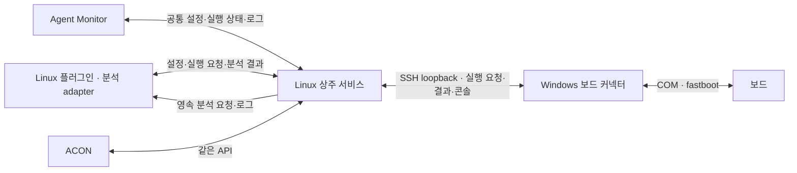

# Agent Monitor 연동·설치 안내

## 설치본 갱신과 재시작

소스 실행은 `./run.sh restart [--port PORT]`, 플러그인의 복사형 배포본은 `python3 apps/agent-monitor/manage.py restart --source PACKAGE [--home HOME] [--port PORT]`를 사용한다. 포트 생략 시 저장된 포트를 사용한다. Git 소스의 UI 빌드 → 새 설치본 준비 → 기존 supervisor에 종료 요청 → 종료 확인 → 새 release 활성화 → READY 확인 순서다. 기존 runtime의 설정·기록을 사용한다.

일반 start는 실행 중인 설치본을 재사용한다. 플러그인은 소스 갱신 적용 시 restart를 호출하고 stdout의 READY/release와 stderr의 설치·종료 진행을 표시한다. 새 설치 실패는 기존 실행을 유지하고 종료 거부는 RESTART_BLOCKED, 45초 내 종료 미확인은 RESTART_PENDING으로 반환한다. 실행·예약이 남은 경우 기존 종료 판정을 따른다. [적용 파일·시험](../porting/PORT-007.md#2026-11-16--설치본-갱신과-재시작).


## 보드 커넥터 미러 · RQ-70/D-75

적용 기준 `c4d7664653a2ae884736e9b9824908f899b771b0`. Agent Monitor는 Windows 보드 커넥터의 상태·설정·로그를 표시하고 공통 API로 명령을 전달한다. Windows 수동 실행과 단일 Worker를 유지한다. 필드·상태·권한은 [미러 계약](../design/BOARD_CONNECTOR_MIRROR.md), 담당별 변경은 [최신 전달 요청](BSP_UPGRADE_PLUGIN_REQUEST.md)을 따른다.

```python
snapshot = client.connector_mirror()
accepted = client.connector_command('putty', {'board_id': 'board-a'},
                                    key='one-operator-intent', snapshot=snapshot)
receipt = client.connector_command_receipt(accepted['command_id'])
```

`QUEUED`는 접수, `APPLIED`는 Windows의 실제 처리 확인이다. HTTP 응답 유실 시 같은 key·원래 snapshot·본문으로 조회/재시도하고, `UNKNOWN` 명령을 새 key로 자동 반복하지 않는다. 설정은 기존 connector-settings CAS 요청 후 `apply-settings`를 사용한다. 새 Manager와 실제 유휴가 확인된 결과 불명 요청만 `acknowledge_unknown_connector_command`로 명시 확인한다.

## 커넥터 화면·PuTTY 입력 후속 · D-74

고정 코드·시험 적용 기준: `bb803c3846a554acc39a9272beb466814429b286`. 아래 RQ-69 변경도 이 기준에 포함하며 과거 커밋은 이력으로 구분한다.

Windows 커넥터의 PuTTY 열기는 입력 제어권 취득과 하나로 합쳐졌다. 보드 콘솔은 독립적인 수신 조회이며 창 종료/실행 실패에 입력 제어권을 반환한다. 서버의 기존 실행/예약/UNKNOWN 배타와 공통 콘솔/오류 API는 유지한다. Linux 플러그인/Agent Monitor에 새 PuTTY 송신 API나 별도 Worker를 추가하지 않는다.

Windows Manager·Host·웹 자산을 같은 버전으로 반영하고 기존 커넥터를 안전 종료한 뒤 시작한다. 관련 코드/선행 조건/복원은 [PORT-009](../porting/PORT-009.md), 시험·독립 리뷰·미검증은 [T-265/266 기록](../testing/runs/20261114-connector-putty.md)을 따른다. 아래 RQ-69 최초 연결/프로파일 절차를 함께 유지한다.


2026-11-15 UI 후속은 입력/상태 API를 바꾸지 않는다. 상태등 행의 설정·전원 조작, 아이콘/목록 요약, 설정 왕복 초안 보존과 시험 중 점멸은 [최종 UI 검증](../testing/runs/20261115-connector-navigation.md)을 따른다.

## 2026-11-14 최초 연결·전체 제어 보완 · RQ-69

이번 후속의 코드·시험 고정 커밋은 `bfb7a21075d2bc7f44f414e087179720cdd3dd5c`다. 아래 과거 고정 커밋에는 포함되지 않는다. [전체 흐름 리뷰](../testing/runs/20261114-plugin-flow-audit.md)와 [현재 검증](../testing/runs/20261114-plugin-flow-implementation.md)을 함께 확인한다.

### 최초 연결 정보 전달

연결 전에는 중앙 설정 API를 사용할 수 없으므로 플러그인이 연결 JSON을 만들고 Windows 실행기에 전달한다. Linux 주소·SSH 계정·포트는 회사 플러그인이 이미 가진 값을 사용한다. Windows에서 접근 가능한 주소를 알아낼 수 없다면 그 값만 최초 한 번 확인한다. Linux `localhost`나 서비스 계정을 Windows 접속값으로 추정하지 않는다.

```python
client.export_connector_bootstrap(
    server=connection_host, account=ssh_account,
    ssh_port=22, remote_dashboard_port=8765,
    path="connector-connection.json",
)
```

Windows 공유 폴더에 위 JSON을 전달한 뒤 기존 실행기를 사용한다.

```bat
board-connector.cmd --import-profile "Z:\project\connector-connection.json"
```

```bat
board-connector.cmd --choose-profile
```

파일 선택 창을 쓸 수도 있다. `--import-only`를 추가하면 설정만 저장한다. 가져오기는 기존 로컬 SSH 키·보드 설정을 보존하며 실행기 화면을 연다. 연결/플래싱/TC를 바로 시작하지 않는다. 기존 Manager가 실행 중이거나 진행·예약·UNKNOWN 기록이 있으면 가져오기를 거부한다. 이미 연결한 서비스와 다른 identity도 덮어쓰지 않는다.

계약 원문은 [connector_bootstrap.py](../../backend/gui_test/core/connector_bootstrap.py)다. `POST /api/v1/gui-test/live/integration/connector-bootstrap`은 명시한 접속 정보에 서버의 runtime/package 식별자를 넣는다. 파일에는 비밀번호·개인 키·명령·TC 경로를 넣지 않는다. 실제 SSH 인증은 Windows의 기존 key/agent를 사용한다. 서비스 식별자는 토큰이 아니며 접속과 이후 요청이 같은 서비스를 가리키는지 확인하는 값이다.

### 새 설치의 준비 순서

1. 설치 관리자로 Linux 서비스를 준비하고 설치 기록의 identity로 `PluginClient`를 만든다.
2. 위 연결 파일을 Windows에서 가져오고 COM 목록에서 보드를 연결한다. 여러 COM·fastboot 장비의 대응은 추정하지 않는다.
3. `settings()`/`save_settings()`로 Linux 허용 폴더·TC root·설치 BAT·timeout을 저장한다. TC 경로는 Windows에 다시 입력하지 않는다.
4. `save_command_profile()`로 회사 공통 TC 호출 인자를 저장하고 `select_profile("commands", ...)`로 revision을 선택한다.
5. `flash_profiles()`에서 Windows의 기존 프로파일·실제 revision을 확인한다. 새 설정은 `save_flash_profile()`로 요청한다. 중앙 PENDING → Windows 안전 적용 → 실제 Host revision 확인 후 `select_profile("flash", ...)`한다.
6. `preview()`와 `preparation()`으로 **해당 설치 BAT·패턴의 고정 TC 목록**을 확인하고 같은 의도의 key로 `start()`한다.
7. `run()`·`events()`·`attempt_log()`·`board_console()`·`connector_errors()`로 진행과 근거를 읽는다. 실패 분석/재실행은 기존 영속 분석 계약을 사용한다.

일반 TC 소스 목록 편집은 `source()` → `inspect_source()` → `apply_source()` → `catalog()`다. 이미지와 함께 수행하는 integration 실행은 중앙의 명시 `tc_root`를 사용하므로, 실행 전 목록은 위 6번 preview 결과를 기준으로 삼는다. 일반 목록을 바꿨다는 이유로 이미 선택한 integration 경로나 수락된 Run을 변경하지 않는다.

프로파일 API prefix는 `/api/v1/gui-test/live/integration/profiles`다. 정확한 입력 모델은 [integration_profiles.py](../../backend/gui_test/core/integration_profiles.py)를 따른다. 생성은 `expected_revision=null`, 덮어쓰기는 현재 revision을 요구한다. flash 프로파일은 이름별 patch로 전달해 무관한 기존 Windows 프로파일을 보존한다. BAT hash·성공/실패 문구·보드 부팅/콘솔 관측 조건은 회사의 실제 정의를 사용한다. 기존 프로파일에 일반 API가 지원하지 않는 고급 필드가 있으면 이름별 경로를 표시하고 덮어쓰기를 거부한다. 기존 revision 선택은 가능하며 변경은 새 이름의 일반 프로파일 또는 기존 로컬 관리 도구를 사용한다. 저장은 장비 명령 실행이 아니다.

| 용도 | 경로·메서드 |
|---|---|
| TC 프로파일 조회·저장·선택 | `GET /commands`, `GET/PUT /commands/{name}`, `POST /commands/{name}/select` |
| TC 호출 검증 | `POST /commands/validate` |
| flash 프로파일 조회·저장·선택 | `GET /flash`, `PUT /flash/{name}`, `POST /flash/{name}/select` |
| Windows fastboot 경로·설정 조회 | `GET /flash/discovery` |
| 유휴 상태의 fastboot 장비 조회 | `POST /flash/discover-devices` |

장비 조회는 `fastboot devices`만 사용하고 시리얼·COM 대응을 자동 확정하지 않는다. `fastboot -w`는 검색 명령으로 사용하지 않는다. 필요한 출력 마커가 정의되지 않은 보드를 준비 완료로 표시하지 않는다.

### 제어·분석·기록

`action(run_id, action, key=..., expected_version=...)`는 pause/resume/cancel/reconcile/transfer-control을 기존 서버 규칙으로 처리한다. 재실행은 분석 결과와 검증 계약을 사용한다. `delete_run(run_id, expected_version)`는 완료·취소·종료·예약/동기화·소유권을 확인한 후 시험 기록까지 영구 삭제한다. `DELETE /integration/runs/{id}`이며 자동 정리와 구분한다.

플러그인은 각 요청에 저장한 runtime/package 식별자를 보낸다. 포트에 다른 서비스가 떠도 서버가 변경 전 거부한다. 커넥터 등록과 콘솔 수신이 모두 최신이어야 새 장비 작업을 시작한다. 콘솔이 오래돼도 기존 작업 조회·취소·복구 요청은 가능하다.

등록 명령 분석기의 `failure-analysis-v1`에는 TC 출력 외에 `integration`의 phase·batch/flash/console·진단·이미지/소스 식별자를 전달한다. 이 부가 근거는 문자열 64 KiB·512노드·깊이8·목록 마지막32개로 제한하며 잘렸으면 `integration_evidence_truncated=true`다. 전체 영속 근거는 해당 Run API에서 읽는다. 민감 문자열을 먼저 마스킹한 뒤 자른다.

### BSP 작업도 같은 플러그인에서 제어

전체 Agent Monitor에는 [BspPluginClient](../../backend/gui_test/standalone/bsp_plugin_client.py)를 사용한다. 이 클래스는 기존 PluginClient를 확장하고 `bsp-control-v1` 범위를 명시한다. `bsp_settings`/`save_bsp_settings`, `jobs`/`start_job`/`job`, `job_action`, `job_events`, `job_reports`, `job_orchestration`을 제공한다. 전체 호스트 health의 capabilities로 지원 여부를 확인한다. GUI Test 단독 서버는 이 범위를 거부한다.

기존 Engine/Worker를 그대로 사용하므로 최초 계획·선행 그룹·배타 수정/빌드·판단·최종 검토 조건이 유지된다. API 제공이 사람의 확인을 자동 승인하는 의미는 아니다. 외부 분석기 보고 필드는 [상태·결과 계약](../design/AGENT_STATUS_CONTRACT.md), 조정 제안은 [오케스트레이터 명세](../design/ORCHESTRATOR_SPEC.md)를 따른다.


2026-11-14 고정 코드·시험 커밋: `475e285cc35765b29470348b581194aa03c47677`. RQ-67/68 구현·문서와 스크립트 정리를 포함한다. 아래 미커밋 표현은 검증 당시 기록이며 현재 적용 기준은 이 커밋이다. [검증·전달 기준](../testing/runs/20261114-agent-monitor-publication.md).


설명: **bsp-os-upgrade**. RQ-67/D-71 · RQ-68/D-72. 현재 소스 기준의 공개 진입점이다. [최신 검증 기록](../testing/runs/20261114-remaining-implementation.md)에서 로컬 시험과 회사 미검증 범위를 구분한다.

## 구성



실제 배정은 기존 Worker 하나가 맡는다. 플러그인과 각 화면은 API 클라이언트다. 화면을 닫아도 서비스와 TC는 종료되지 않는다. 회사 플러그인·ACON 소스는 이 저장소에 없으므로 설치 hook, UI 연결, 분석 호출과 조치 검증 adapter는 회사에서 연결한다.

## 설치·공개 필수 도구 준비

`bash run.sh --port 8765`의 포트 옵션은 일반 하이픈 두 개로 입력한다. 설치 준비는 소스 확인 → Python 가상환경 → 패키지 설치 → 설치 결과 확인 순서로 진행한다. 패키지 설치 중에는 10초마다 경과 시간을 stderr에 표시하고 상세 출력은 설치 home의 `install.log`에 저장한다. 기본 경로는 `~/.local/share/bsp-agent-monitor/install.log`다. 실패하면 단계·종료 코드를, Ctrl+C로 중단하면 중단 안내를 표시한다. 회사 로그는 현지에서 확인한다. [검증 기록](../testing/runs/20261116-monitor-install-progress.md).

플러그인은 명령의 stdout JSON을 결과로 읽고 stderr의 진행 안내를 설치 화면에 전달한다.

배포자는 UI를 미리 빌드한 소스를 전달한다. 사용자의 Linux 설치에는 Node가 필요 없다.

```bash
bash scripts/build-ui.sh
python3 apps/agent-monitor/delivery.py --output /path/to/agent-monitor-source
cd /path/to/agent-monitor-source
bash run.sh --port 8765
python3 apps/agent-monitor/manage.py status
```

`run.sh`는 지원 Python 3.11~3.13을 찾고, 없으면 `scripts/bootstrap-prerequisites.sh`로 배포판의 Python·venv·OpenSSH client를 준비한다. 관리자의 `install`/`start`도 누락된 공개 필수 도구를 검사·준비한다. 정상 설치는 재사용하며 Linux는 apt/dnf/pacman, Windows는 winget과 Windows OpenSSH capability를 사용한다. 관리자 권한이나 회사 저장소 정책으로 설치가 거부되면 해당 단계와 로컬 로그를 반환한다. 임의 저장소·PPA·드라이버 업체를 추정하지 않는다.

Windows 진입점은 `board-connector.cmd`다. 지원 Python이 없으면 PowerShell bootstrap으로 준비한 뒤 계속하며, Python 선택 후 OpenSSH client·Google platform-tools와 고정 Python 패키지를 확인한다. 기본 브라우저 화면에는 Qt를 설치하지 않는다. `--diagnose`는 Python이 없어도 설치를 시작하지 않는다. 공개 도구 설치는 SSH 접속·서비스 시작·TC·장비 명령을 실행하지 않는다.

공개 명령의 근거는 [Microsoft winget install](https://learn.microsoft.com/en-us/windows/package-manager/winget/install), [Windows OpenSSH 설치](https://learn.microsoft.com/en-us/windows-server/administration/openssh/openssh_install_firstuse), [Microsoft 저장소의 Google.PlatformTools 식별자](https://github.com/microsoft/winget-pkgs/blob/master/manifests/g/Google/PlatformTools/35.0.2/Google.PlatformTools.yaml), [Ubuntu python3-venv](https://packages.ubuntu.com/noble/python3-venv)다. 실제 제공 버전은 대상 OS 저장소의 현재 후보를 확인하며 지원 범위를 벗어나면 성공으로 처리하지 않는다.

관리자는 `--home` 아래 `releases/`에 검증한 소스·가상환경을 두고 runtime을 분리한다. 기본 home은 `~/.local/share/bsp-agent-monitor`, 포트는 8766이다. 기존 runtime은 첫 설치/시작에 `--runtime /absolute/existing-runtime`으로 연결한다. `runtime-location.json`에 고정하며 생략하면 재사용하고 다른 경로 요청은 거부한다. `run.sh`와 Linux 설정 마법사는 기존 `.runtime`을 연결한다. 포트 점유·기존 설정·실패 이력을 조용히 바꾸지 않는다.

```bash
python3 apps/agent-monitor/manage.py start --runtime /absolute/existing-runtime --port 8765
python3 apps/agent-monitor/manage.py tools                 # 공개 도구 준비 계획
python3 apps/agent-monitor/manage.py tools --apply         # 실제 공개 도구 준비
```

## 설정을 유지하는 일괄 초기화

```bash
bash run.sh reset
bash run.sh --port 8765
```

첫 명령은 Agent Monitor의 세션·시험 결과·이벤트·예약을 백업 후 비운다. 두 번째 명령은 초기화된 Agent Monitor를 실행한다. 공개 Python 관리 명령은 `python3 apps/agent-monitor/manage.py reset --home <설치 home> --runtime <runtime 절대 경로>`다. root 실행기는 기존 BSP_RUNTIME/저장 경로 선택을 따른다. 필요한 Python은 3.11~3.13이다.

| 데이터 | 초기화 처리 |
|---|---|
| dashboard.db 및 기본 생성되는 demo-dashboard.db | jobs·명령·이벤트·보고·조정·lease·실행 receipt 테이블 비움 |
| GUI Test runs.db | runs·예약·명령·이벤트·outbox 및 준비·실패 분석·삭제·브라우저 세션 기록 비움 |
| connector-registry.db | connector_errors 비움, 등록 정보 유지 |
| 환경·연결 설정 | config, profile/suite/command, 공통 설정·제한시간·저장 정책·TC 소스 설정 보존 |
| runtime의 파일 | JSON 설정·TC snapshot·파일 로그·이미지와 산출물 보존, 전체 백업에 포함 |

초기화 범위는 Linux Agent Monitor runtime의 DB 기록이다. Windows 커넥터의 실행 기록과 외부 TC/이미지 원본은 해당 저장소의 관리 절차를 따른다. 이미지 설치 batch가 연결된 세션은 서비스 실행 중 기존 취소·최종화 API/Worker로 예약 해제를 진행한다. DB를 비우기 전 해제 근거를 확인한다.

실행 중인 관리 서비스는 소유권과 종료 근거를 확인한 뒤 취소 전 백업을 생성한다. 기존 세션 취소 API로 PAUSED/QUEUED 세션의 취소와 이미지 설치 예약 해제를 요청하고 완료를 확인한 뒤 모든 runtime DB의 writer 잠금을 획득한다. 새 실행 claim을 막은 상태에서 실제 실행과 외부 프로세스·Jira 전송·lease 종료를 재확인하고, 실행이 없는 BSP 기록과 이전 GUI Test 저장소의 세션·예약을 별도 DB 백업 후 삭제한다. 이어서 일반 stop으로 종료하고 Worker 잠금 아래 나머지 DB 초기화를 수행한다. live/legacy 경로가 같은 DB를 공유하면 live 경로에서 먼저 처리하고 같은 Run의 중복 취소를 건너뛴다. UNKNOWN, 실행 중 TC/분석, 소유권 불일치, 미지원 DB/계약은 RESET_BLOCKED로 표시한다. 최종 리뷰가 없는 대기·실패·일시정지 BSP 기록도 실제 실행이 없으면 초기화한다. 검사 이후 새 작업이 수락되거나 실행이 확인되면 해당 사유를 전달한다.

백업 위치는 설치 home의 `backups/reset-*`다. SQLite WAL의 확정 데이터를 포함한다. `runtime-reset.json`은 백업 위치와 처리 상태를 기록한다. 종료 전 추가 백업이 생성되면 `pre_stop_archives`에 종료 직전 writer 잠금 안에서 확보한 실행 기록 DB 백업을 누적한다. 해당 백업은 원래 백업 폴더의 `pre-stop-*`에 저장하며 DB 삭제 전에 receipt를 기록한다. 서비스 취소 단계는 RESET_DRAINING, DB 초기화 단계는 RESET_PENDING으로 기록한다. 두 상태에서 start/install/serve는 재개 명령을 안내한다. 같은 `bash run.sh reset`을 다시 실행하면 취소 전 원래 백업을 검증하고 남은 처리를 완료한다. 실행 중 백업은 각 DB의 확정 시점을 기준으로 SQLite snapshot을 생성한다. DB별 처리는 transaction으로 수행한다.

플러그인은 사용자가 선택한 초기화 동작에 명령을 연결하고 성공 JSON의 `state`, `runtime`, `backup`, `pre_stop_archives`, `settings_preserved`를 사용한다. 성공 후 저장한 세션 목록을 갱신한다. 명령 오류는 종료 코드 1과 stderr 안내로 전달한다. [시험 근거](../testing/runs/20261116-runtime-reset.md).

## 기존 runtime 검사·최초 이관·복원

일상 진단은 저장소 루트의 한 명령으로 실행한다.

```bash
bash run.sh doctor
```

`run.sh --port 8765`의 최초 이관 보류 화면에도 같은 요약이 자동 표시된다. 형식·계약 문제, 미해결 항목, 실행 상태, 실제 예약 자원 수, 예약 소유 세션 상태, mock/hardware 실행 방식, 종료 미확인 시도 수를 보여준다. HELD_RESERVATIONS 건수는 이관 조건을 충족하지 못한 예약이 있는 DB의 차단 항목 수다. 실제 예약 자원 수, 예약 유지 이관 가능 자원 수, 보류 사유 코드를 함께 표시한다. 소유 세션 누락은 OWNER_MISSING으로 표시한다. 읽을 수 없는 DB는 예약 상세 확인 불가로 표시한다.

진단은 상태 테이블을 읽고 일반 파일과 전체 테이블의 해시는 생략한다. 작업 이름·경로·토큰·로그 원문을 제외한 요약 JSON을 stdout, 사람용 안내를 stderr로 제공한다. 예약 정리는 해당 세션의 정상 취소·종료 확인 절차를 따른다. 실제 이관의 고정 revision은 아래 `inspect-runtime` 검사에서 얻는다. [검증 기록](../testing/runs/20261116-runtime-doctor.md).

최초 관리 설치에서 PAUSED 세션의 예약이 이관을 막던 경우, `bash run.sh --port 8765`가 소유권·종료 근거·저장 계약을 검사하고 DB와 설정을 백업한 뒤 기존 runtime을 연결한다. 예약 행과 PAUSED 상태는 이관 후에도 유지된다. 서비스 시작 후 재개·취소·분석은 기존 세션 제어로 처리한다.

허용 조건은 예약의 run_id/lease_token 일치, 명시된 mock/hardware 방식, 모든 TC 시도의 terminated=true와 종료 상태다. 시도가 없는 세션도 검사한다. 플래싱은 준비 전 또는 실패 전송 전 상태, 검증된 READY/TESTING 계열 receipt, 종료·미시작이 확인된 FAILED/DONE receipt만 허용한다. 진행 중 취소·최종화·재확인 요청, 소유자 누락·토큰 불일치·종료 근거 누락과 다른 unresolved/live 상태는 화면에 보류 사유를 표시한다. [수정 검증](../testing/runs/20261116-paused-adoption.md).

아래 명령은 전체 revision을 확인하는 오프라인 검사와 명시적 이관·복원 절차다.

```bash
python3 apps/agent-monitor/manage.py inspect-runtime
python3 apps/agent-monitor/manage.py adopt --release RELEASE_SHA256 --inspection-revision INSPECTION_SHA256
python3 apps/agent-monitor/manage.py rollback             # 직전 설치 버전
python3 apps/agent-monitor/manage.py rollback --release VERIFIED_INSTALLED_SHA256
python3 apps/agent-monitor/manage.py cleanup --keep 2      # 정리 계획
python3 apps/agent-monitor/manage.py cleanup --keep 2 --apply
```

`adopt`는 최초 이관에만 사용한다. 설치 manifest·환경과 현재 지원 계약이 검증되고 검사 revision이 같아야 하며, SQLite WAL을 포함한 DB와 설정의 로컬 backup을 만든 후 설치 포인터만 연결한다. UNKNOWN·실행 중·종료 불명 프로세스·검증되지 않은 예약·미지원 계약 또는 기존 Worker 소유권이 있으면 거부한다. 검증된 일시정지 예약은 소유권을 유지하며 이관한다. 상태를 완료로 바꾸거나 실패 기록을 지우지 않으며 이관 자체는 서비스를 시작하지 않는다. 거부된 작업은 그 작업을 수행한 원본 또는 별도로 검증한 호환 실행 코드로 종료 근거를 복구해야 한다.

`rollback`은 설치된 대상의 manifest·가상환경을 다시 검사하며 실행 서비스나 미완료·UNKNOWN·예약이 있으면 활성화를 거부한다. `cleanup`은 현재·직전·이관 및 runtime 기록이 참조하는 release를 보존한다. 미검증 폴더는 삭제하지 않으며 작업이 남아 있으면 정리를 거부한다. backup·로그·상태 DB는 release 정리 대상이 아니다.

## 회사가 제공하는 드라이버·TC 패키지

공개 Python·OpenSSH·platform-tools의 자동 준비와 회사 드라이버/TC 의존성은 구분한다. 회사 패키지 이름이나 공급자를 추정하지 않으며 운영자가 제공한 파일과 신뢰 근거만 사용한다.

Linux 공급 파일은 `agent-monitor-supplied-artifacts-v1` JSON의 `artifacts`에 `path`, `sha256`, `kind`(`driver-deb`, `driver-rpm`, `tc-requirements`)를 기록하고 detached signature와 신뢰 keyring을 제공한다. TC requirements는 모든 버전·SHA256 hash를 고정하고 명시한 offline wheelhouse만 사용한다.

```bash
python3 apps/agent-monitor/manage.py tools --artifact-manifest /approved/supplied.json --artifact-signature /approved/supplied.sig --trusted-keyring /approved/trusted.gpg --wheelhouse /approved/wheels
# 검증·계획 확인 후 같은 명령에 --apply를 추가한다.
```

Windows의 `scripts/bootstrap-prerequisites.ps1`은 `-InstallerPath`, `-ExpectedSha256`, `-PublisherThumbprint`로 서명된 MSI를 받는다. TC 패키지는 `-RequirementsPath`, `-RequirementsSha256`, `-Wheelhouse`, `-TcPython`을 명시한다. `-Plan`은 검증·계획만 수행한다. 설치 명령 성공은 보드 드라이버·회사 TC 실행 인수를 뜻하지 않는다. 실제 OS 패키지 설치·Windows PowerShell/CMD·장비/회사 패키지 인수는 별도 NOT_RUN이다.

## 클라이언트 연결

1. 플러그인 설치 hook에서 관리자의 `start`를 실행한다.
2. 관리자 상태의 관리 인스턴스·release·runtime 일치를 확인한다.
3. `/api/v1/health`의 `runtime_id`, `package_version`을 설치 기록에 저장한다.
4. 이후 `PluginClient` 생성 시 그 값을 `expected_identity`로 전달한다. 응답이 다른 서비스면 새 인스턴스를 추가로 실행하지 않는다.
5. 보드·TC 설정 전에도 health·공통 설정·커넥터 등록을 사용할 수 있다. 보드 준비와 서비스 준비는 별도 상태다.

소스 import는 `backend.gui_test.standalone.plugin_client.PluginClient`다. 기존 GUI Test wheel의 import는 `gui_test`다. 전체 Agent Monitor 전달 폴더는 회사 `backend` 위에 덮어쓰지 말고 독립 설치 경로에 둔다.

```python
from backend.gui_test.standalone.plugin_client import PluginClient

client = PluginClient("http://127.0.0.1:8765", expected_identity=installation_identity)
client.health()
settings = client.settings()
settings["timeouts"]["default_seconds"] = 600
client.save_settings(settings)
```

`installation_identity`는 앞 단계에서 검증·저장한 두 식별자다. 서비스 공유 토큰은 없다. 비브라우저 loopback·SSH/OS 권한 경계를 사용한다. `prepared_token`, batch lease, 브라우저 일회용 session은 연결용 공유 토큰과 다른 용도다.

## 공개 인터페이스

아래 경로의 공통 prefix는 `/api/v1/gui-test/live/integration`이다. 요청 모델·정확한 필드는 [공통 설정 모델](../../backend/gui_test/core/shared_settings.py), [설정 API](../../backend/gui_test/api/shared_control.py), [분석 API](../../backend/gui_test/api/failure_analysis.py)가 원문이다.

| 용도 | API | 공개 클라이언트 |
|---|---|---|
| 공통 설정 조회·CAS 저장 | `GET/PUT /settings` | `settings`, `save_settings` |
| JSON 내보내기·검사·적용 | `GET/POST /settings/file`, `POST /settings/file/validate` | `export_settings`, `import_settings` |
| Linux 허용 폴더 탐색 | `GET /paths` | `paths` |
| Windows 장비 설정 요청 | `PUT /connector-settings` | `save_connector_settings` |
| Windows 적용 근거 | `POST /connector-settings/receipt` | 커넥터가 보고 |
| 설치·TC 실행 | `POST /runs`, `GET /runs/{id}` | `start`, `run` |
| 일시중지·재개·취소 | `POST /runs/{id}/actions/{action}` | `request` |
| 분석 조회·할당·제출 | `GET /analyses`, `POST /analyses/claim`, `POST /analyses/{id}/submit` | `analyses`, `claim_analysis`, `submit_analysis` |
| 상주 분석 상태 | `GET /analyses/runtime` | `analysis_status` |
| 자동 정리 기준·실행 | `GET/PUT /storage-policy`, `POST /storage-cleanup` | `storage_policy`, `save_storage_policy`, `cleanup_snapshots` |
| 조치 후 재분석 | `POST /analyses/{id}/requeue` | `requeue_analysis` |
| 선택 브라우저 화면 | `POST /browser-session` | `browser_access` |

설정은 DB 원본 하나를 사용한다. JSON은 revision이 들어 있는 편집용 교환 파일이다. 오래된 revision은 충돌로 거부하며 최신값을 조용히 덮어쓰지 않는다. timeout은 개별 override → 명시 공통값 → 명시 TC metadata → 600초 순서다. 기존 명시 10초와 이미 수락한 Run은 유지한다.

Windows 설정은 중앙에 저장한 `PENDING`과 실제 Host 시작 설정을 확인한 `APPLIED`를 구분한다. 예약·진행·UNKNOWN이 있으면 적용하지 않는다. SSH 자격은 중앙 장비 설정 payload에 포함하지 않는다. Linux 경로는 서버 선택 창, Windows 로컬 경로는 기존 native 파일 선택 창을 사용한다.

브라우저의 기본 범위는 읽기 전용이다. 설정·제어 화면을 열 때 `browser_access(scopes=["settings", "control"])`로 필요한 범위를 요청한다. 브라우저 변경에는 같은 origin과 session의 CSRF 값을 확인한다. 분석 할당·제출은 플러그인 서비스 전용이다.

## 실행·실패 처리

1. 플러그인이 Linux 설치 BAT와 TC 패턴을 정해 안정적인 멱등 키로 `start`를 요청한다.
2. 서비스가 입력을 고정하고 커넥터에 이미지 전송·플래싱·부팅 확인을 요청한다.
3. 준비가 확인되면 같은 실행 관리자가 TC를 배정한다.
4. 첫 FAIL/ERROR/TIMEOUT/UNKNOWN에 해당 Run의 나머지 TC 배정을 막고 분석 요청을 영속 저장한다.
5. 분석 adapter가 원인·조치·근거·제안 행동을 제출한다. 서버의 신뢰된 검증 adapter가 조치·종료·보드·입력·예약을 확인한다.
6. 검증이 통과하면 실패한 TC의 새 Attempt를 실행한다. 입력 변경은 새 준비와 자식 Run을 거친다. 같은 원인 재발 또는 chain의 자동 재실행 3회 도달 시 중단한다.

외부 플러그인이 직접 소비할 때는 [AnalysisWorker](../../backend/gui_test/standalone/analysis_worker.py)를 재사용한다. `request`와 회사 `analyzer` callback을 주입한다. 분석기 응답을 임의 셸 명령으로 실행하지 않는다. 신뢰된 조치 검증기는 전체/단독 서버 `create_app(..., analysis_verifier=...)`로 연결한다. [AnalysisResult 및 검증 조건](../../backend/gui_test/core/failure_analysis.py)을 그대로 사용하고 [계약 시험](../../backend/gui_test/tests/test_failure_analysis.py)을 함께 가져간다.

기본 상주 Worker는 실패 요청을 소비해 원인과 근거를 정리하고 `HOLD`로 남긴다. 이 기본 진단은 AI 분석이나 조치 완료를 뜻하지 않는다. 등록된 분석·검증 프로그램을 연결하면 같은 Worker가 분석 → 검증 → 재실행을 처리한다. 검증기 부재·조치 미확인은 `HOLD`다. `UNKNOWN`은 Runner의 종료 근거 전 해제하지 않으며 종료 확인만으로 분석 latch를 풀지 않는다.

BSP 모듈의 입력 변경 재실행은 구현되어 있다. 기존 job/module을 유지하고 현재 attempt·계획·소스 기준을 다시 수락한다. 최초 계획, 부트로더 선행 그룹, 자동시험 소유권과 현재 module selection을 검증하고 Attempt 기록까지 같은 guard를 유지한다. 자식 Run은 부모·실패 이력·복구 chain을 이어받는다. 오래된 조건, 취소 또는 근거 부족이면 재실행을 차단한다.

### 분석 프로그램 등록

운영자가 플러그인 분석기와 별도 검증기를 설치한 뒤 실제 절대 경로를 등록한다. 회사 프로그램의 구현과 인증은 회사 접점이다. 브라우저나 분석 결과로 실행 명령을 등록하지 않는다.

```bash
python -m backend.gui_test.standalone.analysis_runtime status --runtime /srv/agent-monitor/runtime
python -m backend.gui_test.standalone.analysis_runtime configure --runtime /srv/agent-monitor/runtime --mode command --analyzer-argv '["/usr/bin/python3","/opt/company/analyze.py","{request_file}"]' --verifier-argv '["/usr/bin/python3","/opt/company/verify.py","{request_file}"]' --expected-revision CURRENT_REVISION
```

설정은 runtime의 `failure-analysis.json`에 저장한다. 실행 파일과 절대 경로 스크립트의 SHA256, 최대 실행시간, 출력 상한을 검사한다. 프로그램은 인자로 받은 JSON 요청 파일을 읽고 stdout에 JSON 객체 하나를 출력한다. 분석 결과 형식은 `AnalysisResult`, 검증 근거는 `FailureAnalysis._verified`가 원문이다. 검증 프로그램은 분석기의 주장을 복사하지 않고 실제 조치·프로세스 종료·현재 보드/입력 근거를 확인해야 한다. 설정이 처리 중 바뀌면 이전 결과를 수락하지 않는다. 오류 시 lease 만료 후 요청을 다시 전달한다.

외부 플러그인이 `AnalysisWorker`로 소비할 때는 `--mode external`로 저장해 내장 소비자를 끈다. 상주 처리 상태는 `client.analysis_status()`로 확인한다. 기본 진단이 이미 HOLD로 처리한 요청은 조치·검증기 연결 후 `requeue_analysis`로 다시 분석한다.

### 저장 공간 자동 정리

기본 기준은 각 호스트에 7일·20 GiB이며 Worker가 주기적으로 관리 캐시만 정리한다. Agent Monitor와 보드 커넥터의 ‘저장 공간 자동 정리’에서 기준을 변경하고 정리 대상을 확인할 수 있다. 같은 기준을 Windows에 전달하며 미연결이면 적용 대기로 남긴다. 실행 기록·로그·실패 근거·진행 작업은 보존한다. 보호 파일 때문에 한도를 넘을 수 있으며 보고서에 표시한다. Windows 재개 가능한 업로드는 정리 대상에서 제외한다.

```python
policy = client.storage_policy()
client.save_storage_policy({
    "expected_revision": policy["revision"],
    "enabled": True, "max_age_seconds": 7 * 86400, "max_bytes": 20 * 1024**3,
})
preview = client.cleanup_snapshots(dry_run=True)
result = client.cleanup_snapshots(dry_run=False)
```

결과의 상위 보고서는 Linux, `connector_cleanup`은 Windows다. 연결 실패·일부 집계·보호 파일로 인한 한도 초과를 성공으로 바꾸지 않는다. JSON 편집은 `export_storage_policy` / `import_storage_policy` 또는 오프라인 `python -m backend.gui_test.core.retention --database EXISTING_GUI_DB export|apply FILE.json`을 사용한다. 실제 DB 경로는 runtime 내 실행 모드별 DB를 확인한다. 오래된 revision은 거부한다.

과거 정책을 저장한 Run은 당시 정책으로 복구한다. 새 Run의 `fail-stop-analysis-v1`을 구버전 Worker로 실행하지 않는다. 최초 계획·선행 그룹·Linux 수정/빌드 배타·최종 검토 게이트는 유지한다.

## 확인과 예외

| 상태 | 처리 |
|---|---|
| 설정 충돌 | 최신 설정을 다시 읽고 변경 부분을 적용 |
| 커넥터 적용 대기 | 진행 작업·예약·UNKNOWN 해소 후 연결 재시작 |
| 분석 HOLD | 원인 조치와 검증 adapter 근거 확인 후 재분석 |
| 같은 원인 재발 | 자동 재실행 중단, 실패 근거와 chain 보존 |
| 포트 점유 | 기존 관리 서비스 상태 확인, 다른 서비스면 포트 명시 |
| 설치/시작 실패 | `--home` 아래 `install.log`, `service.log` 확인 |

현재 코드·시험 변경은 미커밋 작업 트리다. 고정 배포 커밋은 아직 없다. 전달 시 소스 manifest의 파일 해시와 검증 기준을 함께 기록한다. 실제 회사 Linux/Windows 3.13·SSH·보드·분석 모델·ACON 인수는 별도로 수행한다.
