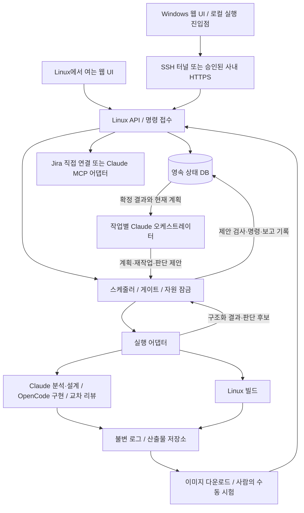

# 시스템 구조와 기술 기준안

상태: React/TypeScript + FastAPI + SQLite WAL + worker를 **1차 로컬 구현에 채택**했다. 이 문서의 확장 구성은 목표 설계이며 실제 서버 설정과 도구 호출 검증은 아직 전이다. 기술 채택은 [결정 기록](../governance/DECISIONS.md)의 ADR-01에 남긴다.

## 목표 구성 — 오케스트레이터 확장 포함

현재 worker/DB/화면을 유지하면서 아래 조정 판단 경로를 추가한다. 오케스트레이터 판단·모듈 보고 v2는 미구현 설계이며 [오케스트레이터 명세](../design/ORCHESTRATOR_SPEC.md)와 [보고 계약](../design/AGENT_STATUS_CONTRACT.md)이 상세 기준이다.

Windows와 Linux 모드는 UI 진입 위치가 다를 뿐 동일한 Linux 작업 관리자를 사용한다. Windows에서 DB 사본을 운영하거나 네트워크 공유 폴더의 SQLite를 동시에 열지 않는다. Windows 로컬 UI 진입점은 같은 화면을 열고 연결을 관리한다. 데스크톱 패키징은 필수가 아니다.

## 초기 기술 구성 제안

| 계층 | 기준안 | 선택 이유 / 제약 |
|---|---|---|
| UI | TypeScript + React | 모듈 표·상세 패널·상태 갱신을 컴포넌트로 분리. 실제 버전은 P0에서 고정 |
| 서버 | Python + FastAPI | Linux 프로세스/파일 어댑터와 명령·조회 API를 한 서비스로 구성 |
| 상태 저장 | SQLite WAL, Linux 로컬 디스크 | 단일 실행 관리자 MVP. 트랜잭션과 유일 제약 사용. 여러 서버 쓰기가 필요하면 별도 ADR로 DB 이전 |
| 실행 | API와 분리된 worker 프로세스, 단일 스케줄러 | 웹 요청 수명과 실행 수명 분리. 서비스 관리 방식은 실제 Linux 환경에 맞춤 |
| 저장소 | DB 메타데이터 + 불변 파일 산출물 | 큰 로그를 DB에 직접 넣지 않고 해시·크기·소유 작업을 기록 |
| 상태 갱신 | 버전 포함 snapshot + SSE, polling 대체 | 재연결 시 snapshot으로 일관성 회복. 실시간 이벤트는 편의이며 DB가 기준 |
| 접속 | 초기 SSH 터널, 필요 시 사내 HTTPS | Linux API는 기본 loopback. 외부 공개 시 인증·TLS·접근 정책 선행 |

기본 스택은 로컬 구현되어 있지만 SSE·실제 서비스 운영·오케스트레이터 등 확장 항목은 별도다. 현재 UI 갱신은 polling이다. 동일 목적이라는 이유로 기존 기술 스택을 교체하지 않는다. Windows 사용 시 터널 단절은 표시하고 서버 프로세스를 종료시키지 않는다.

## 책임 경계

- API: 로컬 접속·출처·입력 검증·명령 중복 방지·조회·결과 등록. 직접 긴 에이전트/빌드 작업을 실행하지 않는다.
- 도메인: 게이트, 상태 전이, 진행률, 결과 유효성. CLI나 UI와 독립된 순수 규칙으로 시험한다.
- 스케줄러: 준비 작업 선별, 잠금 획득, 실행 토큰 발급, 취소/복구. Claude의 제안이 스케줄러 게이트를 덮어쓰지 못한다.
- 오케스트레이터: 작업별 Claude가 저장된 결과를 읽어 계획·실패 원인·다음 행동·사람 판단을 제안한다. 독립 프로세스 배정자가 아니며 직접 DB/소스/Jira를 쓰지 않는다. 현재 연결 확인/질문 기능을 넘어선 판단 호출은 신규 구현 대상이다.
- 에이전트 어댑터: 실제 도구 버전·기능 확인, 실행/조회/중지/재개, 구조화 결과 변환. 미지원 기능은 명시적으로 반환한다.
- 빌드 어댑터: 등록된 빌드 프로필로 실행. 모델이 반환한 임의 셸 문자열을 그대로 실행하지 않는다.
- Jira 어댑터: 내부 검토 ID와 외부 티켓 연결, outbox 재시도, 상태 동기화. 도메인 진행 상태의 소유자가 아니다.
- 파일 저장: 임시 파일에 쓰고 해시 확인 후 원자적으로 등록. DB 등록 실패한 파일은 고아로 분류하고 보존/정리 정책 적용.

## 조정 경로의 저장·실패 경계

내장 CLI 어댑터 또는 기존 wrapper는 결과를 worker에 반환하고 worker가 DB에 저장한 뒤 필요한 이벤트를 조정 큐에 넣는다. 일반 성공 단계 전환과 화면 조회는 LLM을 호출하지 않는다. 조정 큐와 모듈 실행 큐를 분리해 긴 조정 호출이 결과 수집을 막지 않게 한다. 같은 job의 조정 호출은 하나만 실행한다.

새 보고에 판단 후보가 있으면 결과·후보와 blocking 후보의 관련 범위 보류를 함께 저장한다. 참고용 후보는 배정을 막지 않는다. 오케스트레이터가 이를 읽고 제안하되 내부 Decision 생성/중복 검사/Jira 전송 의도는 서버가 처리한다. 조정 실패 동안에도 현재 계획의 독립 작업은 계속되고 후보는 사람이 직접 검토할 수 있다.

새 영속 엔터티·명령의 유일 제약·이전/복원은 [데이터 모델](../design/DATA_MODEL.md)에 따른다. 모듈의 v1/v2 계약과 신규 조정 계약은 별도로 버전 관리하며 외부 wrapper 지원 확인 후 job별로 고정한다. 실제 CLI 옵션·모델 ID·자동 상태 push는 이번 문서에서 구현된 것으로 취급하지 않는다.

## 실행 폴더와 소스 보호

Linux 프로젝트 설정은 원본 old_base, vendor_tree, new_base의 커밋/해시와 실행 작업 사본을 구분한다. 분석은 snapshot만 읽는다. 수정은 실행용 작업 사본에서 수행한다. 사용자 작업 폴더의 미커밋 변경은 시작 시 표시하고 명시적 기준 없이 초기화하지 않는다.

`runtime/<job_id>/` 아래 attempt별 로그·결과·산출물 manifest를 두는 기준안이다. 운영 데이터·DB·자격증명은 Git에 넣지 않는다. `sources/`가 제공되는 환경에서는 읽기 전용 참고자료로 취급한다.

## 실패 경계

API 재시작 후 DB의 미완료 command와 attempt를 조회한다. worker와 외부 프로세스가 살아 있는지 확인한 뒤 연결을 복구한다. 잠금 만료만으로 새 프로세스를 실행하면 중복 수정이 가능하므로 금지한다. 관찰 불가능한 실행은 `UNKNOWN`으로 유지한다.

DB 쓰기 실패 시 다음 작업을 배정하지 않는다. 실행 중인 프로세스는 추적 가능한 상태로 유지하고, 로그/산출물 저장 실패는 성공으로 처리하지 않는다. 디스크 여유·자원 한도·로그 크기는 사전 점검과 운영 알림에 포함한다.

## 확장 경계

초기에는 실행 관리자 하나와 Linux 서버 하나를 대상으로 한다. 분석 동시 수는 설정으로 제한한다. 향후 병렬 수정/빌드는 worktree/container별 자원 키, 산출물 네임스페이스, 병합 충돌 처리, 통합 기준 재검증을 도입한 뒤 활성화한다. 자동 보드팜/Windows 시험은 동일 TestAdapter 인터페이스 뒤에 추가한다.

2026-10-12 D-38: 로컬/SSH 터널 단일 운영자 모드에서는 대시보드 키 없이 바로 진입한다. 네트워크 bind는 127.0.0.1이며 forwarded 헤더를 신뢰하지 않는다. SSH 및 외부 서비스의 인증 정책은 유지한다.

## 구현된 수동 Claude 패키지의 위치

사용자 → 준비된 입력/근거 → Claude 읽기 전용 agent → 제안 JSON → 오프라인 검사 → 사용자 검토 순서다. [수동 패키지](../agents/CLAUDE_ORCHESTRATOR_GUIDE.md)는 worker/DB/API/UI와 연결되지 않는 별도 도구이며 기존 런타임과 저장 스키마를 변경하지 않는다. 자동 이벤트/제안 접수 구성은 O1~O5 목표로 유지한다.

## D-42 현재 내장 실행 경로

React 설정 → Linux API/SQLite에 프로필 저장 → worker가 게이트/공유 잠금 획득 → 내장 Native CLI 또는 명령 어댑터 → v1 결과 검사·DB 저장 → 화면 조회다. 오케스트레이터와 별도 배정기를 만들지 않는다. 프로세스 실행은 브라우저와 독립적이며 API/worker의 계정·PATH를 맞춘다.

native.py가 도구/옵션/로컬 인증 점검, 역할 지침 로딩/고정, CLI envelope·JSONL 변환, 실제 코드 내용 해시·등록 빌드/검증/통합 명령을 담당한다. process.py는 제한 시간·출력 크기·POSIX 프로세스 그룹 종료를 담당한다. bridge.py는 기존 사용자 wrapper와의 라우팅/교차 리뷰를 유지한다. 기본 브리지 스크립트 생성은 하지 않는다.

설정·job JSON에 runner/도구 경로/역할 자료/빌드 명령을 추가하며 DB 테이블 변경은 없다. 실제 프로세스 재접속과 OS snapshot 격리는 아직 없고 UNKNOWN은 재실행하지 않는다. 상세 설정·권한·한계는 [환경 안내](../agents/ENVIRONMENT_AND_BRIDGES.md)를 따른다.
