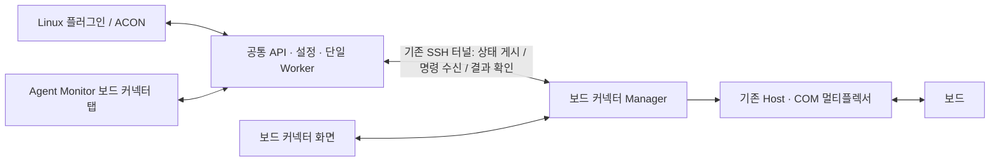

# Agent Monitor의 보드 커넥터 탭

RQ-70 / D-75. Windows에서 사용자가 실행한 보드 커넥터를 Agent Monitor에 표시한다. 화면 영상 전송이 아니라 같은 상태·설정·로그와 명령 결과를 공유한다. Windows 자동 시작 등록이나 별도 TC 실행기는 추가하지 않는다.

## 동작

화면 문구는 설정명·조작명·실제 상태를 중심으로 표시한다. 일반 기능 소개, 공유 구조 설명과 버튼 동작의 반복 설명은 생략하고 미연결 조치·오래된 기록·오류·설정 충돌 안내는 유지한다.

1. 플러그인이 기존 Agent Monitor 서비스를 준비한다.
2. Windows에서 `board-connector.cmd`를 실행하고 연결한다. 최초 접속 정보는 기존 bootstrap JSON을 사용할 수 있다.
3. Agent Monitor에서 **보드 커넥터** 탭을 연다. 보드 수·COM·상태, 보드 콘솔·TC 로그·공통 오류, 경로와 실제 Windows 설정을 확인한다.
4. 보드 설정을 편집해 요청을 저장한다. 저장은 적용 완료가 아니다.
5. **Windows에 설정 적용 요청**을 누르면 Windows가 설정 검증 → 기존 실행/예약/UNKNOWN 확인 → 안전한 연결 종료 → 설정 저장 → 재연결 → Host 설정 확인 순으로 처리한다.
6. **Windows 확인됨**과 적용 근거를 확인한다. TC나 PuTTY가 사용 중이면 기존 설정을 유지하고 사유를 표시한다.

Windows에서 변경한 보드 설정은 다음 연결 상태 게시에 반영된다. 공통 TC·이미지 설정은 기존 `integration/settings`를 양쪽에서 사용한다. SSH 서버·계정·키와 Windows 파일 선택창은 Windows의 최초 연결 설정에 남긴다. Linux 브라우저의 파일 선택 결과를 Windows 경로로 사용하지 않는다. PuTTY 열기는 연결된 Windows PC에 창을 연다.

## 공개 인터페이스

기본 경로는 `/api/v1/gui-test/live/connector/mirror`다. full Agent Monitor와 standalone integration 서비스가 같은 계약을 제공한다. 화면 탭은 full Agent Monitor에 포함한다.

| 요청 | 용도 |
|---|---|
| `GET /mirror` | `schema=connector-mirror-v1`, `fresh`, `inventory`, `console`, 최신 `errors`, `projection`, 최근 `commands`, 공통 `settings` |
| `POST /mirror/state` | Windows 상태 게시. `{projection, registration}`. 등록된 runner·설정/전송 세대와 Manager 세션을 확인한다 |
| `POST /mirror/commands` | `{idempotency_key, runner_id, session_id, revision, action, body}`. 접수 결과는 `QUEUED`다 |
| `GET /mirror/commands/{command_id}` | 명령 상태와 실제 Windows 결과 |
| `POST /mirror/claim` | Windows 전용 `{runner_id, session_id}`. 원자적으로 한 번 claim하며 비공개 claim token을 반환한다 |
| `POST /mirror/commands/{command_id}/receipt` | Windows 전용 `{runner_id, session_id, claim_token, state, result}`. `APPLIED`/`FAILED`; restart 재연결 미확인은 `UNKNOWN` |
| `POST /mirror/commands/{command_id}/abandon` | 명시적 결과 불명 확인. `{runner_id, session_id, expected_updated_at}`. 원래 명령을 재실행하지 않는다 |

`projection`은 Windows의 `session_id`, 공개 프로파일의 SHA-256 `revision`, `profile`, 검색한 `ports`, 상태·오류, 최근 TC 출력·실행 경로·서버 경로·수신 시각을 포함한다. SSH 키·임의 argv·송신 lease·사용자 지정 마스킹 값은 보내지 않는다. TC 로그는 최대 최근 8개 실행의 제한된 tail이며 `logs_truncated`로 잘림을 표시한다. Windows가 UTF-8/ASCII escape를 포함한 전송 본문을 60,000바이트 이하로 줄인다. 전체 로그는 기존 실행 로그 API/Windows 기록에서 확인한다. 오류 화면은 최신 100개를 표시하며 기존 `/connector/errors?after=`의 cursor 계약은 유지한다.

| action | body | 실행 경계 |
|---|---|---|
| `putty` | `{board_id}` | 기존 Manager의 입력 취득·실행·종료 시 반환 |
| `manual` | `{board_id, manual}` | 기존 Host의 배타 제어; TC/예약/UNKNOWN 우회 없음 |
| `restart` | `{}` | 기존 Manager 아래 Host/SSH 안전 종료·재연결; 중앙/현지 실행·예약·UNKNOWN 게이트, same runner/new launch/fresh console 확인 |
| `apply-settings` | `{desired_revision}` | 같은 중앙 설정 요청을 안전하게 재연결해 적용 |

장비 설정 저장은 기존 `PUT /integration/connector-settings`를 사용한다. `expected_revision`은 편집 시작 때의 중앙 설정 버전이다. 미러 화면은 `expected_profile_revision`도 함께 보내며 Windows가 로컬 프로파일 변경 여부를 다시 확인한다. 편집 중 변경된 버전을 자동으로 덧씌우지 않는다. pending 플래싱 설정과 Windows 비공개 observer 설정을 보존한다. `APPLIED` 근거는 실제 Host 설정 해시로 재확인하며 진행 중 TC가 있다는 이유만으로 이미 적용된 설정을 취소하지 않는다.

## 실패·복구

- 등록·콘솔·Manager 상태가 15초보다 오래됐으면 새 명령을 거부한다. 탭을 열어도 장비를 조회하거나 프로세스를 실행하지 않는다.
- 동일 의도의 HTTP 재시도는 같은 key·본문을 사용한다. 같은 key에 다른 내용을 보내면 409다.
- 대기 명령은 60초 뒤 `EXPIRED`, claim된 명령은 60초(설정 적용/연결 재시작 180초) 뒤 결과가 없으면 `UNKNOWN`이다. 자동 재실행하지 않는다.
- Windows는 실행 전 claim 기록, 실행 후 결과를 로컬에 저장한다. SSH 응답이 유실되면 결과만 재전송한다. 이전 Manager의 실제 결과도 원래 claim token으로 확인한다.
- 결과가 계속 불명이면 Windows Manager를 종료 후 다시 실행하고 보드·PuTTY 상태를 확인한다. 새 Manager 세션, 최신 상태, 종료된 실행·예약, 반환된 입력 제어권이 확인된 경우에만 **이전 요청 결과 불명 확인**을 허용한다. 기록은 `ABANDONED`와 결과 불명으로 남는다. 같은 Manager 세션에서는 이 조작을 거부한다. 실제 결과가 뒤늦게 도착하면 그 결과와 확인 이력을 함께 보존한다.
- Windows가 꺼져 있으면 과거 상태만 표시한다. 대시보드가 Windows 앱을 원격으로 설치하거나 시작하지 않는다.

명령 게시·결과 API는 기존 SSH/loopback 경계를 사용한다. Windows 상태/claim/receipt는 non-browser 전용이다. standalone 브라우저는 CSRF와 `settings`(설정 적용) 또는 `control`(PuTTY·입력·결과 불명 확인) 범위가 필요하다. 플러그인은 기존 runtime/package pin을 유지한다. 사용자에게 새 연결 토큰 입력을 요구하지 않는다.

## 데이터·이식

Linux의 기존 `connector-registry.db`에 `manager_projection`, `manager_sessions`, `manager_commands`를 추가한다. Windows의 `runtime/mirror-receipts/`에 미확인 결과를 보관하고 수신 확인된 결과 파일만 지운다. `shared-connector-settings.json`에는 실제 저장한 설정 비교 자료를 추가한다. 이 자료는 Windows 안에 두며 중앙에 복사하지 않는다. 기존 Run·TC DB·단일 Worker는 유지한다.

적용 대상·고정 커밋·검증과 복구는 [PORT-009](../porting/PORT-009.md), 플러그인 요청은 [전달 요청서](../agents/BSP_UPGRADE_PLUGIN_REQUEST.md)를 따른다. 실제 회사 Windows/SSH/보드 인수 T-269는 별도다.

2026-11-18 RQ-74: 플러그인 Git 소유의 전달·설정 공유와 `restart`의 결과 불명·동일 key/snapshot·Manager 생존 경계는 [PORT-011](../porting/PORT-011.md)을 따른다. 재시작은 설정 적용을 자동 수행하지 않으며 Host/SSH 연결만 재기동한다. Manager/SSH가 이미 중지된 경우 원격 요청을 받을 수 없다. 과거 receipt/UNKNOWN·Run/설정 DB를 지우지 않는다.
