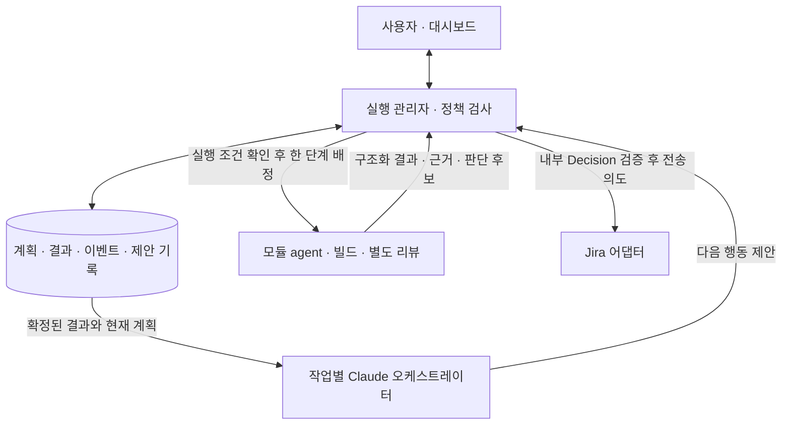

# BSP 오케스트레이터 역할·입출력·운영 명세

기준일: 2026-10-12 · D-39 사용자 확정 방향 · 상세 계약 ADR-06 구현 기준안 · **자동 연동 DESIGNED / NOT_IMPLEMENTED · 수동 Claude 패키지 제공**.

외부 BSP 에이전트 프로젝트의 조정 담당과 대시보드 구현 담당이 함께 읽는 문서다. 작업별 Claude 오케스트레이터 1개가 결과를 종합하고 다음 행동을 제안한다. 기존 실행 관리자(worker)는 실제 배정·상태 저장·게이트를 소유한다. 수동으로 사용하는 실제 agent와 오프라인 검증 도구는 [사용 안내](../agents/CLAUDE_ORCHESTRATOR_GUIDE.md)에 있다. 자동 실행·DB 접수 경로는 아래 목표 설계이며 이 패키지로 활성화되지 않는다.

## 1. 목적과 현재 구현의 차이

| 구분 | 현재 구현 | 이번에 정의한 목표 |
|---|---|---|
| 조정 세션 | `coordinate`로 연결/복구 결과를 기록 | 작업별 논리 오케스트레이터를 유지하고 저장된 상태로 판단 호출 재개 |
| 질문 | `question`의 읽기 전용 응답 | 기존 질문 경로 유지. 작업 변경은 아래 제안·검증 경로로 접수 |
| 계획·결과 종합 | 설정의 모듈 목록과 고정 단계 실행 | 모듈 분석 종합, 계획 변경안, 누락·의존성·검증 범위 제안 |
| 실패 처리 | 결과 기록, 정책 기반 도구 선택, 사용자 재시도 | 이전 시도와 원인을 비교하여 재작업·도구 전환·사람 판단 제안 |
| 결과 수집 | wrapper 종료 시 JSON 1개 | 같은 수집 경로를 유지하고 구조화 보고 v2를 추가 |
| 상태와 진행률 | 서버 계산 | 그대로 서버 소유. 오케스트레이터의 문장·추정치로 덮어쓰지 않음 |

현재 `coordinate`는 세션 연결 확인이며 아래 `orchestrate` 판단 호출이 아니다. 새 stage나 v2 결과를 현재 서버에 보내면 지원되는 것으로 간주하지 않는다. 모듈 보고 필드의 단일 기준은 [AGENT_STATUS_CONTRACT.md](AGENT_STATUS_CONTRACT.md)다.

## 2. 책임과 권한

| 주체 | 책임 | 권한 경계 |
|---|---|---|
| 오케스트레이터 | 요구사항·벤더 변경 분석을 모아 계획 작성, 결과 누락/불일치 확인, 실패 원인과 다음 행동 제안, 사람 판단 후보 정리, 통합·최종 검토 자료 요약 | 구조화된 제안만 반환. 직접 BSP 수정·빌드·하위 agent 실행·DB 상태 수정·Jira 전송 금지 |
| 실행 관리자 | 현재 계획/선행/판단/잠금 확인, 유일한 작업 배정, 프로세스 관리, 결과 검증·영속화, 재시도·중복/역순 제어, 집계 | 제안을 정책과 현재 상태에 대조하여 적용/보류/거부. 모델이 제안한 임의 셸 명령 실행 금지 |
| 모듈 역할 agent | 배정된 한 단계 실행, 실제 소스·산출물·검증·실패·판단 필요 데이터를 보고 | 다른 모듈 배정/완료 처리, 선행 게이트 우회, 자체 자동 재시도 및 직접 Jira 전송 금지 |
| 리뷰 agent | 구현과 별도 세션에서 정확한 revision/diff 검토 | 조정자가 한 종합 검토로 필수 코드 리뷰를 대체할 수 없음 |
| Jira 어댑터 | 내부 Decision을 사내 Jira에 연결하고 동기화 | 오케스트레이터가 Jira 외부 ID를 만들거나 전송 경로를 중복 운영하지 않음 |
| 사람 | 최초 계획 확인, 새 판단 결정, 필수 장비시험 PASS/FAIL, 최종 검토 | 정상적인 승인 범위 내 단계마다 재승인을 요구하지 않음 |

실제 프로세스 배정자는 기존 worker 하나다. 외부 프로젝트에 자체 오케스트레이터가 있다면 이 역할로 연결하되, 대시보드와 외부 조정자가 동시에 하위 agent를 시작하는 구성은 금지한다. OpenCode 기본 구현 → 반복 실패/난항 시 Claude Opus → 작성자별 별도 리뷰 정책은 유지한다. 조정에 Claude를 썼다는 이유만으로 구현 작성자를 Claude로 바꾸지 않는다.

## 3. 결과와 명령의 흐름



모듈 agent는 오케스트레이터 대화창에만 결과를 남기지 않는다. 내장 CLI 어댑터 또는 기존 wrapper → worker → DB 순서로 먼저 저장하고, 오케스트레이터와 화면은 같은 기록을 읽는다. 오케스트레이터가 중단되어도 결과 수집·기존 승인 작업·독립 모듈 진행은 계속된다. 새 판단에 의존하는 작업만 보류한다.

## 4. 호출 시점과 실행 순서

| trigger type | 호출 목적 | 기다려야 하는 범위 |
|---|---|---|
| `JOB_STARTED` | 요구사항·초기 모듈 범위·확인할 정보 정리 | 초기 설정 모듈의 분석은 선행 그룹 완료를 기다리지 않음 |
| `ANALYSIS_SET_COMPLETED` | 현재 계획의 필수 분석을 종합하고 최초 확인할 계획 작성 | 전체 필수 분석이 유효해야 최초 계획 확인 가능 |
| `ATTEMPT_FAILED` | 원인 분류, 이전 수정과 차이, 재시도/전환 제안 | 실패 단계와 그 의존 작업. 독립 작업은 계속 |
| `DECISION_REQUESTED` | 모듈이 보고한 새 판단의 선택지·영향·권장안 정리 | 보고된 영향 범위를 서버가 검증하여 보류 |
| `PLAN_OR_SOURCE_CHANGED` | 오래된 결과·리뷰·계획 재평가 | 영향받는 신규 배정 및 결과의 현재 유효성 |
| `DEPENDENCY_CHANGED` | 선행 무효화·의존 관계 변화 검토 | 관련 의존 작업 |
| `DECISION_UPDATED` | 사람이 내린 결정과 구현/재검증 필요 사항 정리 | 결정 기록만으로 해제하지 않음. 반영·검증 조건 별도 |
| `INTEGRATION_FINISHED` | 통합 결과·미반영 벤더 변경·최종 검토 자료 종합 | 최종 사람 검토는 남겨 둠 |
| `USER_REPLAN_REQUESTED` | 명시된 대상과 범위에서 계획 재검토 | 현재 승인 범위를 넘어서는 부분만 새 판단 |

일반 단계 성공, heartbeat, 화면 새로고침마다 LLM을 호출하지 않는다. 정상 단계 전환은 저장된 계획에 따라 worker가 처리한다. `JOB_STARTED`와 `ANALYSIS_SET_COMPLETED`는 계획 버전별로 중복 접수하지 않는다. 나머지 트리거도 영속 event ID로 중복 방지한다.

호출 순서는 **트리거 저장 → 현재 snapshot과 근거 고정 → 조정 호출 → 응답 검증·제안 저장 → 현재 상태 재검사 → 허용된 제안 적용**이다. job 하나에 동시에 실행되는 판단 호출은 최대 1개다. 실행 중 들어온 추가 이벤트는 큐에 보존하고 다음 호출에서 합칠 수 있다. 응답이 오기 전에 새 이벤트를 처리한 것으로 표시하지 않는다.

## 5. 오케스트레이터에 보내는 입력 — 신규 계약

이 절의 `message_type: "orchestration_request"`, `schema_version: 1`, `stage: "orchestrate"`는 **대시보드 수신·발신 코드가 아직 없는 별도 계약**이다. 모듈의 schema_version과 독립적으로 관리한다. 전송은 기존 wrapper 방식(요청 stdin, 종료 JSON stdout)을 확장하며 실제 CLI 호출 방식은 추정하지 않는다.

| 필드 | 형식·필수 조건 | 의미 |
|---|---|---|
| `schema_version`, `message_type`, `stage` | `1`, `orchestration_request`, `orchestrate` | 계약 구분 |
| `job_id`, `orchestration_run_id`, `session_id` | 필수 문자열 | 작업·이번 판단 호출·논리 조정 세션. 모듈 attempt ID와 별개 |
| `trigger_ids`, `trigger_types` | 비어 있지 않은 문자열 배열 | 서버가 저장한 원인 이벤트와 위 trigger type |
| `base_state_version`, `plan_version`, `fingerprint` | 정수, 정수, 문자열 | 제안의 기준 snapshot. 결과에 그대로 반환 |
| `snapshot` | 필수 객체 | 현재 승인 계획, 모듈/의존/필수 작업, 결과 요약, 판단·적용 상태, 실행 중/UNKNOWN 작업, 잠금·중지 정보 |
| `result_refs` | 배열, 없으면 빈 배열 | 서버가 보관한 `{report_id, sha256}`. 무효/실패/과거 결과도 상태를 붙여 구분 |
| `constraints` | 필수 객체 | 실행 게이트, 도구 선택, 허용 제안 종류, 읽기 가능한 근거, 승인 범위, 재시도/호출 한도 |
| `request` | 문자열 또는 null | 사용자 재계획 요청의 원문. 지시 권한을 확대하지 않음 |

`snapshot`은 저장된 사실을 사용한다. stderr나 과거 대화만 보고 현재 상태를 복구하지 않는다. 큰 로그는 허용된 읽기 도구로 필요한 부분만 조회하도록 참조하고, 도구가 없으면 부족한 근거를 명시한다. 비밀 값·실행 토큰·인증 환경 원문은 입력에서 제외한다. 새 세션에도 이 snapshot과 기존 제안/적용 결과를 전달한다.

## 6. 오케스트레이터가 반환하는 출력 — 신규 계약

| 필드 | 규칙 |
|---|---|
| `schema_version`, `message_type` | `1`, `orchestration_result` |
| `job_id`, `orchestration_run_id`, `session_id` | 받은 값 그대로. 실패도 동일 |
| `trigger_ids` | 해당 호출의 ID 배열 그대로 |
| `base_state_version`, `plan_version`, `fingerprint` | 받은 기준 그대로 |
| `outcome` | `SUCCEEDED` 또는 `FAILED`. 조정 호출의 성공이며 BSP 완료가 아님 |
| `summary` | 필수 문자열. 확인한 사실, 부족한 정보, 제안 이유 |
| `result_refs` | 판단에 사용한 입력 근거의 부분집합. ID와 해시 일치 |
| `proposals` | 배열. 추가 행동이 없거나 호출 실패이면 빈 배열 |
| `error_class` | 실패 시 필수. `ENVIRONMENT`, `CONTRACT`, `INSUFFICIENT_EVIDENCE` 중 하나 |

개별 proposal은 다음 공통 필드를 갖는다.

| 필드 | 규칙 |
|---|---|
| `proposal_key` | 호출 내 유일 문자열. 재전송 시 동일 값·동일 내용 |
| `kind` | 아래 허용 종류 하나 |
| `target` | `{module_ids, stage}`. module_ids는 기존 ID 배열, stage는 대상 단계 또는 null |
| `reason` | 근거 있는 제안 사유 |
| `evidence_refs` | 입력 result_refs에서 선택한 `{report_id, sha256}` 배열 |
| `data` | 종류별 구조화 데이터. 셸 문자열·임의 API 호출·DB patch 금지 |

| `kind` | `data` 필수 내용 | 적용 조건 |
|---|---|---|
| `PLAN_CHANGE` | `base_plan_version`, `changes` 배열: 작업 내용·의존/그룹·완료 조건의 변경 전후와 이유 | 최초 계획은 사람 확인. 이후 새 범위·그룹·필수 시험 제외·모호한 의존성은 새 판단. 기존 ID 보존 |
| `RETRY` | `previous_attempt_id`, `cause_key`, `changed_approach` | 이전 프로세스 종료 확인, 동일한 현재 대상, 게이트/한도 충족. 자동 재시도 설정이 없으면 사용자 선택 대기 |
| `TOOL_ESCALATION` | `previous_attempt_id`, `cause_key`, `requested_tool: claude`, `model_policy: opus`, 난항/반복 근거 | 실제 코드 FIX 이력 또는 검증 가능한 난항 근거를 서버가 검사. 모델의 자체 선언으로 횟수 변경 금지 |
| `DECISION` | `candidate_ids`, `question`, `options`, `recommendation`, `affected_stages`, `blocking` | 기존 Decision 검색·영향 검증 후 내부 판단 생성/연결. 답을 대신 확정하지 않음 |
| `VERIFICATION_PLAN` | 대상 `source_revision`, 이미지 참조, 필수 `cases`, 실행 방법·기대 결과 | 테스트 계획 변경 규칙 적용. 사례 제외는 승인 근거 필요. 장비 결과를 자동 생성하지 않음 |

`PLAN_CHANGE.changes`의 각 항목은 `{operation, module_id, new_module_key, before, after, reason}`이다. operation은 `add/update/deactivate`; 기존 항목은 module_id, 새 모듈은 호출 내 안정적인 new_module_key를 사용하고 실제 ID는 서버가 부여한다. scope 변경을 표시 이름 수정으로 위장하지 않는다. 상세 DAG·사례의 스키마는 구현 단계에서 별도 JSON Schema로 고정하며 그 전 자동 적용하지 않는다.

예시 ID·해시는 설명용이다. 기존 결과를 읽고 재작업을 제안하는 예시:

```json
{
  "schema_version": 1,
  "message_type": "orchestration_result",
  "job_id": "job-example",
  "orchestration_run_id": "orchestration-run-example",
  "session_id": "coordinator-session-example",
  "trigger_ids": ["event-code-failed-example"],
  "base_state_version": 42,
  "plan_version": 2,
  "fingerprint": "copy-the-request-fingerprint",
  "outcome": "SUCCEEDED",
  "summary": "Ethernet 수정 실패는 RX ring API 차이 때문이다. 기존 변경을 보존하고 반환형 처리만 수정하는 재작업을 제안한다. Display 분석 결과에는 영향이 없다.",
  "result_refs": [{"report_id": "report-code-example", "sha256": "0123456789abcdef0123456789abcdef0123456789abcdef0123456789abcdef"}],
  "proposals": [
    {
      "proposal_key": "retry-ethernet-rx-ring",
      "kind": "RETRY",
      "target": {"module_ids": ["module-ethernet-example"], "stage": "code"},
      "reason": "실패 보고서와 현재 diff에서 수정 범위를 확인했다.",
      "evidence_refs": [{"report_id": "report-code-example", "sha256": "0123456789abcdef0123456789abcdef0123456789abcdef0123456789abcdef"}],
      "data": {
        "previous_attempt_id": "attempt-code-example",
        "cause_key": "ethernet.rx-ring.api-mismatch",
        "changed_approach": "현재 diff를 유지하고 신규 API 반환형 처리 변경 후 같은 컴파일 사례 재검증"
      }
    }
  ]
}
```

조정 응답의 성공/프로세스 exit 0은 proposal 적용을 뜻하지 않는다. 응답을 저장한 다음 서버가 각각 판정한다. 모델이 반환한 `approved`, `completed`, `percent` 등 임의 필드로 승인·완료·집계를 변경하지 않는다.

## 7. 제안 적용, 중복 방지, 재계획

1. 조정 응답 전체의 형식·호출 ID·기준·근거 소유 범위를 검사한다. 알 수 없는 kind나 누락 필드는 해당 응답을 CONTRACT 실패로 기록하고 부작용을 만들지 않는다.
2. `(job_id, orchestration_run_id, proposal_key)`를 유일하게 저장한다. 같은 키·같은 내용은 기존 접수 결과, 다른 내용은 충돌이다. 적용 명령 ID도 이 키에서 고정하여 재시작 시 새 명령을 만들지 않는다.
3. `base_state_version/plan_version/fingerprint`가 현재와 다르면 제안을 `STALE`로 보존하고 적용하지 않는다. 새 근거로 새 호출을 만든다. 표시용 요약도 “이전 기준”으로 구분한다.
4. 여러 proposal은 **한 응답을 통째로 원자 적용하지 않는다.** 각각 최신 상태에서 검사하고 결과를 기록한다. 앞선 제안 적용이나 다른 작업으로 실행 상태 버전이 바뀌면 같은 응답의 나머지도 STALE 처리해 재평가한다. 첫 구현은 이 보수적인 기준을 적용한다. 앞선 제안 성공을 뒤 제안 성공으로 간주하지 않는다.
5. 서버는 대상 ID·의존·승인 범위·중지·UNKNOWN·잠금·도구 정책·재시도 한도를 확인한다. 결과는 `APPLIED / WAITING_USER / BLOCKED / REJECTED / STALE`로 기록한다. 접수는 `RECORDED`다. `APPLIED`는 계획/명령 접수를 뜻하며 실제 agent 성공과 다르다.
6. 정상 순서의 다음 단계는 기존 worker가 배정한다. 모델 응답 하나당 별도 스케줄러를 만들지 않는다. 동일 plan의 동일 필수 작업은 중복 추가하지 않는다.

순수 조정 큐·응답·제안 감사 기록의 저장은 job 실행 상태 버전을 올리지 않는다. 실제 계획/명령/모듈 상태 변경만 해당 버전에 반영하여 자기 응답을 저장한 것만으로 STALE이 되지 않게 한다. 새 호출의 재계획 한도는 원래 트리거 묶음에 귀속하여 호출 ID를 바꿔 한도를 초기화하지 않는다.

계획 최초 확인은 전체 분석 후 한 번 받는다. 확인된 범위의 통상 단계 진행은 반복 승인 없이 계속한다. 자동 재시도는 별도 운영 설정에 허용된 범위에서만 가능하며, 기본은 기존 실패 재시도 버튼을 유지한다. 오케스트레이터 도입 자체가 무제한 자동 수정·재시도 허가가 아니다.

## 8. 사람 판단과 Jira

모듈 보고의 `decision_requests`는 서버가 **결과와 같은 트랜잭션에서 DecisionCandidate로 저장하고, `blocking: true`인 후보의 영향 범위 보류도 함께 기록**한다. 참고용 `blocking: false` 후보는 작업을 보류하지 않는다. 오케스트레이터 호출 완료를 기다리는 사이 의존 작업이 시작되지 않게 한다. 후보 자체는 사람이 결정한 답이 아니다.

- 서버는 대상 모듈/단계·의존 관계를 검증한다. 기본 보류는 해당 모듈의 보고된 단계와 확인된 의존 작업이다. 영향 범위를 알 수 없으면 해당 범위를 보류하고 운영 확인을 요청하며 전체 작업을 임의로 완료시키거나 중단하지 않는다.
- 오케스트레이터는 질문·선택지·영향·권장안을 정리해 DECISION 제안으로 반환한다. 일반 환경 오류·코드 수정 실패·리뷰 지적은 그 자체로 새 Jira가 아니다.
- 검증된 새 판단은 서버가 기존 후보/Decision과 연결하거나 내부 Decision을 만들고, 설정된 Jira 어댑터에 전송 의도를 저장한다. 이 자동 접수 경로는 미구현이며 현재는 사용자가 화면에 판단을 등록한다.
- 같은 원인의 후보 키·기존 Decision·영향 범위를 확인하여 반복 실패마다 Jira를 새로 만들지 않는다. 원격 응답 유실 시 기존 티켓 검색 정책을 유지한다.
- 후보가 새 판단이 아닌 일반 실패로 분류되면 summary에 분류 근거와 운영 검토 요청을 남긴다. 자동 보류 해제 proposal 종류는 제공하지 않는다. 사람 확인 또는 이미 확정된 서버 규칙으로만 해제한다. LLM의 “해결됨” 문장만으로 해제하지 않는다.
- 오케스트레이터 장애 중에도 후보와 보류는 남고 사용자가 직접 검토할 수 있다. Jira 장애와 독립 모듈 진행을 분리한다. Jira Done/사람의 결정 기록 뒤에도 실제 반영·검증 조건이 충족되어야 해제한다.

## 9. 세션·장애·실행 비용

작업당 논리 오케스트레이터 하나와 호출 이력 여러 개를 관리한다. Claude 프로세스가 항상 떠 있어야 하는 것은 아니다. 동일 세션을 변경하는 질문·조정 호출은 직렬화한다. 모듈 분석/구현/리뷰 세션은 조정 세션과 분리한다.

재시작 시 DB의 트리거·호출·제안·명령 접수 결과를 먼저 조회한다. 이전 조정 프로세스 상태를 확인할 수 없으면 `UNKNOWN`으로 두고 동시 재호출하지 않는다. CLI 재개가 불가능하면 이전 종료 확인 후 새 외부 세션을 연결하고 영속 snapshot으로 복구한다. 모듈 writer가 UNKNOWN이면 조정 세션 복구와 무관하게 재실행 금지다.

향후 설정 기준안(현재 설정 파일에 추가하면 안 됨):

| 설정 | 초기 기준안 | 동작 |
|---|---|---|
| `orchestration.enabled` | false | 구현·wrapper capability 확인 후 새 작업에 켬 |
| `orchestration.timeout_seconds` | 120 | 시간 초과한 조정 호출만 실패. 기존 coordinate/question의 60초와 별개 |
| `orchestration.max_runs_per_job` | 20 | 초과 시 새 판단 호출 보류·사용자 표시. 모듈 수에 맞게 운영 설정 가능 |
| `orchestration.max_stale_replans` | 트리거 묶음당 2 | 상태 경합으로 무한 호출하지 않음. 초과 시 최신 기준 재검토 필요 표시 |
| `orchestration.auto_retry_limit` | 0 | 모듈/단계별 자동 재시도 허용 횟수. 0이면 제안 후 사용자 선택 대기 |

이 수치는 사용자 확정 성능/비용 한도가 아닌 구현 기본값 제안이다. 오케스트레이터 한도와 모듈 구현의 Opus 전환·전체 실행 한도를 별도로 관리한다. 새 설정을 저장해도 기존 job의 고정 프로필을 조용히 바꾸지 않는다.

조정 호출의 연결 실패·JSON 오류·시간 초과는 해당 호출 실패로 남긴다. 모듈 결과를 FAILED로 덮어쓰거나 기존 PASS를 취소하지 않는다. 이미 승인된 독립 작업은 계속하고, 조정 결과가 꼭 필요한 새 계획/판단 범위만 대기한다. 자료의 지시 문구는 분석 대상이며 오케스트레이터 권한을 바꾸는 명령이 아니다.

## 10. 완료 기준과 구현 인계

- 요구사항: RQ-30~34. 시험: T-71~85. 현재 신규 제품 시험은 모두 NOT_RUN.
- [구현 계획](../implementation/IMPLEMENTATION_PLAN.md)의 O1~O5 순서로 기존 코드에 추가한다. 대시보드 연동은 후속 구현이며 수동 호출 패키지는 별도 M0으로 제공한다.
- 모듈 보고 v1은 그대로 유지한다. v2 지원을 협의한 wrapper와 서버만 새 데이터로 연결하고, v1 결과의 없는 세부 정보를 모델로 만들어 채우지 않는다.
- 승인·선행·공유 잠금·사람 시험·최종 검토·교차 리뷰가 오케스트레이터 응답으로 우회되지 않는 시험이 필수다.
- 대시보드·외부 wrapper·DB 이전/복구를 함께 검증하고 기존 시험 이력과 기준 버전을 보존한다.
- 새 역할 검토는 실제 Claude 검토 결과가 있을 때만 APPROVED로 기록한다. 현재 독립 검토·실제 Linux/CLI/Jira 연결은 미검증이다.

## 11. 제공된 수동 호출 패키지

D-40에 따라 `.claude/agents/bsp-upgrade-orchestrator.md`와 오프라인 검사·내보내기 도구를 제공한다. `claude-manual-v1`은 위 최상위 계약을 유지하고 snapshot/constraints 및 proposal.data의 보수적인 수동 부분집합만 구체화한다. 정의는 [사용 안내](../agents/CLAUDE_ORCHESTRATOR_GUIDE.md)에서 관리한다. 결과는 항상 검토용이며 서버 접수/중복 방지/재시도/게이트 적용을 수행하지 않는다. 파일 ID·해시·상관관계 검사는 가능하지만 자료 진실성/모델 판단 품질은 실제 Claude 인수로 확인해야 한다. 별도 T-86~91로 추적하며 T-71~85의 대체가 아니다.


## D-42 적용 범위

현재 coordinate/question/모듈 v1을 내장 CLI에 연결했으며 사용자 wrapper는 기본 요구가 아니다. 기존 bridge 호환과 수동 Claude 패키지는 유지한다. 이 연결 변경은 위 신규 orchestrate 트리거/제안/자동 적용 계약을 구현하지 않는다. 설치/역할 지침/비대화형 실행·상태 불명 처리 기준은 [환경 안내](../agents/ENVIRONMENT_AND_BRIDGES.md)를 따른다.
