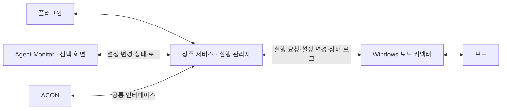

# Agent Monitor · 플러그인 중심 인터페이스 설계

> 2026-11-14 구현 후속: F01~F11의 공통 로컬 기능은 [공개 API/운영 안내](../agents/PLUGIN_CONTROL_API.md)에 구현 계약을 정리했다. 아래 협의 이력의 미확정/예정 표현보다 RQ-67/D-71 및 RQ-68/D-72의 확정·구현 기록을 우선한다. 실제 회사 분석·ACON·장비 인수는 별도다. [현재 검증](../testing/runs/20261114-remaining-implementation.md).

설명: **bsp-os-upgrade**. 작성일: 2026-11-14.

상태: **요구사항·코드 리뷰 APPROVED · 로컬 구현/모의 검증 완료**. 기준 `e4f53ca1ec288feb3eb1b9ccff8335a398ad321c` 위 미커밋 작업 트리. 아래 기능별 협의 내용은 당시 조사·결정 이력이다. 최신 채택 기준은 마지막 절, 구현된 공개 진입점과 제한은 [연동 안내](../agents/PLUGIN_CONTROL_API.md), 시험은 [구현 기록](../testing/runs/20261114-plugin-centric-implementation.md)을 따른다.

## 사용자가 확정한 방향

- 제품명은 **Agent Monitor**, 설명은 **bsp-os-upgrade**다. 기존 문서에서 이 저장소 제품을 가리키는 대시보드는 Agent Monitor 화면을 뜻한다. 회사의 별도 대시보드 명칭을 바꾸는 것은 아니다. 기존 저장소·API 경로·플러그인 패키지 이름을 이 결정만으로 바꾸지 않는다.
- 연결·설정·TC 실행의 운영 기준을 플러그인으로 옮긴다.
- Agent Monitor 없이 플러그인과 Windows 보드 커넥터로 사용한다.
- 플러그인을 중심으로 Agent Monitor·ACON·보드 커넥터가 상호 연동한다. 같은 설정·보드 상태·플래싱/TC 진행·로그를 공유하며 보드 커넥터에서도 설정을 변경할 수 있어야 한다. 별도 실행 관리자나 별도 설정 원본을 만들지 않는다. 각 화면의 세부 조작 범위는 인터페이스에서 정한다.
- 이미지 선택·검증·전송 → fastboot 진입 → 설치 BAT 실행·재부팅 → 부팅 확인 → TC 실행 흐름을 확정한다. 플러그인 중심으로 단계마다 사람 개입 없이 진행한다. 실패 시 후속 실행을 차단하고 플러그인 분석으로 넘긴다.
- 이 논의에서 재시작은 **TC 재실행**이다. 서비스 재기동이나 보드 재부팅을 뜻하지 않는다. 실패한 TC를 무조건 자동 재실행한다는 결정도 아니다.
- 사용자는 설치만 수행하고 이후 개입을 최소화한다. 필요한 구성 요소·서비스·의존성은 설치 과정에서 함께 준비하며 별도 수동 설치 명령을 기본 절차로 요구하지 않는다.
- 플러그인 대화/창을 닫아도 진행 중인 TC는 계속 수행한다.
- TC 실행 제한시간은 개별 TC당 기본 600초이며 플러그인·Agent Monitor·설정 파일에서 수정할 수 있어야 한다. 이는 TC 목록 읽기나 SSH 요청 제한시간이 아니다.
- TC 하나가 실패하면 나머지 TC를 수행하지 않고 플러그인에서 실패를 분석한다. 단순히 보드 상태를 확인한 뒤 사용자가 재실행하는 흐름으로 대체하지 않는다.
- 플러그인 담당자가 제공 코드를 복사해 재사용할 수 있어야 한다. 기능을 문서만 보고 다시 구현하도록 넘기지 않는다. 필요한 소스·의존성·설정 예제·시험을 함께 제공하고 회사 연결부만 조정한다.
- 기능별 절차 → 사용자 확인 → 인터페이스 → 사용자 확인 순으로 문서를 갱신한다. 최초에는 설계만 요청했으며, 2026-11-14 후속으로 리뷰 종료 후 즉시 구현을 승인했다.

## 역할 구분 제안

플러그인은 사용자 요청과 운영 설정의 기준이다. 실제 프로세스 배정·진행 상태·결과는 상주 서비스가 기록한다. 플러그인 대화나 Agent Monitor 창을 닫아도 실행 기록과 작업 소유권을 잃지 않는 구조를 제안한다. 보드 커넥터는 Windows 장비 작업을 수행하고 근거를 보고하며, GUI에서 공통 설정 변경을 요청한다. 어느 화면에서 요청하든 플러그인 중심의 공통 제어 절차와 같은 실행 관리자를 거친다. 화면끼리 직접 명령을 중계하거나 각각 실행을 배정하지 않는다.

ACON은 기존 [다이어그램 설계](WORKFLOW_DIAGRAM.md)의 회사 FrontEnd를 기준으로 연결 대상으로 포함한다. 회사 ACON API·설정 변경 접점·상태 제공 방식은 아직 확인되지 않았으며, 이 문서는 실제 ACON 연결 완료를 뜻하지 않는다.

기존 [오케스트레이터 명세](ORCHESTRATOR_SPEC.md)와 [상태 보고 계약](AGENT_STATUS_CONTRACT.md)의 단일 실행 배정·구조화 결과 기준은 유지한다. 현재 v1/opt-in v2 계약을 이번 문서만으로 변경하지 않는다. 공유 연결 토큰을 다시 사용자 설정에 추가하지 않는다.

## 기능별 확인 순서 제안

| 순서 | 기능 | 먼저 확인할 절차 | 상태 |
|---|---|---|---|
| F01 | 서비스 준비·접속 | 기존 서비스 찾기, 재사용, 미실행·미설치 처리 | 자동 설치 방향 확정 · 인터페이스 확인 중 |
| F02 | 커넥터·보드 연결 | Windows 연결 시작, 등록, 보드 발견, 단절·재연결 | 대기 |
| F03 | Agent Monitor·ACON 연동 | 같은 서비스 연결, 상태·설정 공유, 화면 종료 | 상호 연동 방향 확정 · 상세 인터페이스 대기 |
| F04 | 공통 설정·파일 경로 | 플러그인/화면/커넥터 편집, Windows 적용 응답, 실행 중 변경 | 커넥터 변경·공통 설정 공유 확정 · 상세 대기 |
| F05 | TC 목록·선택 | 서버 소스 선택, 목록 갱신, 실행 대상·제한시간 지정 | 대기 |
| F06 | 이미지 플래싱·부팅 | Linux 이미지 선택, 전송, 대상 확인, 설치·부팅 판정 | 전체 흐름·사람 개입 없는 진행 확정 · 상세 인터페이스 대기 |
| F07 | TC 실행·취소·재실행 | 최초 실행, 종료 확인, 재실행 범위, 중복 요청 처리 | 창 종료 후 지속·기본 600초·실패 시 후속 중단 및 플러그인 분석 확정 · 분석 후 처리 확인 중 |
| F08 | 진행·로그·오류 | 상태/콘솔 수집, 플러그인 전달, 화면 표시, 끊긴 구간 복구 | 대기 |
| F09 | 기록·저장 공간 | 결과 조회, 세션 삭제, snapshot 보관·정리 | 대기 |
| F10 | BSP 작업 연동 | 분석·계획·수정·빌드·리뷰·판단·최종 검토의 플러그인 진입점 | 대기 |
| F11 | 설치·갱신·복구 | 배포 버전, 기존 설정·작업 보존, 업데이트와 복원 | 대기 |

각 기능은 사용자 행동, 입력, 처리 순서, 완료 기준, 실패 시 동작부터 확인한다. 그다음 요청 주체/수신 주체, 기존 API 재사용 여부, 입력·응답, 상태·오류, 중복/재연결, 설정 버전, 검증 사례를 정한다. 새 API 경로·필드·DB 변경은 이 단계에서 확정하지 않는다. 상세 시험 ID와 PORT 적용 단위는 기능별 계약이 합의된 뒤 연결한다.

## F01 · 서비스 준비·접속

### 현재 구현

- [PluginClient](../../backend/gui_test/standalone/plugin_client.py)의 `health()`는 서비스·runtime·runner 식별자와 Worker 상태를 확인한다.
- `ensure_service()`는 연결 실패 때 지정된 `starter`로 **이미 설치된 서비스**를 시작할 수 있다. 패키지 자동 설치 함수가 아니다. 다른 서비스가 응답하거나 식별자가 다르면 추가 서비스를 만들지 않는다.
- `connect()`는 서비스 준비 후 커넥터 준비 상태를 확인한다. 커넥터 미연결 시 오류를 반환하므로 서비스 준비와 보드 준비를 분리해서 보여주는 후속 설계가 필요하다.
- [단독 서버](../../backend/gui_test/standalone/integration.py)는 현재 새 커넥터 등록/조회 router를 연결하지 않는다. [전체 호스트](../../backend/api/main.py)는 연결한다. 기존 고정 Windows HTTP 주소 방식과 신규 자동 등록 방식의 차이를 보존한다.

### 설치·준비 방향 · 사용자 확인 반영

사용자 답변: “사람이 설치만 하면 최소한의 개입을 원해 그냥 필요한 것들은 다 설치하게 해.” 서비스 미설치 시 최초 설치를 자동으로 처리하는 방향을 확정한다. 이 답변은 설계 결정이며 지금 개발 환경이나 회사 장비에 실제 설치를 실행하라는 지시는 아니다.

1. 사용자는 해당 호스트의 설치 진입점을 실행한다. Linux 플러그인 측과 Windows 커넥터 측은 각각 필요한 구성 요소를 준비한다.
2. 설치 과정에서 기능에 필요한 런타임·패키지·외부 도구를 확인하고 누락된 항목을 함께 설치한다. 정상 설치는 재사용한다.
3. 플러그인 사용 시 서비스 준비를 자동 확인한다. 같은 서비스가 실행 중이면 재사용하고, 꺼져 있으면 시작한다. 사용자가 매번 의존성 설치나 서버 시작 명령을 실행하지 않는다.
4. 서비스 상태와 커넥터/보드 연결 상태를 구분해 표시한다. 보드가 없어도 설정과 기록을 확인할 수 있도록 한다.
5. 기존 작업이 있으면 저장된 상태를 불러온다. 설치·연결 확인만으로 새 TC나 플래싱을 시작하지 않는다.
6. 권한·회사 저장소 접근·접속 정보처럼 자동으로 해결할 수 없는 항목만 필요한 조치와 함께 표시한다. 성공한 단계는 재사용하여 전체 설치를 반복하지 않는다.

패키지 목록·공급 원본·버전 고정·오프라인 설치·갱신/복원 방법은 F11에서 구체화한다. Agent Monitor 화면이 없어도 기본 기능은 동작해야 한다. 화면 패키지 포함 여부와 자동 실행은 F03/F11에서 확인하며, 필요 의존성 자동 설치와 구분한다. Windows 접속 수단이 없는 Linux 플러그인이 원격 Windows 설치까지 이미 수행할 수 있다고 가정하지 않는다.

### F01 인터페이스 제안 · 사용자 확인 전

설치 전에 서비스 API가 존재하지 않으므로 최초 설치는 로컬 설치 코드가 담당한다. 설치 후에는 준비 확인과 조회를 공통 인터페이스로 제공한다. 아래 명칭은 동작 설명이며 확정된 API 경로나 SDK 함수명이 아니다.

| 동작 | 요청 주체 → 처리 주체 | 입력 기준 | 반환할 정보 |
|---|---|---|---|
| 설치·의존성 준비 | 설치 진입점 → 해당 호스트 설치 코드 | 배포에 포함된 구성 요소·호환 버전, 기존 설치 정보 | 설치 결과, 재사용한 항목, 실패 항목과 다음 조치 |
| 서비스 준비 요청 | 플러그인 → 로컬 준비 코드 → 상주 서비스 | 저장된 작업 환경·접속 정보, 지원 계약 버전 | 같은 서비스의 식별 정보, 준비 단계, 서비스·Worker·커넥터 상태 |
| 상태 조회 | 플러그인 / Agent Monitor → 같은 상주 서비스 | 저장된 서비스/작업 식별 정보 | 현재 준비 상태, 연결된 보드, 진행 중인 작업, 오류 |

내부 식별자·계약 버전·포트는 자동 전달하고 사용자에게 반복 입력시키지 않는다. 작업 환경이나 회사 접속 정보 중 자동 탐지가 불가능한 값은 최초 설정에서 다룬다. 중복 준비 요청은 같은 설치/서비스를 재사용한다. 조회 요청은 설치·재실행을 유발하지 않는다. 서버 준비와 보드 준비는 별도 결과로 구분한다.

기존 `PluginClient.health()` / `GET /api/v1/health`, `ensure_service()` / starter, `connect()` / capabilities를 재사용하거나 확장하는 방향이다. 필드·HTTP 경로·연결 탐색 방법·오류 코드와 검증 사례는 인터페이스 검토 후 확정한다. 회사 플러그인 원본은 이 저장소에 없어 현재 참조 클라이언트를 기준으로 조사했다.

**확정 F01-Q1:** 미설치 항목은 설치 과정에서 함께 자동 준비한다. 별도 수동 의존성 설치를 기본 절차로 두지 않는다.

**확정 F01-Q2:** 플러그인 대화/창을 닫아도 TC는 계속 수행한다. 창 종료를 취소 요청으로 처리하지 않는다. 실제 서비스/커넥터 종료나 SSH 단절은 창 종료와 다른 사건이며 F02/F08에서 복구 정책을 확인한다. 기존 작업 재표시와 명시적 종료/취소 인터페이스의 상세는 후속 확인한다.

## F04/F07 선행 확인 · TC 제한시간과 보드 장애

사용자 확정: TC는 플러그인 창 종료 후에도 계속 수행한다. 보드 무응답·전원 꺼짐을 고려하며 TC당 기본 600초를 적용하고 플러그인·Agent Monitor·설정 파일에서 변경할 수 있어야 한다. TC 하나가 실패하면 나머지 TC는 수행하지 않고 플러그인에서 분석한다.

### 현재 코드와 차이

- [기존 TC 검색](../../backend/gui_test/core/discovery.py)은 메타데이터에 timeout이 없으면 10초를 사용한다. 600초 기본값은 아직 구현되지 않았다.
- [TimeoutSettings](../../backend/gui_test/core/timeouts.py)는 공통값·TC별 값을 DB에 저장하고 revision 충돌을 검사한다. [기존 API](../../backend/gui_test/api/router.py)의 `GET/PUT /execution-timeouts`는 이 설정을 사용한다. 독립 편집 가능한 설정 파일과 플러그인의 공통 편집 인터페이스는 후속 설계 대상이다.
- [Host](../../backend/gui_test/execution/host.py)는 전달된 timeout으로 Windows TC 프로세스를 감독한다. 초과하면 종료를 시도하고 종료가 확인되지 않으면 UNKNOWN을 보존한다. 서버 측 실행 lease 손실에 대한 기존 10초 판단은 별도 규칙이며 600초로 자동 변경하지 않는다.
- [멀티플렉서](../../backend/gui_test/connector/multiplexer.py)는 물리 포트 오류를 보고한다. UART 어댑터가 계속 연결된 채 보드 전원만 꺼진 경우까지 감지한다는 보장은 없다.

### 설정 인터페이스 제안 · 경로/형식 미확정

- TC 개별 설정 → 공통 설정 → 기본 600초 순으로 유효값을 정한다. 기존 명시 설정의 이전 방식과 메타데이터 우선순위는 구현 전에 확인한다. 기존 설정을 일괄 600초로 덮어쓰는 결정은 아니다.
- 플러그인·Agent Monitor·ACON·보드 커넥터·설정 파일 편집은 동일한 중앙 설정에 반영하는 방향이다. 각 경로가 독립된 운영 설정을 만들지 않는다. ACON의 실제 편집 접점, 파일 위치·형식·재적용 시점·동시 편집 충돌 처리는 F04에서 확정한다.
- 변경값을 검증하고 적용된 값/설정 버전을 반환한다. 연결된 화면은 적용된 값을 표시한다. Windows 커넥터에는 실행 요청과 함께 확정값을 전달한다. 커넥터에서 변경해도 같은 검증·버전 확인을 거치며, 중앙 저장 완료와 Windows 실제 적용 완료는 구분한다.
- 실행 중인 TC의 제한시간은 시작 당시 값으로 유지하고 새 실행에 변경값을 적용하는 방안을 제안한다. 준비된 Run 전체와 TC 재실행 시 어느 설정 버전을 사용할지는 별도로 정한다.
- 600초는 각 TC의 전체 실행 제한시간이다. 로그가 잠시 출력되지 않는 시간을 별도 장애로 간주하거나 출력이 올 때마다 600초를 다시 세는 의미가 아니다. TC 목록 조회·서버 요청·플래싱 제한시간은 분리한다.

### 보드 장애 처리 제안 · 사용자 확인 전

| 관측 상황 | 판정과 처리 제안 |
|---|---|
| 로그가 잠시 없음 | TC가 오래 계산하거나 기다릴 수 있으므로 이것만으로 전원 꺼짐 판정하지 않음. TC 제한시간으로 감독 |
| USB/COM 단절 또는 명확한 통신 오류 | 600초를 기다리지 않고 원인 기록, 해당 TC 프로세스 종료 시도. 종료 확인 시 ERROR |
| COM은 남아 있지만 TC가 완료되지 않음 | 유효 제한시간까지 완료되지 않으면 종료 시도. 종료 확인 시 TIMEOUT. 전원 꺼짐으로 단정하지 않음 |
| TC 프로세스 종료 확인 불가 | UNKNOWN 유지. 보드 예약 해제나 새 실행으로 덮어쓰지 않고 상태 확인 |
| 플러그인 창 종료 | 실행 지속. 상주 서비스와 커넥터가 상태·로그 기록 유지 |

보드 응답을 확인하려고 실행 중인 TC와 별도로 콘솔 명령을 보내지 않는다. 전원 상태를 확정하려면 별도 장비 신호 등 근거가 필요하다. 오류/시간 초과 원인, 적용 제한시간, 실행 식별자, 종료 확인 여부와 로그를 공통 기록으로 남기고 플러그인·Agent Monitor에 동일하게 표시하는 인터페이스를 제안한다. 필드명은 아직 확정하지 않는다.

### 실패 시 후속 TC 중단·플러그인 분석

**확정 F07-Q1:** 사용자 답변 “tc 하나 fail되면 나머지 수행하지 않고 플러그인에서 분석”에 따라, 첫 TC 실패 후 후속 TC 실행을 중단하고 플러그인 분석으로 넘긴다. 앞선 ‘같은 보드의 후속 TC 보류 → 사용자 상태 확인 후 재실행’ 제안을 대체한다. 통신 장애뿐 아니라 TC 자체 검증 실패도 포함한다.

이를 위한 처리 절차는 다음과 같이 제안한다. 세부 인터페이스와 재개 조건은 아직 확정하지 않는다.

1. 실행 관리자는 TC의 FAIL 또는 실행 오류·시간 초과를 확인하면 해당 실행 묶음의 후속 TC 배정을 차단한다. 플러그인 응답을 기다리는 동안 다음 TC를 시작하지 않는다.
2. 실패 결과·TC 출력·보드 콘솔 로그·적용 제한시간·실행 정보·프로세스 종료 확인 여부를 보존하고 플러그인 분석 요청을 기록한다. 종료 불명은 UNKNOWN으로 유지하며 FAIL로 단정하지 않는다.
3. 플러그인은 수집된 근거로 원인을 분석하고 필요한 조치와 재실행 대상을 제안한다. Agent Monitor는 같은 실패·분석 상태를 표시하며 별도로 후속 TC를 실행하지 않는다.
4. 플러그인 창이 닫혔거나 분석 기능에 연결할 수 없으면 분석 요청을 영속 보관하고 후속 TC 중단 상태를 유지한다. 재연결 시 미처리 요청을 복구한다. 백그라운드 분석 실행 방식은 후속 인터페이스 설계에서 정한다.
5. 분석 완료만으로 후속 TC를 자동 재개하거나 보드를 재부팅하지 않는다. 후속 사용자 확정에 따라 원인 조치·실행 조건을 검증한 뒤 자동 재실행하며 같은 원인 재발 시 중단한다. 상세 검증 절차는 아래 구현 계약을 따른다. 미실행 TC는 FAIL로 기록하지 않는다.

후속 차단 범위는 같은 실행 묶음 전체를 제안한다. 다른 독립 실행 묶음과 이미 병렬 수행 중인 TC의 중단 여부는 별도 확인한다. 실패 보고와 분석 요청의 중복 방지, 로그 조회, 분석 결과 연결, 재개 검증은 F07/F08 인터페이스에서 구체화한다.

## F06 · 이미지 플래싱과 상호 연동

### 사용자 확정 절차

플러그인이 아래 흐름을 단계별 사람 개입 없이 진행한다. Agent Monitor·ACON·보드 커넥터에서도 같은 상태를 확인하고 공통 설정 변경을 요청할 수 있어야 한다. 기존 최초 계획·선행 그룹·최종 검토 정책을 이 플래싱 절차 승인만으로 폐기하지 않는다.

1. 플러그인이 Linux 서버의 이미지 묶음·설치 BAT 경로와 대상 보드를 정한다.
2. 서버가 파일을 검증하고 이미지 묶음을 Windows 커넥터로 전송한다.
3. 커넥터가 `reboot lkshell` → lkshell 준비 확인 → `fast` → fastboot 대상 확인을 수행한다.
4. 설치 BAT로 플래싱하고 자동 재부팅한다.
5. 설치 성공과 이번 부팅의 `login :` 출력을 확인한 뒤 TC를 시작한다. 로그인 입력은 기존 TC 로그인 설정과 연결하며 서로 중복 입력하지 않는다.
6. 플래싱·부팅 확인 실패 시 TC를 시작하지 않고 로그와 실패 정보를 플러그인 분석으로 넘긴다. TC 실패도 같은 분석 흐름을 따른다.

사람이 단계마다 실행 버튼을 누르거나 로그를 옮길 필요가 없어야 한다. 분석 결과에 따른 재플래싱·TC 재실행·재개 조건과 반복 한도는 다음 설계 항목이다. 이번 전체 흐름 승인을 ‘이미지가 같으면 항상 재플래싱 생략’ 또는 ‘실패 시 무조건 반복 실행’의 확정으로 해석하지 않는다.

### 공통 설정·인터페이스 제안

- 이미지/BAT 경로·대상 보드·TC 및 단계별 제한시간은 공통 설정으로 관리한다. 플러그인·Agent Monitor·ACON·커넥터의 변경 요청을 같은 인터페이스로 검증하고, 반영 결과를 연결된 화면에 전달한다. 사용자에게 같은 값을 여러 화면에서 반복 입력시키지 않는다.
- Linux 이미지 경로는 서버 기준으로 검증한다. Windows 커넥터에서 변경할 때도 서버 폴더 조회/선택을 제공하는 방향이며 Windows 로컬 탐색기 경로를 Linux 경로로 해석하지 않는다. Windows COM·도구 경로는 해당 커넥터가 탐색·검증한다. 중앙 설정과 장비별 실제 적용 상태를 함께 표시한다.
- 실행에는 확정된 이미지·보드·설정 버전을 고정하는 방안을 제안한다. 진행 중 변경 요청이 현재 플래싱 대상을 바꾸지 않도록 적용 시점을 구분한다. 동시 수정은 충돌을 표시하고 오래된 값으로 덮어쓰지 않는다.
- 플래싱·부팅 제한시간은 TC 기본 600초와 별도로 둔다. 적극 플래싱 중 timeout/단절 시 프로세스를 무조건 강제 종료하거나 BAT를 다시 실행하지 않고 기존 실행 상태를 조회한다. 종료 불명은 UNKNOWN으로 보존하고 후속 TC를 차단한 채 플러그인에 분석 근거를 전달한다.
- 화면·커넥터의 상태 조회나 재접속은 새 플래싱 요청이 아니다. 같은 실행 요청의 중복 수신으로 두 번 플래싱하지 않도록 실행 관리자에서 처리한다. 중앙 연결이 끊긴 동안 새 설정을 적용됐다고 표시하거나 로컬에서 별도 플래싱을 시작하지 않는다.

### 현재 구현과 남은 접점

[Windows 어댑터](../../backend/gui_test/adapters/windows_remote.py)의 `begin_integration()`과 [FlashService](../../backend/gui_test/execution/flashing.py)의 `prepare()`에 이미지 전송·묶음 예약·콘솔/fastboot 준비·BAT 실행·새 부팅 확인이 구현되어 있다. 기존 [자동 퓨징](AUTOMATIC_FLASH_TEST.md)과 [플러그인 연동 계약](BSP_UPGRADE_PLUGIN_INTEGRATION.md)의 실행 근거를 재사용한다.

새 플러그인 중심의 자동 분석 연결, 커넥터 GUI의 공통 설정 변경, ACON 양방향 연동은 이번 단계의 목표다. 기존 커넥터 경로 읽기 전용 표시가 이미 편집을 지원하는 것으로 보지 않는다. 실제 회사 BAT·Windows·보드·ACON 인수는 미검증이다. API 경로·메시지 필드·설정 저장 형식·DB 변경은 상세 인터페이스 확인 뒤 정한다.

## 기존 문서와의 관계

- [전체 화면 설치 계획](PLUGIN_TEST_DASHBOARD_MONITOR_PLAN.md)의 읽기 전용 화면 방향은 이번 목표에서 설정·TC 재실행 연동으로 변경한다. 필요 구성 요소의 자동 설치 방향은 확정했으며, 배포·갱신 기술안과 전체 화면 설치 범위는 계속 미확정이다.
- [플러그인 연동 계약](BSP_UPGRADE_PLUGIN_INTEGRATION.md)과 [커넥터 계약](BOARD_CONNECTOR_CONTRACT.md)은 현재 구현의 기준으로 유지한다. 여기의 제안을 구현된 계약으로 복사하지 않는다.
- 관련 기존 요구사항은 RQ-60·RQ-63~66이다. 기능별 합의 후 새 요구사항·결정·인수 시험을 정리한다. 제품 코드·DB·설정 파일은 이번 단계에서 변경하지 않는다.

## 확인 기록

| 날짜 | 항목 | 결과 |
|---|---|---|
| 2026-11-14 | 운영 중심·화면 연동·TC 재실행 의미 | 사용자 확정, 위 방향에 반영 |
| 2026-11-14 | 제품명·설명 | Agent Monitor / bsp-os-upgrade로 사용자 확정 |
| 2026-11-14 | F01-Q1 최초 설치·의존성 준비 | 사용자 설치 후 최소 개입, 필요한 항목 함께 자동 설치로 확정 |
| 2026-11-14 | F01-Q2 작업 수명 | 플러그인 창 종료 후 TC 지속으로 사용자 확정 |
| 2026-11-14 | F04/F07 TC 제한시간 | TC당 기본 600초, 플러그인·Agent Monitor·설정 파일 편집으로 사용자 확정 |
| 2026-11-14 | F07-Q1 첫 TC 실패 후 처리 | 나머지 TC 수행 중단 후 플러그인 분석으로 사용자 확정. 이전 사용자 상태 확인 후 재실행 제안 대체 |
| 2026-11-14 | F06 자동 플래싱 흐름 | 전체 절차 및 플러그인 중심의 사람 개입 없는 진행으로 사용자 확정 |
| 2026-11-14 | F03/F04 상호 연동 | Agent Monitor·ACON·보드 커넥터 상호 연동 및 커넥터 설정 변경으로 사용자 확정 |
| 2026-11-14 | F01/F03/F04/F06 상세 인터페이스·F07 분석 후 재실행/재개 조건 | 사용자 확인 대기 |

제품 시험·회사 연동 시험은 NOT_RUN, 독립 리뷰는 NOT_REVIEWED다. 문서 링크 검사 결과는 [문서 작업 기록](../testing/runs/20261114-plugin-centric-design.md)에 별도로 남긴다.

## 코드 복사·재사용 전달 기준

사용자는 플러그인에서 코드를 그대로 가져다 사용할 수 있도록 요구했다. 현재 `standalone/plugin_client.py`는 공통 core와 httpx를 참조하므로 파일 하나만 복사하는 독립 클라이언트가 아니다. 기존 [소스 구조](GUI_TEST_LAYOUT.md)와 [패키징 코드](../../apps/gui-test/package.py)의 소스 내보내기·headless wheel staging을 출발점으로 삼는다. 새 기능의 복사/설치 검증을 이미 완료한 것으로 보지 않는다.

전달 완료 조건은 다음과 같다.

- 원본 공통 코드를 수정하지 않고 가져올 수 있는 소스 범위와 공개 진입점을 제공한다. 의존 소스·고정 외부 의존성·설정 예제·설치/실행 진입점·계약 시험·버전/파일 해시를 같은 기준으로 제공한다. 새 EXE는 만들지 않는다.
- 플러그인 쪽은 공개 클라이언트를 호출하고 회사 설치 hook·설정 저장소·ACON/UI 접점을 연결한다. 전송·플래싱·TC 배정·결과 판정 코어를 다시 구현하지 않는다. 서버 기능은 같은 상주 서비스에서 동작하며 클라이언트 복사로 Worker가 추가 실행되지 않는다.
- 원본 저장소 경로가 없는 별도 폴더에서 복사한 소스만으로 설치·import·서비스 기동·클라이언트 요청·계약 시험을 확인한다. 원본의 전체 Dashboard 모듈이나 개발자 절대 경로에 의존하는 시험을 독립 검증으로 사용하지 않는다. 실제 장비 동작은 별도 회사 인수로 확인한다.
- 기존 회사 `backend` 패키지나 설정을 덮어쓰지 않는다. 기존 소스의 상대 구조 또는 설치 namespace `gui_test`를 사용하며 회사 구조와 충돌하는 부분은 설치/호스트 adapter에서 조정한다. 최종 전달 디렉터리와 자동 준비 스크립트는 F11에서 확정한다.

사용자가 확인한 ‘Agent Monitor가 플러그인에 들어가는 구조’는 플러그인 설치·관리 아래에서 화면을 함께 사용할 수 있는 제품 구성을 뜻한다. 플러그인 대화 프로세스 안에서 서버를 실행한다는 뜻이 아니다. 상주 서비스는 실행·상태를 유지하고 화면은 선택적으로 접속한다. Windows 보드 커넥터는 Windows에 별도로 설치한다. 기존 Agent Monitor 전체 기능 중 포함할 범위와 배포 방식은 F03/F11에서 구체화한다.

## 전체 요구사항 완성 후 독립 리뷰 · 사용자 지시

전체 요구사항과 기능별 인터페이스 정리가 끝나면 별도 세션에서 전체 요구사항 문서와 관련 결정·계약·PORT의 일관성을 검토한다. 사용자는 검토 세션의 reasoning effort를 현재 작업 세션보다 한 단계 높이도록 요청했다. 시작 시 실제 기준 effort와 지원되는 상위 단계를 확인해 기록하며, 확인하지 않은 설정으로 리뷰했다고 쓰지 않는다.

리뷰 결과에는 대상 문서/코드 기준, 실제 모델·effort, 누락·충돌·미결정과 수정 근거를 남긴다. 지적을 검토해 반영하고 미반영 사유와 남은 확인 사항을 기록한 뒤 문서 검사를 다시 수행한다. 사용자 결정이 필요한 항목은 기술 제안으로 임의 확정하지 않는다. 현재는 요구사항 협의 중으로 해당 전체 리뷰는 NOT_RUN / NOT_REVIEWED다. 이 리뷰 지시 당시에는 제품 구현 승인이 없었으나, 후속으로 리뷰 종료 후 즉시 구현이 승인됐다. 실제 장비 실행·커밋/푸시는 별도다.

## 2026-11-14 리뷰 후 구현 승인·채택할 기술 기준

사용자가 “리뷰가 끝나면 바로 구현 시작”을 승인했고 분석 후 정책을 “원인 조치와 실행 조건 확인 후 자동 재실행, 같은 원인 재발 시 중단”으로 확정했다. 앞선 구현 대기·재실행 조건 미결정 기록은 당시 이력이다. 아래는 리뷰 지적에 따른 기술 선택이며 별도 사용자 지정 필드로 표현하지 않는다. 기능별 상세가 필요한 회사 접점은 계약 adapter로 분리한다.

1. **새 실행 정책:** 새 일반/플러그인 Run에 `fail-stop-analysis-v1`을 고정한다. 정책 없는 과거 Run과 기존 retry policy Run은 당시 의미로 읽고 저장된 테스트/이미지/timeout을 변경하지 않는다. 알 수 없는 정책은 실행하지 않는다. 한 Run의 실패는 해당 Run의 후속 배정만 막으며 다른 독립 Run을 임의 취소하지 않는다.
2. **실패·분석 수명:** TC FAIL/ERROR/TIMEOUT/UNKNOWN과 준비·플래싱·부팅 실패는 결과와 같은 DB 트랜잭션에서 중단 표시와 안정적인 분석 요청 ID를 저장한다. 재시작·중복 보고에도 요청을 잃거나 중복 실행하지 않는다. lease/버전으로 분석 담당을 할당하고 만료 시 같은 요청을 다시 전달한다. 분석 결과는 원래 시험 결과를 바꾸지 않는다. `resume`, 복구의 READY 응답, 다른 화면 요청으로 분석 중단을 우회하지 못한다.
3. **자동 재실행:** 플러그인 분석 담당은 원인 식별·조치 요약·근거 참조와 제안 행동을 반환한다. 조치가 미완료면 분석/조치 대기 상태를 유지한다. 서버는 현재 실행 버전·프로세스 종료·보드/입력 준비·예약/기존 운영 게이트를 다시 확인한 뒤 실패한 TC부터 새 Attempt로 재실행한다. 동일 원인 키는 같은 실행의 복구 이력에 보존해 재발 시 자동 진행을 중단한다. 다른 원인이 반복돼도 무한 반복하지 않도록 같은 복구 chain 전체에서 자동 재실행 최대 3회를 기술 기본값으로 둔다. 새 요청 키나 자식 Run으로 한도를 초기화하지 않는다. 원인 없는 임의 재시도, 모델 응답의 임의 셸 실행, UNKNOWN 강제 해제는 하지 않는다. 동일 입력이면 같은 실패 slot의 새 Attempt로 재실행한다. 소스/이미지/프로파일 변경은 기존 고정 입력과 섞지 않고 같은 복구 chain의 새 검증/준비·자식 Run 경로를 사용한다. 조치 근거는 서버 또는 등록된 회사 검증 adapter가 확인하며 검증 수단이 없으면 HOLD다. 지연된 분석 응답보다 취소·일시중지·UNKNOWN·소유권 변경이 우선한다.
4. **공통 설정:** 개별 TC override → 명시 중앙 공통값 → 명시 소스 metadata → 600초 fallback 순서다. 기존 명시 10초를 덮어쓰지 않는다. 새 실행의 수락 때 고정하고 진행 중 snapshot은 유지한다. DB가 운영 원본이며 편집용 JSON은 revision을 포함한 import/export 경로다. 오래된 파일·화면 수정은 충돌로 반환하고 적용 성공으로 표시하지 않는다. 중앙 저장 완료와 Windows 적용 완료를 구분한다.
5. **설치 전후 연결:** 서비스의 안정적인 runtime/instance/package 식별과 변경 가능한 설정/보드 준비를 분리한다. 보드·TC가 없어도 health/설정/등록을 제공한다. 실행 수락 때만 runner/소스/프로파일을 고정한다. standalone에도 같은 connector router를 연결하고 비브라우저 loopback 등록·설정 경로와 same-origin 화면 편집 범위를 명시한다. 별도 Worker를 추가하지 않는다.
6. **플러그인 분석 연결:** 상주 서비스의 영속 분석 요청을 소비하는 공통 클라이언트/분석 worker를 제공한다. 회사 분석 호출은 주입 adapter이며 실제 모델 호출은 모의 시험에 포함하지 않는다. 회사 adapter가 없을 때 분석 완료로 꾸미지 않고 연결 대기를 표시한다. ACON도 같은 공개 API를 소비하며 실제 회사 API는 현지 mapping으로 남긴다.
7. **전달·설치:** Linux 플러그인/서비스/Agent Monitor와 Windows 커넥터는 호스트별 소스 의존성을 모두 제공한다. 기존 전체 Agent Monitor 자산과 GUI Test 단독 화면을 혼동하지 않는다. 원본 없는 별도 디렉터리의 import뿐 아니라 설정 저장·서비스/클라이언트 요청·connector adapter import·계약 시험을 검증한다. 설치·기동은 재사용 가능한 진입점으로 제공하고 정상 환경/작업을 보존한다. 현재 설치된 호환 의존성을 유지하며 새 필요 의존성이 있으면 버전을 확인해 고정한다.

구현 순서는 핵심 상태/분석·공통 설정 → 서비스/클라이언트·커넥터/화면 → 설치·복사 전달·회귀 → 독립 코드 검토다. 실제 회사 ACON·모델·Windows 장비 인수와 게시를 로컬 구현 완료로 대체하지 않는다.
