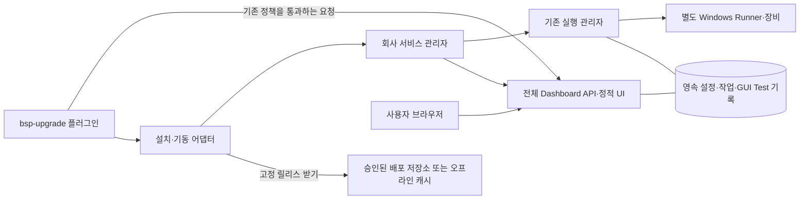

# 플러그인 관리형 전체 대시보드 설치·실행 설계

작성·갱신일: 2026-11-10. 상태: **DESIGN_ONLY / IMPLEMENTATION_NOT_STARTED / NOT_REVIEWED**.
조사 시점 HEAD: `b93751a60798a39426ba1738ee3bdb71c9709cf1`. 구현 착수 때 최신 코드·변경·회사 접점을 다시 확인한다. 대상 구현 커밋·새 다운로드 설치물은 아직 없다.

2026-11-13 회사 검토용으로 공유한다. 본문 코드 조사는 2026-11-10 기준이며 이후 구현 현황은 [현재 상태](../implementation/CURRENT_STATUS.md)와 구분해 읽는다. 이 게시로 자동설치 기능의 구현을 승인하거나 완료 처리하지 않는다.

사용자는 진행 중인 플러그인 테스트를 확인하는 요구에서 **현재 대시보드 전체를 포함하는 방향**으로 범위를 확장하고, 플러그인 설치/시작 때 다운로드한 뒤 설정에 따라 자동 실행하는 방식을 제안했다. 이 문서는 그 방식의 검토안이다. 다운로드 원본·설치 방식·서비스 구조·갱신 정책 등 기술 선택은 제안이며 사용자 확정 기술 방식으로 승격하지 않는다.

**사용자가 구현을 지시하기 전까지 제품 코드·설정·DB·설치물·이미지를 만들거나 변경하지 않는다.** 현재는 이 계획과 문서 진입점·진행 기록만 갱신한다. 실제 회사 시험은 사용자가 수행하고 피드백한다. 회사 접속·장비 시험을 설계의 선행 조건으로 요구하지 않는다.

관련 원문은 [플러그인 연동 설계](BSP_UPGRADE_PLUGIN_INTEGRATION.md), [회사 안내](../gui_test/BSP_UPGRADE_COMPANY_GUIDE.md), [PORT-007](../porting/PORT-007.md), [PORT-008](../porting/PORT-008.md)이다. RQ-60/D-64와 RQ-61/D-65는 기존 기능의 추적 기준이며 전체 대시보드 자동 설치의 구현 완료 근거가 아니다. 아래 PDM ID는 계획 내부 ID이고 정식 RQ/D/T 등록은 구현 지시 후 진행한다.

## 1. 목표와 사용 흐름

**플러그인이 호환 버전의 전체 대시보드를 설치·기동·재사용하고, 사용자는 별도 서버 설치 명령 없이 브라우저로 확인한다.** 매 실행마다 다시 다운로드하지 않는다.

1. 플러그인 설치 때 배포 원본·호환 버전·설치/runtime 위치를 구성한다. 네트워크가 가능하면 미리 설치하고, 그렇지 않으면 최초 시작 때 설치한다.
2. 시작 때 설치본과 기존 서비스의 버전·runtime·설정을 확인한다. 같은 서비스가 정상 실행 중이면 재사용한다.
3. 설치본이 없으면 지정 릴리스를 내려받아 검증·설치한다. 유효한 설치본이 있으면 다운로드를 생략한다.
4. 회사 설정을 연결하고 API와 Worker 서비스를 기동해 준비 상태를 확인한다.
5. 설정에 따라 브라우저를 열거나 `대시보드 열기`와 실제 접속 주소를 제공한다.
6. 이후 플러그인 작업과 대시보드는 같은 실행 관리자를 사용한다. 테스트가 시작되면 Test 현황에 자동 표시한다.
7. 플러그인/브라우저를 닫아도 서비스와 승인된 기존 작업은 유지된다. 재접속하면 같은 작업을 조회한다.

자동 기동은 서비스 준비를 뜻한다. 새 BSP 작업 생성·모델 추론·장비 퓨징·Jira 티켓 발송을 설치 성공의 확인 동작으로 실행하지 않는다. 기존 작업의 재개는 서버의 기존 복구·게이트·예약 규칙을 따른다.

## 2. 포함 범위와 현재 구현

배포 대상은 **대시보드·다이어그램·사람 검토/Jira·Test 현황·실행 기록·환경 설정 전체 UI와 이를 지원하는 API/Worker 코드**다. TestPage만 넣는 구성이 아니다. 화면과 코드가 포함되는 것과 회사 연동이 준비되는 것은 구분한다.

| 현재 파일/기능 | 확인 내용 / 필요한 추가 작업 |
|---|---|
| `apps/web` | 전체 대시보드 UI. 배포 때 미리 빌드한 정적 자산을 넣을 수 있다. |
| `backend/api/main.py`, `backend/worker/main.py` | 전체 API/실행 관리자. 기존 GUI Manager/Worker를 구성하므로 별도 integration Worker와 이중 기동하면 안 된다. |
| `run.sh`, `scripts/start.sh` | 이미 설치한 Python 환경·빌드 UI를 사용한다. 터미널 종료 시 자식 Worker도 종료하는 개발 실행 경로다. 자동 다운로드·설치·서비스 등록 기능은 아니다. |
| 루트 `README.md` | 전체 서버/Worker 대상은 Linux다. Windows는 브라우저·SSH 터널 클라이언트이며 전체 Worker의 Windows 네이티브 실행은 지원하지 않는다. 서비스 설치 파일은 아직 없다. |
| `apps/gui-test/package.py --integration --include-ui` | GUI Test 전용 UI/백엔드 전달 경로다. 전체 Dashboard 설치물로 그대로 취급할 수 없다. |
| `standalone/plugin_client.py:SystemdService` | 이미 설치한 고정 systemd unit을 시작하는 어댑터다. 다운로드·unit 설치·전체 Dashboard 준비 상태 확인은 추가 필요하다. |
| `backend/api/main.py`의 health | 현재 API 응답만으로 전체 Worker·설정·Runner 준비를 증명할 수 없다. 관리형 배포 identity/준비 확인을 추가해야 한다. |

모델 CLI·인증, 회사 Jira 자격 증명, TC·이미지 경로, 드라이버와 실제 장비 준비는 회사 환경 설정에 연결한다. Windows Runner는 기존 별도 설치/상주 구성을 유지한다. 대시보드 다운로드가 Windows 장비 준비까지 자동 완료한다는 뜻은 아니다.

## 3. 실행 구조와 단일 소유권

- 플러그인은 설치·기동·작업 요청·조회 접점이다. 새 실행 스케줄러를 만들지 않는다.
- 전체 Dashboard API가 UI와 플러그인 호출을 함께 제공하고 기존 Manager/Worker를 재사용하는 구성을 권장한다. GUI Test 서비스의 인증·principal·멱등 API를 전체 호스트에 연결한다. 별도 standalone integration Worker를 같은 runtime에 추가하지 않는다.
- API와 Worker는 역할이 다른 프로세스일 수 있지만 서비스 관리자가 수명을 소유한다. 플러그인의 요청/대화/터미널 종료에 프로세스 종료를 연결하지 않는다.
- 실제 배정·결과/진행률·게이트는 기존 실행 관리자가 확정한다. 회사 플러그인에 자체 배정기가 있다면 그 접점을 먼저 조사하고 단일 배정자로 연결한다. 플러그인과 Dashboard가 같은 모듈/장비를 각각 실행해서는 안 된다.
- [오케스트레이터 명세 §2](ORCHESTRATOR_SPEC.md), [상태 보고 계약 §1–2](AGENT_STATUS_CONTRACT.md)의 역할·현재 v1/opt-in v2 경계를 유지한다. 필드 목록을 이 계획에 복제하거나 설치 편의 때문에 운영 정책을 변경하지 않는다.
- Test 현황에서 플러그인 소유 Run은 우선 조회 전용이다. 전체 Dashboard의 기존 조작은 서버 정책을 통과하며, 제어권 인계가 필요한 Run은 기존 version/controller 검증을 따른다.

기존 GUI 전용 서비스나 전체 Dashboard가 이미 운영 중이면 무조건 하나 더 띄우지 않는다. identity와 capability가 맞는 서비스는 재사용하고, 불일치·기존 활성 작업이 있으면 해당 전환을 보류한다. 모르는 서비스를 종료하거나 잠금 파일을 지우지 않는다.

## 4. 다운로드·설치·업데이트 흐름

### 4.1 배포 단위

플러그인 버전이 호환 Dashboard 릴리스·계약 범위를 지정한다. 기본은 `latest`나 Git main 자동 clone 대신 **검증한 고정 릴리스**다. 설치물에는 전체 Python 소스/설치 패키지, 미리 빌드한 전체 UI, 잠긴 의존성, 지원 플랫폼 조건, manifest·해시·설치/복원 안내를 포함한다. 설치 PC에서 Node/npm으로 UI를 빌드하는 흐름은 기본으로 삼지 않는다.

다운로드는 회사에서 승인한 내부 저장소/미러를 우선할 수 있다. 인터넷 차단 환경은 동일 manifest·해시를 가진 오프라인 설치물/캐시를 반입한다. 배포 원본과 인증 방법은 회사에서 한 번 구성하며 임의 모델 출력/일반 URL을 설치 원본으로 사용하지 않는다.

해시는 신뢰하는 플러그인 배포 메타데이터 또는 인증된 회사 저장소에서 가져오고 회사 서명 정책이 있으면 서명도 검증한다. 신뢰할 수 없는 같은 다운로드에 들어 있는 해시만으로 출처를 인증했다고 주장하지 않는다.

### 4.2 설치의 원자성과 재진입

상태는 `미설치→다운로드→검증→설치 준비→기동→준비 완료`로 표시한다. 실패하면 단계·원인·조치·진단 ID를 남긴다. `설치 완료`와 `실제 BSP/장비 사용 준비 완료`는 구분한다.

설치/runtime별 잠금으로 동시 플러그인 시작을 직렬화한다. 임시 staging에 다운로드하고 크기/해시·지원 플랫폼·의존성·안전한 압축 해제를 확인한 뒤 같은 파일시스템의 버전 디렉터리에 게시한다. 서비스 준비 확인 후 활성 버전 포인터/receipt를 원자적으로 확정한다. 중단된 staging은 설치 완료로 인식하지 않는다. 재시도는 기존 설치본/실행 서비스를 먼저 재확인한다.

다운로드 실패 시 호환되는 검증된 설치본이 있으면 재사용한다. 없으면 실행 불가 이유를 표시한다. 다른 버전이나 demo로 몰래 대체하지 않는다. Python 실행 환경은 설치 시 지원 OS/아키텍처·실제 Python/venv를 검사하고 승인된 의존성 묶음에서 전용 환경을 구성한다. 임의 Linux에서 동일 portable Python이 동작한다고 가정하지 않는다.

### 4.3 버전과 업데이트

매 시작 때 원격 최신 버전으로 덮어쓰지 않는다. 플러그인이 요구하는 호환 버전이 설치돼 있으면 재사용한다. 새 릴리스가 필요해도 **실행/퓨징/테스트/UNKNOWN/종료 정리 작업이 있으면 활성 전환을 미룬다.** 다운로드 staging과 실제 활성화는 분리할 수 있다.

전환은 API/Worker의 호환성·runtime·계약을 함께 확인하고 기존 프로세스가 작업을 소유하지 않는 시점에 수행한다. UI/API/Worker를 제각각 버전으로 바꾸지 않는다. 기존 로컬/회사 추가 수정이 있는 설치본은 파일 목록과 provenance로 감지하고 자동 덮어쓰기를 거부한다. 회사 개선을 반영한 별도 릴리스로 재패키징하거나 연결 어댑터에서 유지한다.

## 5. 설정 자동 적용과 기동

아래 이름은 개념 항목이며 아직 존재하는 설정 키/CLI가 아니다.

| 설정 범위 | 제안 처리 |
|---|---|
| 배포 원본·고정 버전·설치 루트 | 플러그인의 설치 관리 설정. 실제 인증 값은 보호된 저장소 참조 |
| runtime·서비스 계정·포트 | 최초 설치 때 고정. 서버 주소는 loopback 기본, 다른 PC는 기존 SSH 터널 경로 사용 |
| 작업 폴더·모델/CLI·Jira·TC/이미지·Runner | 현재 Dashboard/GUI Test 설정 계약에 매핑하고 형식·실제 설치 기능을 구분해 확인 |
| `autostart` | 플러그인 시작 시 같은 서비스 재사용 또는 서비스 관리자로 기동 |
| `auto_open_browser` | 준비 완료 뒤 사용자 클라이언트에서 브라우저 열기. 원격 Linux의 브라우저 실행으로 Windows 브라우저를 대신 열 수 있다고 가정하지 않음 |
| 사용자 변경값 | 기존 runtime의 저장 설정을 보존. 플러그인 관리 필드만 revision/CAS 검증 후 적용하고 나머지는 매 시작 덮어쓰지 않음 |

플러그인에 모든 설정을 새로 중복 저장하지 않는다. 배포/기동 값과 제품 설정의 소유 필드를 구분하고 bootstrap 값은 최초 미설정 값에만 적용한다. 이후 변경은 현재 서버 설정 revision을 확인해 필요한 필드만 갱신한다. 환경 설정 화면의 사용자가 변경한 경로·프로필을 시작할 때 초기화하지 않는다.

서비스 관리자는 회사 환경의 systemd user service 또는 승인된 supervisor 어댑터를 사용한다. root 권한·특정 systemd 정책이 이미 있다는 가정은 하지 않는다. 최초 필요한 환경/등록 조건은 설치 진단으로 모으고 매 실행 반복 설정을 기본 요구하지 않는다. 현재 개발용 start.sh를 그대로 플러그인의 자식 프로세스로 실행하는 방식은 장기 기동 기본안으로 쓰지 않는다.

설정 포트에 서비스가 있으면 identity와 capability로 재사용 여부를 판단한다. 다른 서비스면 충돌을 표시하고 임의 종료/자동 포트 변경으로 오접속하지 않는다. 실제 endpoint는 검증된 실행 receipt로 플러그인에 반환한다. 준비 확인은 API 응답뿐 아니라 API/Worker의 release·runtime·설정 일치와 Worker 소유 상태를 검증한다. Runner/모델/Jira 미연결은 해당 기능의 미준비로 표시하고 전체 UI 조회를 불필요하게 막지 않는다.

## 6. 전체 화면 연결과 Test 현황

전체 UI가 포함돼도 기존 회사 플러그인의 상태가 저절로 Dashboard job이 되는 것은 아니다. 플러그인의 작업 생성·모듈/계획·현재 단계·판단·결과를 기존 서버 계약에 연결할 어댑터가 필요하다. 회사 private 플러그인 코드는 미확인이므로 구체 파일과 상태 대응은 구현 전 접점 조사로 확정한다. 표준 결과 계약과 게이트를 건너뛰어 화면만 완료로 표시하지 않는다.

진행 Run 자동 발견·메뉴 건수·첫 화면 요약·선택 고정·TC별 판정·재시도·로그/보고서는 유지할 목표다. 같은 API/Manager를 사용하므로 앞선 별도 Dashboard→GUI 서비스 중계 서버는 기본안에서 제외한다. 기존 별도 서비스가 필요한 회사 구성은 후속 대안이며 두 Worker를 동시에 띄워 해결하지 않는다.

활성 Test 상세/로그 1초, 전체 요약 2초 조회로 정상 연결에서 통상 1~2초 반영을 목표로 한다. 앱당 요약 구독은 하나, 요청 중첩은 금지한다. 숨김 탭은 중지하고 복귀 즉시 갱신한다. 실패하면 마지막 확인 시각·상태를 유지하고 재조회하며 시험 FAIL로 바꾸지 않는다.

진행 자동 따라가기에서 실행 중 Run을 우선하고 직접 선택한 기록은 유지한다. 상세 링크는 지정 Run을 열며 없거나 다른 identity이면 이유를 표시한다. source/Run/서비스 재시작 이전의 응답은 배제한다. TC 100%여도 FINALIZING/예약 해제 미확정이면 종료 정리/확인 필요로 표시한다.

같은 Run version에서도 stdout/stderr가 늘 수 있으므로 로그 cursor를 별도 관리한다. 목록은 페이지 처리하고 로그는 제한된 증분으로 읽어 전체 이력을 매번 전송하지 않는다. 1차 라이브 로그는 Linux Run에 저장된 TC 출력과 이미 제공되는 phase/진단이다. Windows raw COM 원문은 현재 계속 중계된다고 가정하지 않으며 필요 시 별도 설계한다. 토큰·사적 receipt는 표시하지 않고 로그/진단은 텍스트로 처리한다.

## 7. 파일·DB 영향과 복원

아래는 구현 지시 이후 예상 범위다. 현재 제품 파일을 수정했다는 뜻이 아니다.

| 범위 | 예상 파일/접점 |
|---|---|
| 전체 배포물 생성 | 신규 전체 Dashboard 패키징 스크립트·manifest/의존성·버전 검증·서비스 템플릿. 기존 GUI 전용 packager를 전체 설치물로 오인하지 않음 |
| 플러그인 bootstrap | 재사용 설치/기동 어댑터와 회사 plugin 설치/start hook. 언어·경로는 실제 회사 플러그인 접점 확인 후 확정 |
| API/서비스 준비 | `backend/api/main.py`, `scripts/serve.py`, host 서비스 어댑터. plugin 인증·기존 integration API·release/worker 준비 상태 연결 |
| 실행 소유권 | `backend/worker/main.py`, `backend/services/gui_test_host.py`, 관련 GUI host. 단일 Manager/Worker·기존 운영 게이트 보존 |
| 조회/UI | `backend/gui_test/api/router.py`, 필요한 공통 projection, `packages/gui-test-ui/src`, `apps/web/src/main.tsx`·host/스타일 |
| 설정 연결 | `backend/settings.py`, GUI 설정 계약·구성 importer의 필요한 접점. 기존 저장값·revision 보존 |
| 시험·전달 | 아래 PDM 시험, 영향 회귀, 요구사항·계약·설치/복원·새 PORT. 구현 후 고정 커밋/manifest로 전달 |

설치 경로의 버전 디렉터리와 영속 runtime(DB·설정·산출물·스냅숏)은 분리한다. 설치본 교체로 runtime을 지우거나 새 빈 DB로 바꾸지 않는다. 예상 신규 영속 항목은 설치 manifest/receipt·활성 버전·호환 계약·비밀 없는 설정 참조다. 제품 DB schema 변경은 현재 제안하지 않지만 회사 상태 어댑터에 새 필드가 필요하면 영향과 이전 계획을 먼저 갱신한다.

업데이트 전 DB의 정합한 백업과 관련 설정·산출물 참조를 보존한다. 실패하면 검증한 이전 코드/설정과 호환 runtime으로 복원한다. 향후 schema 변경이 있으면 구버전 코드만 되돌리지 않고 해당 백업·호환성 절차를 따른다. 진행/UNKNOWN 작업을 백업 시점으로 되감아 재실행하지 않는다. 설치 장애로 기존 활성 서비스를 중단하거나 물리 상태 미확인을 자동 해결하지 않는다.

## 8. 단계·완료 조건

현재 완료 범위는 조사와 설계 갱신이다. 제품 단계는 모두 **미구현**이고 사용자 구현 지시 전에는 시작하지 않는다.

| 단계 | 내용 | 완료 조건 |
|---|---|---|
| 0 | 전체 포함·다운로드/자동 기동 설계 | 범위·파일/DB·충돌·설정 소유·운영 경계·미결정과 문서 정합성 확인 |
| 1 | 정식 요구/시험·전체 릴리스 계약 | 고정 소스·전체 UI/API/Worker·플랫폼/의존성·manifest 재현/검증 |
| 2 | 설치·캐시·동시 시작·기동 어댑터 | 모의 저장소/서비스로 최초/재시작/네트워크 실패/원자성/identity/포트 시험 |
| 3 | 단일 실행 소유·설정·plugin 상태 연결 | 복수 배정/GUI Worker 없음, 기존 데이터·게이트·설정 보존, 읽기/제어 정책 검증 |
| 4 | 자동 Run 표시·전체 화면 | 진행/중간 접속·복수 Run·단절·역순/로그·기존 UI/설정 회귀 |
| 5 | 영향 회귀·독립 검토·PORT | 고정 코드와 설치물 일치, 실제 수행한 검증/미검증·복원/회사 접점 전달 |
| 6 | 사용자 회사 시험/피드백 | 실제 설치·다운로드 원본·서비스 정책·CLI/SSH/COM/장비·Jira 결과를 별도 기록 |

## 9. 검증 계획과 미결정

모든 아래 제품 시험은 **NOT_RUN**, 독립 검토는 **NOT_REVIEWED**다. 기존 RQ-60/T-200~209·RQ-61/T-210~217과 REG-0075의 실행/복구 경계를 영향 회귀로 유지한다.

| 계획 ID | 확인할 동작 |
|---|---|
| PDM-01 | 최초 다운로드/설치·미리 빌드한 전체 UI 포함·Node 없는 대상 설치·플랫폼/의존성 실패 구분 |
| PDM-02 | 고정 버전 재사용·오프라인 캐시·해시/출처 불일치·중단 staging·동시 시작/설치·회사 수정 보존 |
| PDM-03 | 기존 서비스 재사용·API만 살아 있는 경우·release/runtime/config 불일치·포트 충돌·중복 Worker 차단 |
| PDM-04 | plugin/터미널/브라우저 종료 후 지속·서비스 재기동·기존 Run 재조회·원치 않는 새 작업 없음 |
| PDM-05 | 자동 설정의 최초값·소유 필드·사용자 저장값·revision 충돌·자격 증명 비노출 |
| PDM-06 | 플러그인 상태/명령이 단일 실행 관리자에 연결·모듈/계획·분석 예외/선행 게이트·Jira/최종 검토 보존 |
| PDM-07 | 모든 메뉴/기존 설정·기존 local 실행 회귀·Windows 브라우저/SSH endpoint·자동 열기/수동 열기 |
| PDM-08 | Test 자동 발견/선택·1~2초 목표·재시도/FINALIZING/UNKNOWN·같은 version 새 로그·역순 응답 |
| PDM-09 | 활성/UNKNOWN 작업 중 업데이트 유예·설치 실패 시 기존 서비스 유지·코드/설정/runtime 복원 |
| PDM-10 | 회사 실제 릴리스 반입/다운로드·Linux 서비스·CLI 인증/추론·Windows Runner/장비·Jira·피드백 |

남은 회사 확인은 배포 저장소/반입 정책, Linux OS/아키텍처/Python·서비스 관리자, 설치/영속 경로·계정, 기존 plugin의 상태/배정 주체, endpoint/터널·비밀 저장소다. 설계 기본값은 고정 릴리스·최초 1회 설치·기존 서비스 재사용·loopback·활성 작업 중 업데이트 유예다. 이 선택들은 제안이며 회사 사실로 가정하지 않는다. 실제 장비/모델/Jira의 성공을 설치/모의 시험으로 대신하지 않는다.

## 10. 이전 안과의 관계·문서 검증

최초 안은 별도 Dashboard가 플러그인 GUI Test 서비스를 읽는 조회 전용 구성이고 `gui-test-view.json`·중계 API·외부 조회 전용 Worker 분기를 제안했다. 후속 대화에서 전체 포함과 플러그인 다운로드/자동 기동을 검토하면서 **이 문서의 기본안은 전체 서비스 관리형 구성으로 변경**했다. 이전 기술 제안을 구현 완료/사용자 확정으로 취급하지 않으며 외부 조회 중계는 현재 기본안의 필수 파일/설정에서 제외한다. 기존 진행 기록의 최초 설계 내용은 당시 이력으로 보존한다.

제품·회사 시험이나 독립 검토를 수행하지 않았다. 이 문서 변경에 대한 링크/정합성 검사 결과는 같은 날짜의 진행 기록에 별도로 남긴다.
