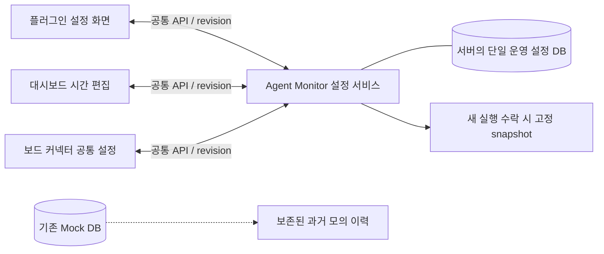

# Test 현황 Mock 제거·제한시간과 플러그인 양방향 설정 설계

작성일: 2026-11-15. 상태: **공통 설정·제품 Mock 제거 설계 방향 Astra APPROVED / 제품 변경 부분 WIP·CHANGES_REQUESTED / 제품시험 NOT_RUN**.
조사 기준 HEAD: `b1209321737a75343f337d2e582277a6e6a5a77a` 및 현재 작업 트리. 다른 세션의 보드 커넥터 화면·문서 변경은 이 설계의 구현·검증 근거가 아니다.

## 1. 사용자 요구와 범위

- 최초 요청은 큰 Mock Demo 배너 대신 오른쪽에 실제/Mock 배지를 두는 것이었다. 후속 지시로 **Test 현황의 제품 Mock 실행 모드를 제거**한다. 실제 실행 준비/단절 상태를 작게 표시하며 실제 모드가 장비 준비 완료를 뜻하지 않도록 한다.
- TC 목록의 시간 제목 옆에 전체 제한시간을 표시하고 변경할 수 있어야 한다. 시간은 각 TC의 실행 제한시간이며 선택한 TC 전체 실행의 총시간이 아니다.
- 기본 제한시간은 **120초**다. 2026-11-14의 600초 기본값 결정은 이 후속 사용자 지시가 대체한다. 목록 조회·HTTP 요청·플래싱·분석 lease 제한시간은 별개다.
- 플러그인에서 바꾸면 대시보드에도, 대시보드에서 바꾸면 플러그인에도 같은 저장값이 적용돼야 한다. 어느 한쪽의 값을 항상 우선하는 정책이 아니다.
- **Preflight 별도 UI 버튼은 제거**하고 시작 요청 내부의 서버 검증·예약·실행 게이트를 유지하는 안으로 정리한다. 별도 클릭 의무만 제거하는 앞선 선택 버튼 제안을 대체한다.
- 사용자는 Astra에게 데이터 직접 접근과 인터페이스 사용을 비교해 구조를 설계하도록 요청했다. Mock 제거에 따른 runtime/API/기존 데이터·시험 영향도 추가 Astra 검토를 완료했다. 현재 제품 구현은 중지된 부분 WIP이며 이 문서는 설계 검토 결과다.

관련 원문: [공개 제어 안내](../agents/PLUGIN_CONTROL_API.md), [실행 계약](GUI_TEST_CONTRACT.md), [기존 협의 이력](PLUGIN_CENTRIC_INTERFACE_PLAN.md), [PORT-007](../porting/PORT-007.md). 기존 RQ-63/67/68/69와 D-71~73의 설정·실행 경계를 유지한다. 새 구현의 RQ/D/T 등록과 게시 커밋 고정은 구현 단계에서 수행한다.

## 2. 현재 구조

| 위치 | 현재 역할과 한계 |
|---|---|
| `core/shared_settings.py` | 공통 설정을 서버 DB에서 읽고 CAS로 저장한다. JSON은 revision을 가진 import/export 교환물이다. |
| `core/timeouts.py` | 같은 Manager의 timeout document와 revision을 관리한다. 공통 설정 API와 기존 timeout API가 이 원본을 함께 사용한다. |
| `standalone/plugin_client.py` | `settings()` / `save_settings()`로 실모드 공통 API를 사용한다. 실제 회사 플러그인의 화면 수명·자동 갱신 코드는 이 저장소에서 확인되지 않았다. |
| `runtime.py` | 기본 Mock과 live Manager는 별도 DB를 사용할 수 있다. 이미 실제 실행기가 설정된 경우 같은 Manager를 재사용한다. URL 이름만으로 Mock 여부를 추정하지 않는다. |
| `TestPage.tsx`, `ExecutionTimeoutSettings.tsx` | TC 목록·시간 설정 UI. 원격 변경 감지, 목록 유효 시간 재계산, 지연 응답 및 draft 보호의 통합 보완이 필요하다. 현재 hook 변경은 미검증 WIP다. |
| `SharedControl.tsx` | 실모드 공통 설정 폼과 별도 갱신을 가진다. 여러 화면의 독립 polling과 편집 상태를 함께 다뤄야 한다. |
| `core/manager.py` | 시작 요청 안에서 이미 Preflight와 설정 revision 확인을 수행하고 예약과 Run snapshot을 생성한다. |

핵심은 실모드의 저장 원본이 없는 것이 아니라, 소비자들이 같은 원본을 사용하고 최신값을 안전하게 다시 읽는 규칙을 완성하는 것이다. Mock 설정을 수정해도 실모드 플러그인 값이 바뀌지는 않는다.

## 3. 구조 비교와 권장안

| 선택 | 이점 | 문제 / 판정 |
|---|---|---|
| 클라이언트가 SQLite 직접 접근 | 같은 파일이면 바로 읽을 수 있음 | 다른 PC·SSH 환경의 파일 공유, DB 잠금·스키마 의존, 서비스 identity·인증·CAS·실행 수락 경계 우회. 비권장. |
| 공용 JSON 직접 수정 | 사람이 확인하기 쉬움 | 동시 수정 유실, 파일 복사본 분기, 원자성·서비스 연결 불명. 운영 원본으로 비권장. |
| 기존 공통 HTTP API와 서버 DB | 현재 구현 재사용, 원자 CAS·서비스 식별·검증·snapshot 유지 | 클라이언트 갱신 규칙 보완 필요. **Astra 권장안**. |

기존 `GET/PUT /api/v1/gui-test/live/integration/settings`와 `PluginClient.settings/save_settings`를 공개 접점으로 유지한다. 기존 `GET/PUT /execution-timeouts`는 같은 Manager의 같은 timeout 원본을 다루는 호환 접점이다. 요청·응답의 정확한 필드와 검증은 [공통 모델](../../backend/gui_test/core/shared_settings.py)과 [시간 모델](../../backend/gui_test/core/timeouts.py)을 원문으로 삼는다.

## 4. 갱신·충돌·실행 규칙

1. 저장 성공은 서버가 반환한 값과 revision으로 확정한다. 로컬 UI 캐시·플러그인 설정 파일을 별도 운영 원본으로 두지 않는다.
2. 같은 workspace의 호스트 측 controller/store 하나가 조회·저장·revision 통지를 소유하고 공통 UI가 구독한다. 활성 시 초기 즉시 조회와 약 3초 single-flight 갱신, 비활성 시 polling 중지, 재활성·focus 복귀·재연결 시 즉시 조회를 권장한다. SharedControl과 시간 hook이 각각 polling하지 않는다. 각 프로세스는 같은 서버 원본에 수렴하며 모든 화면이 동시에 바뀌는 분산 트랜잭션을 의미하지 않는다.
3. 편집 중 입력은 원격 변경으로 덮어쓰지 않는다. 저장은 편집 시작 시의 revision을 사용한다. 충돌이면 최신값과 draft를 구분해 재확인하며 무조건 재시도해 덮어쓰지 않는다.
4. 늦게 도착한 조회 응답이 저장 성공값이나 새 연결의 설정을 되돌리지 못하도록 요청 세대·서비스 identity·수명과 대조한다. 해시 revision은 숫자 크기로 선후를 비교하지 않는다.
5. 통신 단절 시 마지막 확인값과 미동기화를 표시한다. 서버 저장 전에는 적용 성공으로 표시하지 않는다. 외부 변경에는 '다른 곳에서 변경됨', 자신의 저장 성공에는 '저장됨'을 구분한다.
6. 제품의 Test 현황은 실제 설정 원본 하나에 연결한다. 과거 Mock DB·설정·Run을 실제 원본에 자동 복사하거나 실제 결과로 표시하지 않는다. 자동시험용 모의 어댑터는 제품 실행 모드와 구분한다.
7. 기존 우선순위인 개별 TC 예외 → 명시 공통값 → 명시 TC metadata → 기본값을 유지하되 fallback만 120초로 바꾼다. 기존 명시 10/600초는 일괄 이전하지 않는다.
8. 새 저장값은 다음 실행 수락에 적용한다. 수락한 Run·진행 중 Attempt의 시간은 바꾸지 않는다. 저장된 미래 설정과 실행 당시 값을 구분한다.

## 5. 화면과 Preflight

시간 제목 옆의 현재 공통값을 눌러 전체 제한시간을 편집하는 안을 권장한다. 명시 공통값이 있으면 `TC 전체 기본 120초 · 변경`과 예외 수를, 공통값이 null이면 `기본 120초 · TC 지정값 사용 · 변경`을 표시한다. 서버 조회 전에는 확인 중, 실패 시에는 마지막 확인값과 stale을 표시한다. 전체 일괄 적용 시 개별 예외를 지우는 현재 동작은 사용자가 저장 전에 알 수 있게 한다. null을 자동으로 120으로 저장해서 명시 TC metadata를 덮지 않는다.

권장 Preflight 흐름은 **테스트 시작 → 서버 사전 검사 → 원자 예약·실행 수락**이다. 별도 화면 버튼은 제거한다. UI에서 이전 점검 성공 여부를 시작의 필수 조건으로 삼지 않되 소스·설정·명령·연결 미준비와 권한·보드 예약·UNKNOWN 게이트는 유지한다. 검사 후 설정이 바뀌면 서버가 거부하며 이전 점검 결과로 실행을 허용하지 않는다. 클릭 한 번에 `/preflight`와 `/runs`를 연속 호출할 필요 없이 기존 `/runs` 내부 검증을 사용한다. 시작 중 중복 클릭 방지·멱등 처리는 유지한다. 서버의 진단용 Preflight API 제거 여부는 UI 버튼 제거와 별도로 판단한다.

## 6. 구현 영향과 단계

| 단계 | 예정 변경 | 완료 조건 |
|---|---|---|
| 1 | 시간 기본값과 유효값 계산, 기존 snapshot·CAS 계약 | 기본120·명시값 보존·원격 변경 충돌·실행 중 고정 시험 |
| 2 | 공유 설정 조회/저장과 UI 갱신 수명 | 양방향 변경·지연 응답·편집 보존·모드/서비스 전환 시험 |
| 3 | `CaseTree.tsx`, `TestPage.tsx`, 시간 편집 UI/CSS | 시간 헤더 편집·작은 모드 표시·시작 단일 조작·접근성·좁은 화면 시험 |
| 4 | PluginClient 계약·회사 플러그인 전달 안내·PORT | 참조 클라이언트와 서버의 양방향 모의 검증, 실제 회사 소비자 갱신 항목 명시 |

예상 파일은 위 현재 구조 표의 공통 모델·설정 서비스·클라이언트·공유 React 화면과 관련 시험이다. DB schema 변경·새 공용 파일·설정 일괄 덮어쓰기는 현재 권장안에 필요 없다. 서버 API/Worker와 Windows 커넥터의 기본값·계약 호환성은 함께 확인한다.

## 7. 검증 계획과 미완료

- Python/API: 기본120, 명시10/600·metadata·개별 예외 보존, 공통 API↔timeout API 같은 원본, 저장 충돌, 수락 Run 고정, 시작 내부 Preflight 거부·예약 경쟁.
- 브라우저/모의 플러그인: 양쪽 저장 후 상대 화면 갱신, dirty draft·충돌 재확인, 응답 역전, 모드 전환·비활성/재접속, 단절·미동기화 표시, 시간 헤더 전체 수정과 TC 예외, 375px·키보드.
- 경합·수명: GET A 지연 → PUT B 성공 → A 도착 시 B 유지, single-flight·중복 polling 없음, service/runtime identity 교체 시 이전 응답 차단, Mock 수정이 live 원본에 영향을 주지 않음.
- 빌드: Dashboard와 standalone 공유 UI 양쪽. 문서 링크/ID 검사와 제품시험은 별도다.
- 실제 회사 플러그인 화면의 자동 갱신·Linux/Windows·장비 인수는 **NOT_RUN**이다. 참조 클라이언트·모의 성공만으로 회사 완료를 선언하지 않는다.

현재 제품시험은 NOT_RUN이며 구현 완료 또는 코드 리뷰 APPROVED 상태가 아니다. 사용자 요청 이전에 시작한 기본값·작은 배지·시간 hook 변경은 미검증 부분 WIP로 남아 있다. 시간 헤더 편집·Preflight 버튼 제거·양방향 동기화의 전체 구현은 아직 완료되지 않았다.

## 8. Astra 검토 결과

사용자 명시 요청으로 별도 `gpt-6-astra` 세션 `astra_settings_architecture`가 읽기 전용으로 코드·계약·PORT·시험 정의를 확인했다. 파일 수정과 시험 실행은 하지 않았다.

**최초 APPROVED는 공통 API 재사용·단일 원본·당시의 Mock 격리·120초 fallback과 명시값 보존·선택 Preflight의 설계 방향에 한정했다.** 후속 사용자 지시의 제품 Mock 제거와 Preflight 버튼 제거도 Astra 추가 구조 검토에서 **설계 방향 APPROVED**를 받았다. 제품 코드 전체의 승인 또는 회사 플러그인 UI 자동 갱신 완료를 뜻하지 않는다. 구현 검토 판정은 부분 WIP 기준 **CHANGES_REQUESTED**다.

| 지적 / 현재 빈틈 | 구현 완료 조건 |
|---|---|
| SharedControl 별도 polling의 동시 요청·응답 역전 방어 부족 | 호스트 controller로 통합하고 저장 전 GET의 늦은 응답을 거부 |
| 시간 hook의 외부 변경 callback을 TestPage가 자신의 저장과 구분하지 않음 | 원격 갱신·자신의 저장 메시지 및 상태 분리 |
| dialog frozen revision은 CAS에 적절하나 충돌 안내·복구 부족 | 초안 보존·외부 변경 알림·최신값 비교/다시 불러오기 |
| TC 선택 변경 코드의 옛 `??10`, 기본600을 기대하는 기존 시험 | 기본120과 명시10/600 보존 시험을 함께 갱신·실행 |
| 작은 배지 새 클래스의 스타일과 두 호스트 검증 없음 | Dashboard/standalone 빌드와 모드·단절·반응형 확인 |
| 커넥터 browser 공통 폼은 수동 조회 중심 | 담당 세션과 연결해 shared-dirty·원격 갱신 규칙 적용. 현재 다른 세션 WIP 보존 |
| 실제 회사 플러그인 host의 갱신 구현 미제공 | 공개 client 계약을 전달하고 현지 host에서 구독/재조회 연결·인수 |

추적·시험 보완은 기존 T-240/242/243/255와 관련 RQ-63/67/68/69를 출발점으로 삼는다. 실제 참조 client 시험 파일은 `test_plugin_control_workflow.py`, `test_plugin_integration_service.py` 등을 확인해 연결한다. 이 구조 검토는 제품시험 PASS를 새로 만들지 않는다.

## 9. 후속 확정 범위: 제품 Mock 제거

이 절이 앞선 Mock 모드 유지·모드 전환 시험·선택적 Preflight 버튼 제안을 대체한다. 자동시험의 fake와 BSP 본체의 demo 운영 정책을 삭제하는 범위로 확대하지 않는다.

### 제품 진입과 API

- Test 현황은 실제 서비스의 단일 원본으로 진입한다. 신규 방문·예전 `guiExecution=default` URL·기존 localStorage 모드값은 실제 화면의 **조회 진입**으로 정규화한다. 방문만으로 설정 저장·Run 생성·장비 실행을 하지 않는다.
- 모드 선택, Mock 시나리오/속도, 가짜 보드·TC, 오류 주입/데모 복구, GUI 전용 격리 demo Job UI를 제거한다. 단일 모드에서 실제/Mock 선택 배지는 필요 없으며 실행 관리자 연결·보드 준비 상태를 간결하게 표시한다.
- **구 non-live API의 변경 요청을 live로 redirect/alias하지 않는다.** 예전 Mock 시작·재개 요청이 장비 실행으로 바뀌지 않도록 명시 폐기 오류(예: 410)로 거부한다. 구 조회도 실제 결과로 묵시 대체하지 않는다.
- `gui-last-run`의 Mock ID·연결·명령·Suite·TC 선택을 live 캐시로 복사하지 않는다. 서비스/runtime identity와 현재 권한·scope를 재확인한다.

### factory·Worker·이력

- `Manager`의 adapter 미지정→MockRunner 기본 fallback을 제거하는 것이 목표다. 제품 factory는 실행기가 없어도 실제 Manager의 미연결 상태를 만들고, 시험 helper가 fake를 명시 주입한다.
- `backend/api/main.py`와 `backend/worker/main.py`, `backend/services/gui_test_host.py`, `backend/gui_test/runtime.py`를 함께 정리한다. 실제 Manager/API·실행 Worker는 한 소유자만 가지며 `/demo/jobs`와 Mock 실행/fault 경로를 제품에 등록하지 않는다.
- 과거 Mock DB/Run/로그는 원본 보존하고 live로 병합하지 않는다. 남은 QUEUED/RUNNING/PAUSED/UNKNOWN을 자동 복구·tick·재실행·완료 처리하지 않는다.
- 별도 아카이브 제품 화면은 필수가 아니다. 필요한 이력 export는 Manager/Worker를 기동하지 않는 명시적 읽기 전용 reader로 분리한다. 기존 CLI export가 factory에 의존하는 점도 점검한다.

### standalone·패키지

- 기존 standalone Mock Worker를 hardware Worker로 교체하지 않는다. Mock 제거를 단독 앱의 새 장비 실행권 부여로 확대하지 않는다.
- `standalone/server.py`의 Mock 서비스 진입, health의 고정 simulation 값, CLI start/status/export, launcher·package 소비자를 함께 조사한다. 공유 프런트엔드 빌드는 유지할 수 있지만 실제 기능은 기존 identity·scope/CSRF를 가진 integration service 계약을 따른다. 미연결 시에는 연결 안내를 제공한다.
- `standalone/integration.py`, PluginClient의 `/live/integration/*`, 공통 설정·실행 수락·예약 경계는 유지한다.
- 제품 package에서 demo fixture 자산·Mock 전용 entrypoint를 제외하기 전에 `Manager`의 top-level Mock import 등 의존을 정리한다. 시험 app factory에서만 fake를 명시 주입하며 제품 URL/env 옵션으로 Mock을 다시 켜지 않는다.

### 구현 단계와 완료 조건 추가

기본값/공통 설정 controller → 실제 단일 factory/API/Worker → UI/Preflight 버튼 정리 → standalone/legacy 호환·package → 관련 시험·계약/PORT 갱신 순으로 한 단위씩 진행한다. 큰 기본 실행 경로 변경이므로 사용자 변경을 보존하며 단계별 검증한다.

| 검증 대상 | 완료 조건 |
|---|---|
| 무설정 제품 | 빈 보드/TC와 미연결 안내, MockRunner 생성·실행 없음 |
| 구 URL·API | 실모드 조회만 수행, 구 변경 요청은 장비 호출 없이 거부 |
| 기존 Mock runtime | 파일/기록 보존, pending 자동 처리 없음, live 통계·보고서·재실행 혼입 없음 |
| 실행 소유 | 전체 호스트의 실제 Worker 단일 소유와 예약 배타 유지 |
| 시작 UX | Preflight 버튼 없이 시작, 서버 검사 실패·revision 경합·보드 점유 시 실행 거부 |
| standalone/package | 기존 권한·identity·health·진입점 smoke, 새로운 hardware 권한 없음, 제품 Mock 진입점 없음 |
| 시험 회귀 | 순서·반복·취소·UNKNOWN·CAS·복구는 fake connector/fixture로 계속 검증, 실제 SSH/COM fallback 없음 |

추가 검토에서도 구현·시험은 NOT_RUN이다. 기본120·공통 API 양방향 갱신 설계는 계속 유효하다. 현재 제품 코드에는 Mock 경로와 Preflight 버튼이 남아 있으며 이 문서를 구현 완료 근거로 사용하지 않는다.

문서 검증: `.venv/bin/python docs/testing/validate_docs.py`와 `git diff --check`는 종료 코드0으로 PASS했다. 로그는 로컬 전용 `.local-reports/20261115-test-timeout-design-01/`에 보존하며 저장소에 포함하지 않는다. 제품시험 PASS 또는 실제 회사 인수 근거가 아니다.

## 10. 2026-11-15 추가 반영 확인

사용자가 추가 반영사항 확인과 커밋·푸시를 요청해 이 설계 문서를 게시한다. 제품의 미검증 부분 수정 7개 파일은 포함하지 않는다. 이 문서 게시를 Mock 제거·120초·단일 controller 구현 완료 또는 추가 제품시험 PASS로 해석하지 않는다. 현재 제품 적용 기준은 [플러그인 요청서](../agents/BSP_UPGRADE_PLUGIN_REQUEST.md)의 보드 커넥터 미러 절이다. 문서 검사와 게시 범위는 [추가 확인 기록](../testing/runs/20261115-main-cleanup.md)에 남긴다.
