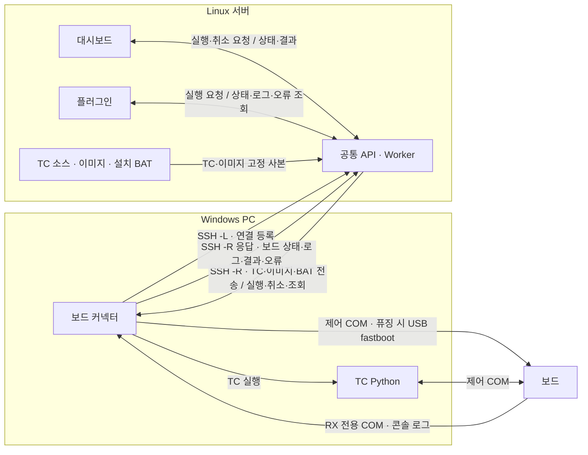

# 보드 커넥터 가이드

## 설치 전 준비

- Windows PC: Python 3.13 64비트(3.11/3.12 호환), OpenSSH 클라이언트, 저장소 소스.
- Linux 서버: 대시보드 API·Worker 실행, SSH 키 또는 agent 인증 설정.
- 보드: 제어 COM 연결. 콘솔 로그를 보려면 별도 RX 전용 splitter 포트 준비.
- TC Python: 실제 TC에 필요한 패키지가 설치된 `python.exe` 준비.
- 최초 연동: 아래 **플러그인·대시보드 연동**의 서버 설정 완료.

명령은 PowerShell 기준이다. 예시 소스 위치는 `C:\work\bsp_os_upgrade_dashboard`다. 최초 설치에는 패키지 저장소 접속 또는 회사에서 준비한 pip 오프라인 설정이 필요하다. 기존 CLI 배포 ZIP에는 GUI용 Qt가 포함되어 있지 않다.

## 설치 방법

```powershell
cd C:\work\bsp_os_upgrade_dashboard
.\board-connector.cmd
```

탐색기에서는 저장소 루트의 **board-connector.cmd**를 더블클릭한다. 처음에는 실행 환경과 패키지를 준비한 뒤 GUI를 연다. 다음 실행부터 설치가 정상인지 확인하고 바로 GUI를 연다. 소스만 바뀌면 패키지를 다시 설치하지 않는다.

## 연결 구조



- SSH 연결은 Windows에서 시작한다. 터널은 커넥터가 생성한다.
- Linux는 TC 소스·제한시간·시험 기록을 관리한다. Windows에 TC 폴더를 다시 입력하지 않는다.
- 현재는 TC 고정 사본을 전송한다. Z: 드라이브 원본 직접 실행은 지원하지 않는다.
- 제어 COM은 해당 작업이 사용한다. 콘솔 수집은 별도 RX 포트를 사용한다.

| 포트 | 용도 |
|---|---|
| Linux SSH 포트 | 기본 22. 회사 설정에 맞춰 입력 |
| Linux 대시보드 포트 | 회사 예시 8765. 실행 중인 서버 포트 입력 |
| Windows 브라우저 포트 | 터널이 사용 중인 로컬 포트. **대시보드 열기**로 접속 |
| 커넥터·역방향 터널 포트 | 기본 8771. 기존 저장 설정이 있으면 해당 값 사용 |

`127.0.0.1`은 접속하는 PC 자신이다. Linux의 `8765`와 Windows 브라우저 포트는 같을 필요가 없다.

## 동작 방법

### 최초 설정

1. `board-connector.cmd`를 실행한다.
2. **환경설정**에서 Linux SSH 서버·계정·대시보드 서버 포트를 입력한다.
3. **TC Python → 찾아보기…**에서 TC용 `python.exe`를 선택한다.
4. **연결할 보드 수**를 지정한다.
5. 보드별 탭에서 이름·제어 COM을 선택한다. 목록이 없으면 **COM 새로고침**을 누른다.
6. 콘솔을 수집할 보드는 **콘솔 RX COM**을 선택하고 실제 격리를 확인한 뒤 **RX 전용·제어선 격리 확인**을 체크한다.
7. 필요하면 **고급 연결 설정**에서 SSH 포트·키 파일을 지정한다.
8. **설정 저장**을 누른다.

### 연결·시험·종료

1. **연결 → 연결**을 누른다.
2. 로컬·SSH·대시보드·역방향 응답이 정상인지 확인한다.
3. 보드 수·COM·상태를 확인한다.
4. **대시보드 열기**를 누른다.
5. 대시보드에서 TC 소스를 선택하고 시험을 시작한다. 플러그인에서도 같은 서버로 요청한다.
6. 커넥터의 **로그 보기**에서 필요한 탭을 선택한다.
7. 작업이 끝나면 **연결 종료**를 누른다.

창만 닫으면 연결과 시험은 계속된다. 연결된 동안 보드 설정을 바꾸려면 작업을 끝내고 **연결 종료**부터 수행한다.

| 상태 | 의미 |
|---|---|
| 초록 · 연결 | COM 감지 및 연결 상태 확인. 부팅·시험 통과를 뜻하지 않음 |
| 노랑 · 시험 중 / 예약·대기 | 실행 또는 장비 예약 중 |
| 노랑 · 확인 필요 | 현재 상태를 확인할 수 없음 |
| 빨강 · 오류 | 연결 또는 장비 오류 확인 필요 |
| 회색 · 미연결 | COM 또는 연결 확인 불가 |

| 로그 탭 | 내용 |
|---|---|
| 보드 콘솔 | RX 포트에서 수집한 보드 출력 |
| TC 실행 | TC의 표준 출력·표준 오류 |
| 연결 | 커넥터·SSH·서버 연결 상태 |
| 플러그인 오류 | 공통 서버에 전달할 보드 오류. 실제 플러그인 수신 여부는 플러그인에서 확인 |

**오류만**, 검색, **복사**, **로그 열기**를 사용할 수 있다.

## 경로 확인

**연결 → 경로 보기**에서 확인한다. 경로는 읽기 전용이다.

| 표시 | 기준 |
|---|---|
| Linux 선택 TC 소스 | 서버에서 현재 선택한 소스 |
| Linux 설치 BAT | 플러그인이 해당 실행에 전달한 BAT 절대경로 |
| Linux 실행 TC 소스 | 해당 실행에 저장된 TC 경로 |
| Windows 이미지 작업 폴더 | 커넥터가 이미지 준비 후 기록한 폴더 |
| Windows TC 작업 폴더 | 표시된 TC 실행 ID의 작업 폴더 |

요청 전에는 **요청 전**, 아직 경로를 받지 못하면 **준비 전 또는 경로 미수신**으로 표시한다. 완료된 작업은 **이전 실행**, 연결이 끊기면 **과거 수신 정보**로 표시한다. 폴더의 현재 존재 여부는 확인하지 않는다.

## 플러그인에서 이미지 플래싱 요청

1. Linux에서 빌드가 끝난 이미지와 설치 BAT를 같은 폴더에 준비한다.
2. 플러그인에 BAT까지 포함한 절대경로를 지정한다. 예: `/srv/images/build-123/install.bat`.
3. 플러그인에서 실행할 TC를 선택하고 요청한다.
4. Linux 서버가 허용 경로·파일 해시를 검사하고 이미지·BAT·TC를 Windows로 전송한다.
5. 커넥터가 저장된 플래싱 프로파일로 fastboot 진입 → BAT 실행 → 부팅 확인 → TC 실행을 진행한다.
6. 플러그인에서 결과·오류를 확인한다. 커넥터에서는 **경로 보기**와 **보드 콘솔**을 확인한다.

BAT는 같은 폴더와 하위 폴더의 파일을 상대경로로 참조해야 한다. BAT 안의 Linux 절대경로나 특정 PC 경로는 자동 변환하지 않는다. 플래싱 프로파일이 먼저 설정되어 있어야 하며 커넥터 GUI에 별도 실행 버튼은 없다.

## 예외 조치

| 증상 | 조치 |
|---|---|
| 창이 열리지 않음 | 아래 진단 실행 명령으로 시작해 오류 확인. Python 3.13 64비트(3.11/3.12 호환)와 패키지 저장소 접속 확인 |
| COM이 목록에 없음 | 케이블·드라이버 확인 후 **COM 새로고침** |
| COM 중복 오류 | 보드별 제어 COM과 RX COM을 모두 다른 포트로 선택 |
| 보드 콘솔이 비어 있음 | RX splitter 연결·포트·격리 확인. 가상 COM 드라이버는 별도 설치 |
| `Connection refused` / `channel ... open failed` | Linux API 실행 여부와 **대시보드 서버 포트** 확인 |
| 각 소켓 주소는 하나만 사용 가능 | 기존 커넥터·SSH 터널의 사용 포트 확인. 중복 실행 정리 후 재연결 |
| SSH 인증 실패 | PowerShell에서 같은 서버·계정·포트·키로 SSH 인증과 서버 키 확인 완료. GUI는 비밀번호 입력을 지원하지 않음 |
| 역방향 등록 HTTP 401/403 | 서버·커넥터 버전과 loopback 주소 확인. 브라우저에서 등록 API를 직접 호출하지 않음 |
| 역방향 연결 실패 | SSH 서버의 포트 포워딩 허용 여부와 Linux 역방향 포트 점유 확인 |
| `TC_PYTHON_NOT_CONFIGURED` | **TC Python**에서 실행 가능한 `python.exe` 선택 |
| 시험 중 timeout | 대시보드 **Test 현황**에서 TC 시간을 눌러 전체·개별 제한시간 조정. 통신 오류이면 연결 로그부터 확인 |
| `확인 필요` / 과거 로그 표시 | SSH·COM·실제 시험 상태 확인. 기록 삭제로 해제하지 않음 |
| 연결 종료 거부 | 실행·예약·일시정지·종료 불명·삭제 중 작업 확인 후 정리 |

진단 실행:

```powershell
.\board-connector.cmd --install-only
```

설치 실패 시 콘솔 창에 오류가 남는다. 연결·실행 오류는 커넥터의 **로그 보기** 또는 `%USERPROFILE%\.bsp-dashboard\windows\logs\connector.log`에서 확인한다. 기존 `--home`을 사용했다면 같은 인자를 전달한다.

## 플러그인·대시보드 연동

### 설치 담당자: 최초 한 번

1. Linux 대시보드에 [PORT-009](../porting/PORT-009.md)의 서버·Worker 변경을 적용한다. 기존 서버를 재사용한다.
2. 해당 runtime의 `gui-test.json`에서 `runner`를 `registered`로 설정한다. 기존 실행 기록과 다른 설정은 보존한다.
3. Linux API·Worker, Windows 커넥터, 플러그인 클라이언트에 토큰 제거 변경을 함께 적용한다. 이전 버전과 혼용하면 토큰 오류가 날 수 있다.
4. Linux API·Worker가 같은 runtime을 사용하도록 설정하고 재시작한다.
5. 커넥터에서 **연결**을 누른다. 대시보드 실제 시험 화면에 보드가 표시되는지 확인한다.
6. 대시보드에서 TC 소스를 선택한다. 이후 보드·COM·TC 경로를 플러그인에 중복 입력하지 않는다.

연결 토큰의 생성·복사·입력은 필요 없다. 기존 `GUI_TEST_RUNNER_TOKEN`, `GUI_TEST_CONNECTOR_REGISTRATION_TOKEN`, `GUI_TEST_INTEGRATION_TOKEN`과 저장된 연결 토큰 파일은 사용하지 않는다. 기존 파일을 자동 삭제하지는 않는다. SSH 키 인증은 유지한다.

### 플러그인 연결

1. Linux의 같은 대시보드 API를 연결 대상으로 지정한다. 같은 서버에서 실행하는 경우 예시는 `http://127.0.0.1:8765`다.
2. 참조 클라이언트를 `PluginClient(url, expected_identity=identity)`로 생성한다. 연결 토큰은 전달하지 않는다.
3. `gui-test.json`의 `integration` 실행 설정을 준비한다. 자동 퓨징 설정은 [플러그인 설치 안내](BSP_UPGRADE_COMPANY_GUIDE.md#회사-플러그인-연결)를 따른다.
4. loopback `/api/v1/health` 응답으로 서비스·Worker·커넥터 identity를 확인하고 고정한다.
5. 참조 `PluginClient`의 아래 메서드를 회사 플러그인에 연결한다.

| 확인할 내용 | 메서드 |
|---|---|
| 연결된 보드 | `connector_inventory()` |
| 보드 콘솔 | `board_console()` |
| 새 오류 | `connector_errors(after=마지막_seq)` |
| 시험 진행·결과 | `run(run_id)` |

오류 조회의 마지막 `seq`를 저장하고 다음 조회에 사용한다. 재접속 시 기존 Run ID를 유지한다.

회사 플러그인 화면·설정 메뉴는 이 저장소에 없다. 위 메서드 연결과 실제 오류 수신은 회사에서 확인해야 한다. 이미 전체 대시보드가 실행 중이면 같은 runtime에 별도 standalone Worker를 추가하지 않는다.

## 설정·업데이트

| 항목 | 위치·처리 |
|---|---|
| Windows 설정 | `%USERPROFILE%\.bsp-dashboard\windows\windows-runner.json` |
| Windows 로그 | 같은 폴더의 `logs` 또는 **로그 열기** |
| TC 소스·제한시간·세션 | Linux 대시보드에서 관리 |
| 대시보드 화면만 재빌드 | 커넥터 재설치 불필요 |
| 커넥터 코드·의존성 변경 | 시험 종료 → 연결 종료 → 기존 설정 백업 → 변경 파일 적용 → board-connector.cmd 실행 |

기존 사용자 지정 `--home`이 있으면 `board-connector.cmd --home "D:\기존 설정"`처럼 같은 경로를 계속 사용한다. 새 실행 환경은 해당 home의 `connector-environments` 아래에 둔다. 기존 저장소 `.venv`가 필요한 패키지를 모두 갖추고 있으면 그대로 사용한다. 의존성 변경·환경 손상 시 새 환경을 준비하고 이전 환경과 설정은 보존한다. 설치 확인은 TC나 이미지 파일을 복사하지 않는다. 현재 스냅샷 자동 정리는 지원하지 않는다.

## Mac 미리보기

```bash
python3.13 -m venv .venv
.venv/bin/python -m pip install -r apps/gui-test/requirements.lock -r apps/board-connector/requirements.lock
.venv/bin/python -B -m backend.gui_test.connector --preview
```

저장소 루트에서 실행한다. 화면과 모의 로그만 확인할 수 있으며 실제 서버·보드에는 연결하지 않는다.

Windows 실장비·회사 서버 검증은 미실행이다. 로컬 검증 결과는 [시험 기록](../testing/runs/20261112-board-connector-gui.md), 개발 상세는 [연결·콘솔 계약](../design/BOARD_CONNECTOR_CONTRACT.md)을 따른다.
