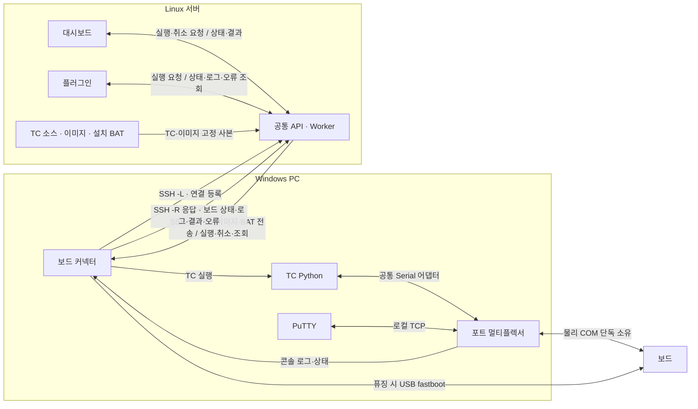

# 보드 커넥터 가이드

2026-11-14 RQ-67/68: [플러그인 중심 공통 설정·실패 분석·설치 안내](../agents/PLUGIN_CONTROL_API.md). 최신 적용/검증 상태는 해당 안내를 따른다.


## 스냅샷 저장 공간

1. 환경설정 → **저장 공간 자동 정리** → **정리 기준 불러오기**를 누른다.
2. 보관 기간·용량을 바꾸고 **정리 기준 저장**을 누른다.
3. **정리 대상 확인**으로 Linux와 Windows의 정리량을 확인한다. 바로 정리하려면 **지금 정리**를 누른다.
4. Windows 적용이 **SYNC_PENDING**이면 연결을 복구한다. 저장한 정책은 다시 전달된다.

Qt 호환 화면에서는 **스냅샷 저장 공간**의 **저장**·**정리 예상 보기**를 사용한다.

기본값은 자동 정리, 7일, 서버·Windows 각각 20 GiB다. 현재 소스·실행 중·일시 중지·종료 불명 작업·준비된 이미지·실패 근거는 보존한다. 실행 기록과 로그는 지우지 않는다. Windows의 재개 가능한 업로드도 보존하므로 용량 목표를 넘을 수 있다. **일부 경로 제외**가 표시되면 해당 경로는 계산·삭제하지 않은 상태다.

설정 파일을 사용하는 플러그인은 `PluginClient.export_storage_policy(path)`로 내보내고, 수정한 파일을 `import_storage_policy(path)`로 적용한다. 파일 형식과 시험 범위는 [실행 기록](../testing/runs/20261114-remaining-implementation.md)을 따른다.

## 설치 전 준비

- Windows PC: 저장소 소스와 최초 설치 권한. Python 3.13 64비트·OpenSSH·platform-tools는 실행 스크립트가 확인하고 누락된 도구를 준비한다. 설치된 Python 3.11/3.12도 호환된다.
- Linux 서버: 대시보드 API·Worker 실행, SSH 키 또는 agent 인증 설정.
- 보드: 실제 COM 연결. 멀티플렉서 방식은 별도 RX COM·가상 COM 드라이버가 필요 없다.
- TC Python: 실제 TC에 필요한 패키지가 설치된 `python.exe` 준비.
- 최초 연동: 아래 **플러그인·대시보드 연동**의 서버 설정 완료.

명령은 PowerShell 기준이다. 예시 소스 위치는 `C:\work\bsp_os_upgrade_dashboard`다. 최초 설치에는 패키지 저장소 접속 또는 회사에서 준비한 pip 오프라인 설정이 필요하다. 기존 CLI 배포 ZIP에는 GUI용 Qt가 포함되어 있지 않다.

## 설치 방법

현재 기본 화면은 **Windows 로컬 브라우저**다. `board-connector.cmd`를 실행하면 커넥터 환경을 확인하고 기존 Manager를 시작/재사용한 뒤 웹 화면을 연다. 기본 실행에는 Qt를 설치하거나 import하지 않는다. Python·TC 의존성·OpenSSH·장비 드라이버는 여전히 필요하다. Linux의 공유 폴더를 Z:로 열어 실행해도 실행 주체는 Windows다. 실제 회사 Z:/UNC 실행은 아래 인수 항목에서 확인한다.

```powershell
cd C:\work\bsp_os_upgrade_dashboard
.\board-connector.cmd
```

탐색기에서는 저장소 루트의 **board-connector.cmd**를 더블클릭한다. 처음에는 실행 환경과 패키지를 준비한 뒤 웹 화면을 연다. 다음 실행부터 설치가 정상인지 확인하고 같은 Windows Manager를 재사용한다. 소스만 바뀌면 패키지를 다시 설치하지 않는다. 브라우저를 닫아도 연결/시험은 유지된다. 다시 CMD를 실행하면 새 화면 세션을 얻는다. 주소에 포함된 일회성 화면 열기 값은 브라우저에서 즉시 제거하며 사용자에게 토큰 입력을 요구하지 않는다.

Qt 호환 화면이 필요한 경우에만 ` .\board-connector.cmd --ui qt`를 사용한다. 이 경우 기존 Qt 고정 의존성을 검사/설치하며 브라우저용 환경과 이전 Qt 환경을 삭제하지 않는다. GUI 기술을 바꿔도 TC·COM·플래싱 실행 코어와 단일 실행 소유권은 유지한다.

### 웹 화면에서 확인할 것

Mac/Linux에서 같은 웹 화면을 살펴보려면 `.venv/bin/python -m backend.gui_test.connector --preview`를 실행한다. 기본 브라우저가 열리며 보드/연결/TC는 임시 모의 데이터다. 미리보기는 loopback 8774를 사용하고 점유 시 OS가 다른 포트를 배정한다. 실제 Windows 설정·COM·SSH는 사용하지 않는다. 미리보기 서버는 실행한 터미널에서 Ctrl+C로 종료한다.

- **보드 현황:** 연결 단계, 등록/감지/시험 중 보드 수, 보드 선택과 제어권, 실행·예약·UNKNOWN 때문에 조작할 수 없는 이유.
- **COM 멀티플렉서:** 같은 기존 물리 COM 단독 소유·TC lease·PuTTY 조회/수동 제어 경로다. 여러 화면을 열어도 물리 COM을 추가로 열지 않는다.
- **연결 전원 버튼:** 미연결에서는 시작, 연결 후에는 종료로 바뀐다. TC 시작 버튼이 아니다. 시험·예약·종료 불명 작업이나 오래된 상태에서는 종료할 수 없다.
- **간략 표시:** 보드 리스트는 보드명·COM·상태등 한 줄로 표시한다. Windows/SSH/서버/왕복도 상태등으로 표시하며 마우스를 올리면 상태를 확인할 수 있다. 초록은 정상, 빨강은 오류, 노랑은 진행/확인 필요, 회색은 미연결/대기다.
- **접기/열기:** COM 멀티플렉서와 콘솔 안내는 `연결 상세 · 콘솔 안내` 안에 두고 기본 접는다. 로그는 작은 창으로 표시하며 `로그 보기 · 접기`에서 접거나 크기를 조절한다.
- **콘솔 구분:** 보드 콘솔은 수신된 UART 부팅·시스템 출력을 조회한다. PuTTY는 같은 UART를 별도 터미널에서 보며 명령 입력에는 수동 제어권이 필요하다. TC 로그는 TC 프로그램의 stdout/stderr다.
- **로그:** 보드 콘솔/TC 로그/연결/공통 오류, 검색·오류 필터·복사·로그 폴더. 화면은 최대 1,000줄/64 KiB를 표시하며 같은 로그를 매번 다시 쓰지 않는다.
- **환경설정:** Windows 서버/TC Python/보드 매핑과 서버 공통 설정을 구분한다. Linux 경로는 서버 폴더 탐색으로 고르며 TC별 제한시간 재정의와 미지 기존 설정을 보존한다. 오래된 폼 저장은 충돌로 거부하고 초안은 유지한다.
- **파일 선택:** Windows 표준 대화상자로 전체경로만 가져온다. 취소하면 기존 입력을 유지한다. 대화상자를 지원하지 않으면 전체경로를 직접 입력한다. 파일을 브라우저에 업로드하지 않는다.

Linux 대시보드/플러그인은 이미 연결된 Windows 커넥터에 작업을 요청한다. Linux 화면의 버튼이 꺼진 Windows 커넥터 프로세스를 직접 기동하는 기능은 구현하지 않았다. Z:의 실행 소스를 Windows 로컬로 버전별 복사하는 배포 캐시도 이번 변경에 포함하지 않는다.

### CMD 경로 오류 · 번호별 진단과 조치

먼저 PowerShell의 같은 소스 폴더에서 읽기 전용 진단을 실행한다. 설치·Manager·GUI·SSH·COM을 시작하지 않는다.

```powershell
.\board-connector.cmd --diagnose
# CMD 시작 설정 영향을 제외하고 비교
cmd.exe /d /c .\board-connector.cmd --diagnose
```

| 표시 | 의미와 조치 |
|---|---|
| BC-00 이전의 경로 오류 | CMD 실행 전 AutoRun 등 시작 환경의 가능성을 확인한다. `/d` 실행과 비교하며 원인을 확정하지 않는다. 스크립트 내부 재진입이 이미 발생한 최초 오류를 없애지는 못한다. |
| BC-02 | 로컬 진단 로그를 만들 수 없다. 콘솔 내용을 보존하고 Windows 로컬 로그 폴더 쓰기 권한을 확인한다. 실행은 계속 시도한다. |
| BC-11 | CMD가 놓인 소스 폴더 접근 실패. 같은 사용자·같은 Windows 세션에서 Z:/UNC를 열고 확인한다. 필요하면 전체 소스를 로컬 폴더로 복사한다. 자동 드라이브 매핑/관리자 승격은 하지 않는다. |
| BC-12 | 소스 파일 누락. 표시된 Missing 경로를 확인하고 CMD만 복사하지 말고 전체 소스를 갱신한다. |
| BC-20 | Python 후보 검사. 일부 후보 실패는 정상 fallback일 수 있다. 후보별 경로·버전·오류는 로컬 launcher 로그에서 확인한다. |
| BC-30 / BC-31 | 지원하는 64비트 Python을 못 찾았거나 명시 경로 검사 실패. 직접 성공한 Python 경로를 아래 방법으로 지정한다. Python 미설치로 단정하지 않는다. |
| BC-40 / BC-41 | Python 선택 후 설치/GUI 준비 단계. 앞선 Python 오류와 connector.log를 확인한다. pip 오류는 회사 네트워크/오프라인 wheelhouse를, GUI 오류는 자산·브라우저/Manager 버전을 확인한다. |
| BC-50~54 | 읽기 전용 파일/환경 진단. BC-53은 아직 재사용 환경이 없다는 뜻이며 자동 설치를 수행하지 않는다. |
| BC-55 | 웹 화면 자산 누락. 전체 소스 또는 같은 버전 배포본을 갱신한다. pip 재설치를 반복하지 않는다. |
| BC-56 | 별도 공개 필수 도구 준비 접점 실패. 전체 소스의 bootstrap 스크립트와 표시된 prerequisites 로그를 확인한다. 회사의 설치 정책·허용 배포 경로를 따르며 웹 화면 오류와 구분한다. |

PowerShell에서 성공한 Python의 실제 경로를 확인하고 이 CMD에만 지정할 수 있다. 따옴표는 PowerShell 문법이며 변수 값 안에 추가 따옴표를 넣지 않는다.

```powershell
python -c "import sys; print(sys.executable)"
$env:BOARD_CONNECTOR_PYTHON = 'C:\실제 Python 폴더\python.exe'
.\board-connector.cmd --diagnose
.\board-connector.cmd
# 자동 탐색으로 되돌릴 때
Remove-Item Env:BOARD_CONNECTOR_PYTHON
```

CMD 진단 로그는 `%LOCALAPPDATA%\BspBoardConnector\logs\launcher-*.log`에 실행별로 남긴다. LOCALAPPDATA가 없으면 TEMP를 사용한다. Python 준비/GUI 상세 로그는 기존 home의 `logs\connector.log`다. 전체 환경변수나 사용자 인자를 로그에 덤프하지 않는다. CMD는 레지스트리·드라이브 매핑·기존 설정/환경을 자동 삭제하지 않는다.

기존 구버전 Manager가 살아 있으면 화면 지원 여부를 확인하고 업데이트 안내를 표시한다. 작업 중인 Manager를 강제 재시작하거나 두 번째 Manager를 만들지 않는다. 기존 Qt 화면에서 작업/연결을 안전하게 끝낸 후 이전 Manager도 종료해야 새 코드를 읽는다. 구버전에 Manager 종료 접점이 없으면 회사의 프로세스 종료 절차 또는 **작업이 모두 끝난 뒤** Windows 로그아웃/로그인으로 사용자 프로세스를 정리한다. 새 CMD를 실행하기만 해서는 이미 실행 중인 구버전 프로세스 코드가 교체되지 않는다.

기본 브라우저 열기 실패는 Windows 기본 브라우저 설정을 확인하고 다시 CMD를 실행한다. 화면 세션 만료/브라우저 실패는 기존 TC를 종료하지 않는다. 현재 변경의 로컬 시험과 남은 실제 Windows 인수는 [실행 기록](../testing/runs/20261114-connector-web.md), 설계·구현 후 리뷰 상태는 [Astra 리뷰 기록](../testing/runs/20261114-connector-web-review.md)을 따른다.

## 연결 구조



- SSH 연결은 Windows에서 시작한다. 터널은 커넥터가 생성한다.
- Linux는 TC 소스·제한시간·시험 기록을 관리한다. Windows에 TC 폴더를 다시 입력하지 않는다.
- 현재는 TC 고정 사본을 전송한다. Z: 드라이브 원본 직접 실행은 지원하지 않는다.
- 멀티플렉서가 물리 COM을 열고 TC·PuTTY·로그에 출력을 분배한다. 명령 전송은 한 작업만 허용한다. 기존 COM 직접 연결 방식은 별도 RX 포트 구성을 유지한다.

| 포트 | 용도 |
|---|---|
| Linux SSH 포트 | 기본 22. 회사 설정에 맞춰 입력 |
| Linux 대시보드 포트 | 회사 예시 8765. 실행 중인 서버 포트 입력 |
| Windows 브라우저 포트 | 터널이 사용 중인 로컬 포트. **대시보드 열기**로 접속 |
| 커넥터·역방향 터널 포트 | 기본 8771. 기존 저장 설정이 있으면 해당 값 사용 |

`127.0.0.1`은 접속하는 PC 자신이다. Linux의 `8765`와 Windows 브라우저 포트는 같을 필요가 없다.

## 동작 방법

### 최초 설정

1. `board-connector.cmd`를 실행한다.
2. **환경설정**에서 Linux SSH 서버·계정·대시보드 서버 포트를 입력한다.
3. **TC Python → 찾아보기…**에서 TC용 `python.exe`를 선택한다.
4. **연결할 보드 수**를 지정한다.
5. **통신 방식 → 포트 멀티플렉서**를 선택하고 보드별 탭에서 이름·보드 COM·통신 속도를 설정한다. 목록이 없으면 **COM 새로고침**을 누른다.
6. 아래 **TC 공통 모듈 연결**을 한 번 적용한다. 기존 프로파일은 자동 전환하지 않으며, **기존 COM 직접 연결**에서는 RX 설정을 유지한다.
7. 필요하면 **고급 연결 설정**에서 SSH 포트·키 파일을 지정한다.
8. **설정 저장**을 누른다.

### TC 공통 모듈 연결

TC마다 수정하지 않는다. 공통 통신 모듈에서 COM을 여는 부분만 바꾼다. 기존 `import serial`과 상수 사용은 유지한다.

```python
from serial_proxy import Serial

# 기존 serial.Serial(...) 호출을 변경. COM 번호와 나머지 인자는 유지.
port = Serial(port_name, baudrate=115200, timeout=1)
```

커넥터가 TC 자식 프로세스에 `serial_proxy.py`와 연결 정보를 자동 제공한다. TC Python에는 기존 pySerial이 필요하다. TC 소스 사본에는 어댑터를 덮어쓰지 않는다. 커넥터 밖에서 실행하거나 TC가 별도 프로세스·네이티브 프로그램으로 COM을 직접 열면 추가 연동이 필요하다. 직접 COM으로 자동 우회하지 않는다.

검증 범위는 read/readline/write, timeout, 입력 버퍼 초기화, 통신 설정과 명시적 DTR/RTS 변경이다. OS COM 핸들·fileno/ioctl 직접 사용, inter_byte_timeout 기반 동작은 지원하지 않는다. 해당 기능을 쓰는 공통 모듈은 회사 적용 전에 조정한다.

### PuTTY

1. 연결 화면에서 보드를 선택하고 **PuTTY 열기**를 누른다. 기본은 로그 조회 전용이다.
2. 명령 입력이 필요하면 TC가 끝난 뒤 **수동 제어**를 누른다.
3. 이미 열려 있던 조회용 PuTTY는 연결이 종료된다. **PuTTY 열기**로 제어용 연결을 연다. 이전 입력은 재전송하지 않는다.
4. PuTTY 연결을 닫거나 **수동 제어 종료**를 누르면 제어권을 반납한다.

PuTTY 주소·포트는 자동 전달한다. PuTTY를 찾지 못하면 고급 연결 설정의 파일 선택창에서 `putty.exe`를 선택한다. 수동 제어 중에는 TC·퓨징 시작이 차단된다. TC·예약·UNKNOWN 중에는 수동 제어를 시작할 수 없다.

### 연결·시험·종료

1. **연결 → 연결**을 누른다.
2. 로컬·SSH·대시보드·역방향 응답이 정상인지 확인한다.
3. 보드 수·COM·상태를 확인한다.
4. **대시보드 열기**를 누른다.
5. 대시보드에서 TC 소스를 선택하고 시험을 시작한다. 플러그인에서도 같은 서버로 요청한다.
6. 보드 행을 선택하고 **로그 보기**에서 필요한 탭을 선택한다.
7. 작업이 끝나면 **연결 종료**를 누른다.

창만 닫으면 연결과 시험은 계속된다. 연결된 동안 보드 설정을 바꾸려면 작업을 끝내고 **연결 종료**부터 수행한다.

| 상태 | 의미 |
|---|---|
| 초록 · 연결 | COM 감지 및 연결 상태 확인. 부팅·시험 통과를 뜻하지 않음 |
| 노랑 · 시험 중 / 예약·대기 | 실행 또는 장비 예약 중 |
| 노랑 · 확인 필요 | 현재 상태를 확인할 수 없음 |
| 빨강 · 오류 | 연결 또는 장비 오류 확인 필요 |
| 회색 · 미연결 | COM 또는 연결 확인 불가 |

| 로그 탭 | 내용 |
|---|---|
| 보드 콘솔 | RX 포트에서 수집한 보드 출력 |
| TC 로그 | TC 프로그램의 표준 출력·표준 오류. 실행 버튼이 아님 |
| 연결 | 커넥터·SSH·서버 연결 상태 |
| 플러그인 오류 | 공통 서버에 전달할 보드 오류. 실제 플러그인 수신 여부는 플러그인에서 확인 |

**오류만**, 검색, **복사**, **로그 열기**를 사용할 수 있다.

## 경로 확인

**연결 → 경로 보기**에서 확인한다. 경로는 읽기 전용이다.

| 표시 | 기준 |
|---|---|
| Linux 선택 TC 소스 | 서버에서 현재 선택한 소스 |
| Linux 설치 BAT | 플러그인이 해당 실행에 전달한 BAT 절대경로 |
| Linux 실행 TC 소스 | 해당 실행에 저장된 TC 경로 |
| Windows 이미지 작업 폴더 | 커넥터가 이미지 준비 후 기록한 폴더 |
| Windows TC 작업 폴더 | 표시된 TC 실행 ID의 작업 폴더 |

요청 전에는 **요청 전**, 아직 경로를 받지 못하면 **준비 전 또는 경로 미수신**으로 표시한다. 완료된 작업은 **이전 실행**, 연결이 끊기면 **과거 수신 정보**로 표시한다. 폴더의 현재 존재 여부는 확인하지 않는다.

## 플러그인에서 이미지 플래싱 요청

1. Linux에서 빌드가 끝난 이미지와 설치 BAT를 같은 폴더에 준비한다.
2. 플러그인에 BAT까지 포함한 절대경로를 지정한다. 예: `/srv/images/build-123/install.bat`.
3. 플러그인에서 실행할 TC를 선택하고 요청한다.
4. Linux 서버가 허용 경로·파일 해시를 검사하고 이미지·BAT·TC를 Windows로 전송한다.
5. 커넥터가 저장된 플래싱 프로파일로 fastboot 진입 → BAT 실행 → 부팅 확인 → TC 실행을 진행한다.
6. 플러그인에서 결과·오류를 확인한다. 커넥터에서는 **경로 보기**와 **보드 콘솔**을 확인한다.

BAT는 같은 폴더와 하위 폴더의 파일을 상대경로로 참조해야 한다. BAT 안의 Linux 절대경로나 특정 PC 경로는 자동 변환하지 않는다. 플래싱 프로파일이 먼저 설정되어 있어야 하며 커넥터 GUI에 별도 실행 버튼은 없다.

## 예외 조치

| 증상 | 조치 |
|---|---|
| 창이 열리지 않음 | 아래 진단 실행 명령으로 시작해 오류 확인. Python 3.13 64비트(3.11/3.12 호환)와 패키지 저장소 접속 확인 |
| COM이 목록에 없음 | 케이블·드라이버 확인 후 **COM 새로고침** |
| COM 중복 오류 | 보드별 실제 COM을 다르게 선택. 기존 직접 연결 방식은 RX COM도 중복되지 않아야 함 |
| 보드 콘솔이 비어 있음 | 멀티플렉서: 실제 COM 점유 프로그램·통신 속도 확인. 기존 직접 연결: RX splitter 설정 확인 |
| 프록시 COM 매핑 없음 | 공통 모듈을 연결한 뒤 대시보드·플러그인에서 TC 시작 |
| SERIAL_PROXY_FAILED | 보드 분리·수신 누락·통신 설정 오류 확인. 실패 기록 확인 후 안전 종료·재연결 |
| `Connection refused` / `channel ... open failed` | Linux API 실행 여부와 **대시보드 서버 포트** 확인 |
| 각 소켓 주소는 하나만 사용 가능 | 기존 커넥터·SSH 터널의 사용 포트 확인. 중복 실행 정리 후 재연결 |
| SSH 인증 실패 | PowerShell에서 같은 서버·계정·포트·키로 SSH 인증과 서버 키 확인 완료. GUI는 비밀번호 입력을 지원하지 않음 |
| 역방향 등록 HTTP 401/403 | 서버·커넥터 버전과 loopback 주소 확인. 브라우저에서 등록 API를 직접 호출하지 않음 |
| 역방향 연결 실패 | SSH 서버의 포트 포워딩 허용 여부와 Linux 역방향 포트 점유 확인 |
| `TC_PYTHON_NOT_CONFIGURED` | **TC Python**에서 실행 가능한 `python.exe` 선택 |
| 시험 중 timeout | 대시보드 **Test 현황**에서 TC 시간을 눌러 전체·개별 제한시간 조정. 통신 오류이면 연결 로그부터 확인 |
| `확인 필요` / 과거 로그 표시 | SSH·COM·실제 시험 상태 확인. 기록 삭제로 해제하지 않음 |
| 연결 종료 거부 | 실행·예약·일시정지·종료 불명·삭제 중 작업 확인 후 정리 |

진단 실행:

```powershell
.\board-connector.cmd --install-only
```

설치 실패 시 콘솔 창에 오류가 남는다. 연결·실행 오류는 커넥터의 **로그 보기** 또는 `%USERPROFILE%\.bsp-dashboard\windows\logs\connector.log`에서 확인한다. 기존 `--home`을 사용했다면 같은 인자를 전달한다.

## 플러그인·대시보드 연동

### 설치 담당자: 최초 한 번

1. Linux 대시보드에 [PORT-009](../porting/PORT-009.md)의 서버·Worker 변경을 적용한다. 기존 서버를 재사용한다.
2. 해당 runtime의 `gui-test.json`에서 `runner`를 `registered`로 설정한다. 기존 실행 기록과 다른 설정은 보존한다.
3. Linux API·Worker, Windows 커넥터, 플러그인 클라이언트에 토큰 제거 변경을 함께 적용한다. 이전 버전과 혼용하면 토큰 오류가 날 수 있다.
4. Linux API·Worker가 같은 runtime을 사용하도록 설정하고 재시작한다.
5. 커넥터에서 **연결**을 누른다. 대시보드 실제 시험 화면에 보드가 표시되는지 확인한다.
6. 대시보드에서 TC 소스를 선택한다. 이후 보드·COM·TC 경로를 플러그인에 중복 입력하지 않는다.

연결 토큰의 생성·복사·입력은 필요 없다. 기존 `GUI_TEST_RUNNER_TOKEN`, `GUI_TEST_CONNECTOR_REGISTRATION_TOKEN`, `GUI_TEST_INTEGRATION_TOKEN`과 저장된 연결 토큰 파일은 사용하지 않는다. 기존 파일을 자동 삭제하지는 않는다. SSH 키 인증은 유지한다.

### 플러그인 연결

1. Linux의 같은 대시보드 API를 연결 대상으로 지정한다. 같은 서버에서 실행하는 경우 예시는 `http://127.0.0.1:8765`다.
2. 참조 클라이언트를 `PluginClient(url, expected_identity=identity)`로 생성한다. 연결 토큰은 전달하지 않는다.
3. `gui-test.json`의 `integration` 실행 설정을 준비한다. 자동 퓨징 설정은 [플러그인 설치 안내](BSP_UPGRADE_COMPANY_GUIDE.md#회사-플러그인-연결)를 따른다.
4. loopback `/api/v1/health` 응답으로 서비스·Worker·커넥터 identity를 확인하고 고정한다.
5. 참조 `PluginClient`의 아래 메서드를 회사 플러그인에 연결한다.

| 확인할 내용 | 메서드 |
|---|---|
| 연결된 보드 | `connector_inventory()` |
| 보드 콘솔 | `board_console()` |
| 새 오류 | `connector_errors(after=마지막_seq)` |
| 시험 진행·결과 | `run(run_id)` |

오류 조회의 마지막 `seq`를 저장하고 다음 조회에 사용한다. 재접속 시 기존 Run ID를 유지한다.

회사 플러그인 화면·설정 메뉴는 이 저장소에 없다. 위 메서드 연결과 실제 오류 수신은 회사에서 확인해야 한다. 이미 전체 대시보드가 실행 중이면 같은 runtime에 별도 standalone Worker를 추가하지 않는다.

## 설정·업데이트

| 항목 | 위치·처리 |
|---|---|
| Windows 설정 | `%USERPROFILE%\.bsp-dashboard\windows\windows-runner.json` |
| Windows 로그 | 같은 폴더의 `logs` 또는 **로그 열기** |
| TC 소스·제한시간·세션 | Linux 대시보드에서 관리 |
| 대시보드 화면만 재빌드 | 커넥터 재설치 불필요 |
| 커넥터 코드·의존성 변경 | 시험 종료 → 연결 종료 → 기존 설정 백업 → 변경 파일 적용 → board-connector.cmd 실행 |

기존 사용자 지정 `--home`이 있으면 `board-connector.cmd --home "D:\기존 설정"`처럼 같은 경로를 계속 사용한다. 새 실행 환경은 해당 home의 `connector-environments` 아래에 둔다. 기존 저장소 `.venv`가 필요한 패키지를 모두 갖추고 있으면 그대로 사용한다. 의존성 변경·환경 손상 시 새 환경을 준비하고 이전 환경과 설정은 보존한다. 설치 확인은 TC나 이미지 파일을 복사하지 않는다. 현재 스냅샷 자동 정리는 지원하지 않는다.

## Mac 미리보기

```bash
python3.13 -m venv .venv
.venv/bin/python -m pip install -r apps/gui-test/requirements.lock -r apps/board-connector/requirements.lock
.venv/bin/python -B -m backend.gui_test.connector --preview
```

저장소 루트에서 실행한다. 화면과 모의 로그만 확인할 수 있으며 실제 서버·보드에는 연결하지 않는다.

Windows 실장비·회사 서버 검증은 미실행이다. 로컬 검증 결과는 [시험 기록](../testing/runs/20261112-board-connector-gui.md), 개발 상세는 [연결·콘솔 계약](../design/BOARD_CONNECTOR_CONTRACT.md)을 따른다.
